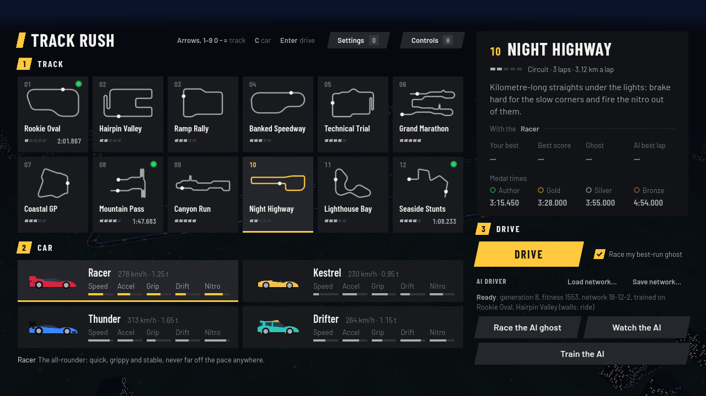
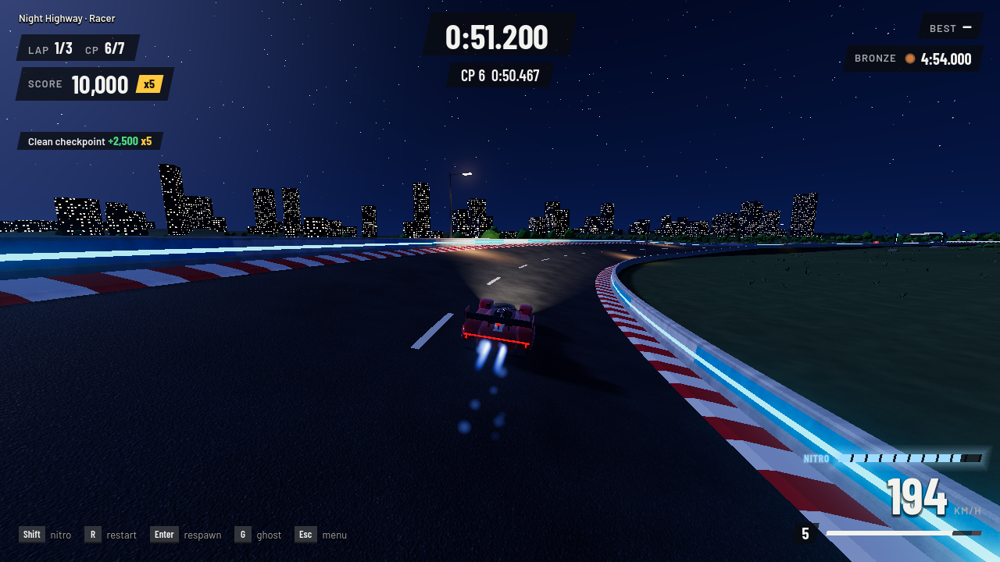
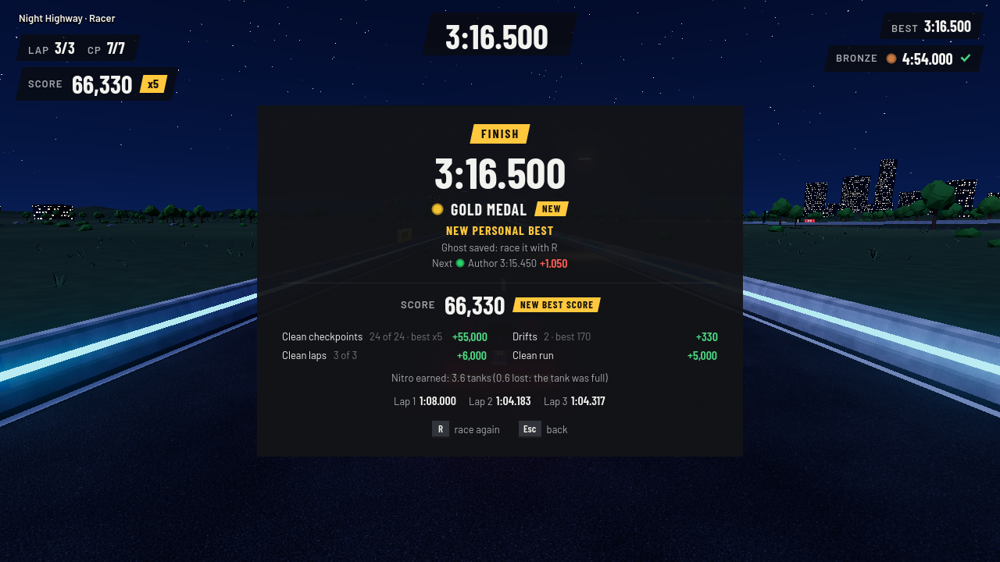
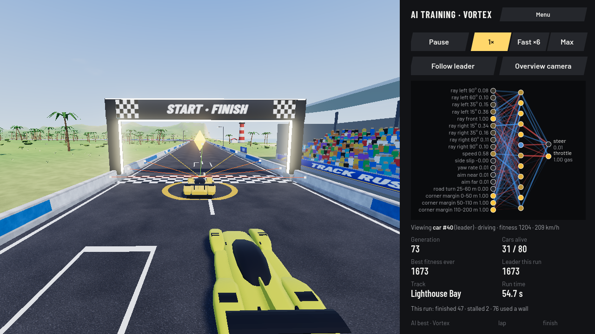
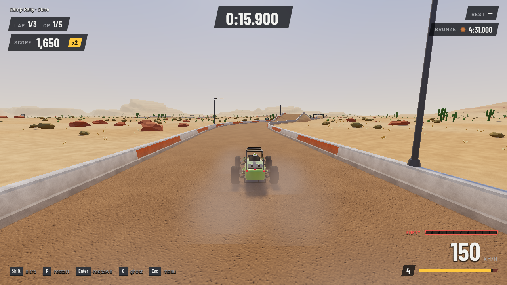
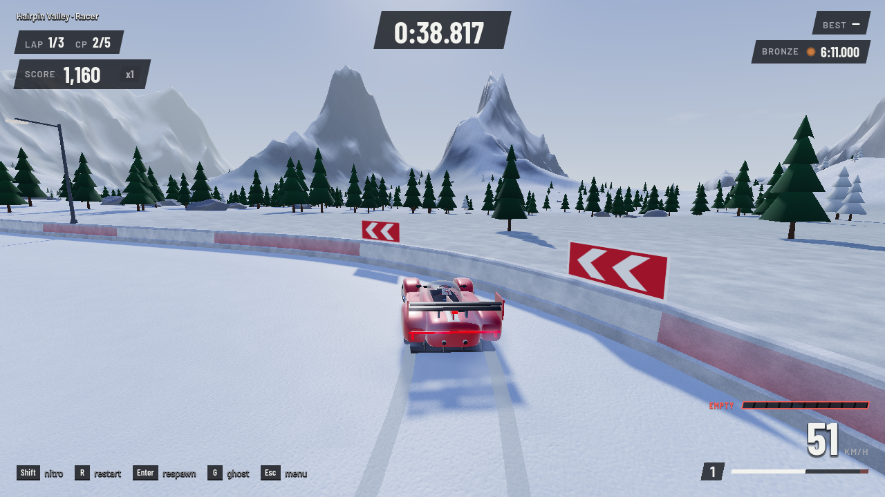

# Track Rush

A Trackmania-style racer, plus a neural-network AI driver that you train yourself with
neuroevolution and can watch learn in real time. Pick one of 6 cars, chase the medal times on
12 tracks, fire the nitro, score points for clean driving, race the ghost of your own best run,
and play with a keyboard or a gamepad.

Version 6.0.0 is the game rebuilt in the [Godot](https://godotengine.org) game engine (version
4.7.2). It plays the same as the browser version 5 it was ported from: the same tracks, cars,
physics, points, medals and AI. The browser version is still in the [`web/`](web/) folder and
still playable. Everything runs on your own computer: no accounts, no internet, no cloud.
Version 6.1.0 adds two cars, the Dune buggy and the Vortex hypercar, and new detailed car models
with spinning, steering wheels, working suspension, lights and a driver who steers, leans into the
corners and celebrates at the finish (see [The cars](#the-cars)).
Version 6.2.0 lets you train the AI with any of the six cars: every car keeps its own AI network, which
Watch the AI and Race the AI ghost use when that car is picked (see [Training the AI](#training-the-ai)).
Version 6.3.0 adds road surfaces: stretches of dirt and packed snow on four tracks, with less grip, longer
slides, dust and snow thrown up by the tyres, and a car that suits them, the Dune (see [Road surfaces](#road-surfaces)).



| Driving at night (headlights, nitro flames, the score on the left) | The finish panel |
| --- | --- |
|  |  |



## Play it on Windows

### The ready-made game (no installation)

1. Get `TrackRush-6.2.0-windows.zip`. It is made with the export steps in
   [Making the game files](#making-the-game-files-export); it is not stored in the repository
   itself (it is about 40 MB), so it is shared separately, for example attached to a release on
   the repository's GitHub **Releases** page.
2. Unzip it anywhere (right-click, **Extract All...**). You get `TrackRush.exe`,
   `libtrackrush.windows.template_release.x86_64.dll` and a short `README.txt`.
   **Keep the `.dll` file next to `TrackRush.exe`**: it is the fast AI training engine.
   Without it the game still runs, but AI training is about a hundred times slower
   (the training screen says so).
3. Double-click `TrackRush.exe`.

The game is not signed with a certificate, so the first time Windows may show a blue
**"Windows protected your PC"** (SmartScreen) box. Click **More info**, then **Run anyway**.

Nothing is installed and nothing is written next to the game: your best times, ghosts,
settings and AI network are kept in one save file (see [Saved data](#saved-data)).
To remove the game, delete the folder (and the save folder, if you want your records gone too).

### From the project, with Godot 4.7.2

This is how you run the game while working on it. Godot runs on Windows, Linux and macOS
(the fast AI training library is only built for Windows and Linux, see
[`native/README.md`](native/README.md); elsewhere training is slower).

1. Download Godot **4.7.2**, the standard version (not ".NET"), from its
   [release page](https://github.com/godotengine/godot/releases/tag/4.7.2-stable)
   (for Windows: `Godot_v4.7.2-stable_win64.exe.zip`). Unzip it; there is nothing to install.
2. Get this repository onto your computer (on GitHub: **Code**, **Download ZIP**, then unzip;
   or `git clone`).
3. Start Godot. In the Project Manager click **Import**, pick the `project.godot` file in the
   repository folder, then **Open**. The first time, Godot spends a few seconds importing the
   fonts and the icon.
4. Press **F5** (or the ▶ "Run Project" button at the top right). The game opens in its own window.

Use the same Godot version (4.7.2): an older one can't run the project, and a newer one may
offer to convert it.

## Playing

| Key | Gamepad | Action |
| --- | --- | --- |
| ↑ / W | RT (analogue) | Accelerate |
| ↓ / S | LT (analogue) | Brake, then reverse once stopped |
| ← → / A D | Left stick (analogue), d-pad ← → | Steer |
| Space | A | Handbrake (start a slide) |
| Shift (either one) | X or RB | Nitro (hold it) |
| R | View (Back on older pads) | Restart the run instantly |
| Enter / Backspace | B | Respawn at the last checkpoint (the timer keeps running) |
| G | Y | Show or hide the ghost of your best run |
| Esc | Menu (Start on older pads) | Back to the menu |

On the menu:

| Key | Gamepad | Action |
| --- | --- | --- |
| Arrows or W A S D, 1-9, 0, -, = | d-pad / left stick | Pick a track (0, - and = are tracks 10-12) |
| C / Shift+C | RB / LB | Next / previous car |
| Enter or Space | A | Drive |
| H or ? | View | The **Controls** screen: every key and button (Esc, H or B closes it) |
| O | highlight **Settings**, then A | The **Settings** screen |
| Mouse | | Click a track tile or a car card to pick it, double-click to drive straight away |

Each run starts with a 3-2-1-GO countdown. Circuits are 3 laps, and a lap only counts when you pass
every checkpoint in order. At each checkpoint you see your split time compared with your best run
(green = faster, red = slower). Sprints have a long straight after the finish line, so you can brake
to a stop. When you finish, the finish panel shows your time, the medal it earned, how far you are
from the next medal, your points with their breakdown, and the lap times; **R** races again and
**Esc** goes back to the menu.

**The menu** is three steps: **1 Track**, **2 Car**, **3 Drive**. Each track tile shows the track's
outline (the dot is the start; sprints have a second dot at the finish), its number, how hard it is
(1-5 bars), and the medal and best time you have with the picked car. The panel on the right is the
selected track: its description, length and laps, then with the picked car your best time, best
score, whether a ghost is saved, the AI's best and the four medal times. Under it are **Drive**, the
**Race my best-run ghost** option and the **AI driver** block (the picked car's AI network, Load / Save
network, Race the AI ghost, Watch the AI, Train the AI). The header line shows a few key hints; the
**Controls** button lists the rest, and the **Settings** button opens the settings.

**Drifting:** pull the handbrake (Space) into a corner to make the rear step out, then countersteer
and use the throttle to hold the slide. Braking hard while turning only tightens the line a little.

**Gamepad:** any controller Windows (or Linux) recognises as a game controller works; the buttons are
named as on an Xbox pad (on a PlayStation pad A is ✕, B is ○, X is □ and Y is △). Plug it in and a
short note confirms it. The stick and both triggers are analogue, with a small dead zone so a worn
stick doesn't drift; half-way on the stick gives about a third of full steering, for fine
corrections. Keyboard and gamepad can be used together (each control takes the stronger of the two).
On the menu, the Settings screen and the training screen the d-pad or stick moves a highlight,
**A** presses, **B** goes back, and on the menu **LB** / **RB** change the car. While the gamepad is
the last thing you used, the key hints show its buttons.

### The cars

There are six cars. Each handles differently and has its own best times, ghosts, medals and best scores.

- **Racer** (red, the default): the all-rounder. Quick, grippy and stable, never far off the pace anywhere.
- **Kestrel** (yellow): light and nimble. The most grip, the shortest braking and the quickest launch, but a low
  top speed. It is the quickest car on twisty tracks (Hairpin Valley, Technical Trial, Canyon Run, Lighthouse Bay).
- **Thunder** (blue): heavy and brutal. Huge power and the highest top speed; its downforce makes it grip better
  the faster it goes, so slow corners need patience. It is the quickest car where the straights are long
  (Banked Speedway, Grand Marathon, Night Highway).
- **Drifter** (teal): a loose rally car. It slides on demand, holds long drifts and lands jumps without losing
  speed. It is the quickest of the first four cars over the jumps (Ramp Rally, Seaside Stunts) and scores drift
  points easily; on dirt and snow it keeps a little more grip than the Racer.
- **Dune** (green): an open buggy on big tyres. Soft and forgiving: strong grip in slow corners, traction on all
  four wheels, gentle slides that are easy to catch and soft landings, but the lowest top speed, so it is the slowest
  car on tarmac. On dirt and snow it keeps far more grip than any other car (97 % of it on dirt, 72 % on snow), which
  makes it the quickest car of all on Ramp Rally and Hairpin Valley. It is the easiest car to drive cleanly.
- **Vortex** (orange): a mid-engine hypercar. The most power, the highest top speed and the most grip at speed,
  but light and twitchy at the limit, and its nitro tank lasts only 3 s. In the medal autopilot's hands it is the
  quickest car on every track with little or no loose road; on dirt and snow it keeps the least grip of all, so it is
  only fifth on Ramp Rally and Hairpin Valley. In your hands it rewards precise driving.

| Car | Mass | 0-100 km/h | 0-200 km/h (with nitro) | Top speed (with nitro) | Nitro tank | 100-0 km/h | Cornering grip, 30 m / 120 m circle | Drift held |
| --- | --- | --- | --- | --- | --- | --- | --- | --- |
| Racer | 1,250 kg | 2.70 s | 9.78 s (7.57 s) | 277.7 km/h (291.8) | 5 s | 30.7 m | 1.68 g / 1.58 g | 0.83 s |
| Kestrel | 950 kg | 2.43 s | 11.28 s (9.78 s) | 230.2 km/h (239.8) | 4 s | 27.7 m | 1.78 g / 1.59 g | 0.75 s |
| Thunder | 1,650 kg | 2.68 s | 8.20 s (6.08 s) | 312.7 km/h (328.9) | 6 s | 33.8 m | 1.47 g / 1.56 g | 1.07 s |
| Drifter | 1,150 kg | 2.50 s | 9.23 s (7.57 s) | 264.3 km/h (278.9) | 5 s | 33.1 m | 1.59 g / 1.52 g | 1.63 s |
| Dune | 1,100 kg | 2.87 s | 12.68 s (10.88 s) | 222.4 km/h (232.9) | 5 s | 31.7 m | 1.71 g / 1.43 g | 0.60 s |
| Vortex | 1,150 kg | 2.57 s | 6.22 s (5.47 s) | 321.4 km/h (338.1) | 3 s | 28.8 m | 1.68 g / 1.75 g | 1.22 s |

The numbers are measured with the game's own physics (`tools/car_stats.gd`, see [Tests and tools](#tests-and-tools)).
"Drift held" is how long a keyboard driver typically keeps a handbrake slide going. The car picker shows the same
as five bars (speed, acceleration, grip, drift, nitro). The numbers are for asphalt; on dirt and snow every car grips,
brakes and accelerates less (see [Road surfaces](#road-surfaces)).

**Picking a car:** click a car card under the tracks (a double-click drives straight away), press **C** /
**Shift+C** on the menu, or use **RB** / **LB** on a gamepad. The cards sit three to a row (two in a narrow
window); the line under them describes the picked car. The choice is remembered, and Drive and Race the AI ghost
use it. The track tiles, the records and the medal times follow the picked car, and so does the AI driver block:
each car has its own AI network (see [Training the AI](#training-the-ai)).

**The models.** Every car is drawn in detail: tyres with tread grooves, spoked rims in the car's own style, brake
discs and calipers, suspension arms (and coil springs on the Dune) that you can see working, head and tail lights,
mirrors, vents, panel lines, wings and exhausts, and its race number on the doors. The wheels spin with the car's
speed and the front ones steer; the body squats when you accelerate, dives under braking, leans out of corners and
sinks onto its springs when it lands, while the wheels stay on the road (and hang down in the air). The Vortex's
rear wing tilts up as an air brake. A driver sits in every car: the steering wheel turns with the front wheels and
the arms follow it, the head looks into the corners and leans against the cornering force, the body rocks under
braking and acceleration and bumps on landings, and at the finish the driver pumps a fist. The brake lights glow
brighter when you brake. On night tracks (and at dusk) the headlights light the road ahead: two real lights on
High graphics, one on Medium, and a cheap glow on the road on Low. Each car is a single mesh, so it costs only a
few draw calls; the Low setting uses a lighter version of it, and the AI training fleet a much simpler one.

### Nitro

Hold **Shift** (or **X** / **RB** on a gamepad) to burn nitro: it adds a strong push on top of the engine, with
blue flames from the exhausts and a slight camera kick. A full tank lasts 4-6 s depending on the car and is
worth roughly 0.3-0.5 s on a long straight. Nitro only works on the ground and going forwards: it does nothing in
the air, in reverse, while braking or while the handbrake is held. Holding nitro alone also opens the throttle.

The **NITRO** gauge above the speed shows the tank in ten segments: it glows while you boost, changes colour
when it is low and reads EMPTY when it is empty. Every run starts with a full tank, and a respawn keeps what
is left. The tank is **refilled by points** (see below): every 16,000 points you bank put one full tank back, so
a clean lap refills about half a tank to a full one, depending on the track, and drifts and jumps fill it faster.
Penalties take nothing out of the tank, and points banked at the finish refill nothing (the race is over).

### Points for clean driving

Each run in Drive and Race the AI ghost scores style points:

| What | Points |
| --- | --- |
| Clean checkpoint (no wall contact or respawn since the last one; the lap line and the finish count too) | 500 × the combo |
| Combo | starts at x1 and goes up by one with every clean checkpoint in a row, up to x5; a wall contact or a respawn puts it back to x1 |
| Drift (a slide of 12° or more above 43 km/h, at least 0.6 s, ending without a wall contact or a spin) | about 600 a second at 30° and 90 km/h, more for more angle and speed, doubling over the first 3 s |
| Air (a jump of 0.5 s or more, landed straight with no wall contact right after) | 500 a second in the air |
| Close call (within 0.5 m of a wall above 108 km/h without touching it) | 250 |
| Clean lap / clean run (no wall contact or respawn) | +2,000 / +5,000 |
| Wall contact | −150, plus 25 for every m/s of speed lost into the wall and 200 a second of scraping after the first 0.5 s, at most −1,500 |
| Respawn | −500 |

Drifts, jumps and close calls only count on new road: after a respawn (or if you turn round and drive back),
the stretch you have already driven scores none of them again until you are past the furthest point you had
reached. The score never goes below zero.

The score sits under the lap and checkpoint counters with the combo next to it. A line below shows the drift,
jump or wall contact going on right now, and short notes pop up for every gain and loss. The finish panel shows
the total, the breakdown and how much nitro the points earned. Your **best score is saved for each track and
car** and shown in the menu's track panel. Clean driving pays most: one wall hit costs the combo and the clean
lap and clean run bonuses, often 10,000-15,000 points in all.

### Medals

Every track has four medal times for every car, as in Trackmania: **author**, **gold**, **silver** and **bronze**.
The menu shows the selected track's medal times for the picked car in the track panel (the ones you have won are
lit) and, on each track tile, the medal your best time with that car has earned. During a race the HUD shows the
next medal to aim for under your best time: it is crossed out once the clock passes it, and ticked when you beat
it. The finish panel shows the medal the run earned (marked NEW when it beats your previous one) and how far you
are from the next.

Gold, silver and bronze are 6 %, 20 % and 50 % slower than the author time, rounded up to a whole second (for
example the Racer's Rookie Oval medals are 2:01.867, 2:10, 2:27 and 3:03). Author times:

| Track | Racer | Kestrel | Thunder | Drifter | Dune | Vortex |
| --- | --- | --- | --- | --- | --- | --- |
| Rookie Oval | 2:01.867 | 2:05.550 | 2:01.867 | 2:04.367 | 2:09.683 | 1:52.250 |
| Hairpin Valley | 4:07.233 | 4:02.267 | 4:18.500 | 4:06.783 | 3:58.333 | 4:07.933 |
| Ramp Rally | 3:05.633 | 3:04.500 | 3:12.917 | 3:03.983 | 3:00.133 | 3:05.700 |
| Banked Speedway | 2:01.017 | 2:17.317 | 1:55.450 | 2:04.017 | 2:23.150 | 1:48.600 |
| Technical Trial | 3:45.083 | 3:41.933 | 3:47.950 | 3:45.017 | 3:47.283 | 3:32.783 |
| Grand Marathon | 2:30.467 | 2:33.017 | 2:29.317 | 2:32.033 | 2:38.433 | 2:18.867 |
| Coastal GP | 3:07.950 | 3:09.750 | 3:13.283 | 3:09.533 | 3:16.167 | 2:54.900 |
| Mountain Pass | 1:53.267 | 1:52.333 | 1:56.517 | 1:53.267 | 1:52.683 | 1:49.233 |
| Canyon Run | 4:24.067 | 4:19.883 | 4:31.817 | 4:21.400 | 4:18.500 | 4:16.333 |
| Night Highway | 3:15.450 | 3:19.050 | 3:15.050 | 3:16.367 | 3:24.583 | 2:58.767 |
| Lighthouse Bay | 2:38.067 | 2:37.433 | 2:40.467 | 2:40.817 | 2:43.533 | 2:28.617 |
| Seaside Stunts | 1:08.233 | 1:09.650 | 1:08.617 | 1:07.967 | 1:10.500 | 1:01.433 |

The times are for the full race you drive (3 laps, or the whole sprint), from a standing start with a full
nitro tank. The author time is the fastest of 50 runs of a simple autopilot with different cornering
settings, driving each car with the same physics as you: it burns nitro on the straights and its points
refill the tank as yours do (`tools/medals.gd`, see [Tests and tools](#tests-and-tools)). The autopilot only
follows the centre line and uses nitro simply, so a driver with a real racing line and good nitro timing can beat
even the author time. A medal counts to the millisecond the HUD shows. (On the eight all-asphalt tracks the first
four cars' times are the browser version's except the Racer on Technical Trial, 1.05 s slower here: see
[HANDOFF.md](HANDOFF.md). Hairpin Valley, Ramp Rally, Mountain Pass and Canyon Run got dirt or snow in version 6.3.0
and new times, 0.8-37 s slower than before depending on the car: see [Road surfaces](#road-surfaces). The Dune and the
Vortex exist only in this version.)

### Your ghost

When you set a personal best, the run is saved as the **ghost** of that track and car: from the next restart a
see-through light-blue car (the same model as yours, with flames where you used nitro) drives your best run
alongside you, so you can see where you gain or lose time. It is only drawn: you can drive through it, and it
never affects your race. It fades out while it is right on top of your car (every race starts that way) and
disappears once it has finished. **G** (or **Y** on a gamepad) shows or hides it during a race, and the
**Race my best-run ghost** option (on the menu and in Settings) sets the same choice; it is remembered. The menu's
track panel says "Ghost: Saved" when the picked car has one saved. Runs in **Race the AI ghost** count too (that
race shows the AI; your own ghost appears in Drive).

A ghost stores the car's position, angles, wheel speed and nitro 30 times a second (plus the moments of landings,
wall hits and respawns) and replays within a few centimetres of the original run. It stores where the car was, not
which keys were pressed, so it can't drift off when replayed. Best times and ghosts only count for the physics
version they were set with.

### How the cars drive

The Racer is a 1,250 kg, all-wheel-drive sports car: 0-100 km/h in about 2.7 s, a top speed of about 277 km/h,
and around 1.6-1.7 g of cornering grip. The other cars use the same physics with their own weight, engine,
gearing, tyres, downforce, brakes and steering. In plain words, the physics (`sim/car.gd`, the cars in
`sim/cars.gd`) works like this:

- **Tyres** grip more as they start to slide sideways, peak at about 8° of slip, then lose a little grip.
  Braking or accelerating uses up some of that grip, so you can't brake flat out and turn at full grip at the same time.
- **Weight moves** when you brake (onto the front tyres) or accelerate (onto the rear), and downforce
  presses the car onto the road more the faster it goes.
- **Gearbox**: automatic, 6 speeds, with an engine that has a real torque curve and a rev limiter. The HUD shows gear and revs.
- **Steering** has a speed-sensitive lock, so a keyboard can't overdrive the front tyres at high speed,
  and a stability control (like a road car's ESC) stops quick left-right key presses from building
  up a fishtail. Stability control switches off while you use the handbrake, so you can still drift.
- **Hills and banking** matter: banked corners push the car into the turn and add grip, and the car
  stays planted over crests unless the road really drops away (kicker ramps).
- **Jumps**: in the air the car keeps the rotation it took off with; steering only nudges it a little.
  Landings don't bounce.
- **Walls** cost time, so the racing line matters: a hit takes away the speed going into the wall and
  also speed along it, far more for a hard hit than for a graze. A 5° touch at 150 km/h costs about
  15-20 km/h, a 15° hit at 200 km/h about half the speed, and a 30° hit at 180 km/h (or anything
  steeper) stops the car. Rubbing along a wall slows the car further: grinding along a barrier at full
  throttle settles at about 90 km/h. Walls don't bounce you back across the road, and the car lines up
  with the wall as it slides. Pinned nose-first against a wall, full throttle with the wheels turned away
  slides it off within about 2 s; at part throttle a steep nose-in needs reversing (or Enter). Hits throw
  sparks and give the camera a short shake. Every car has the same size for collisions and the same walls.

The physics runs at a fixed 60 steps per second everywhere (the screen draws the cars in between steps), so
it doesn't depend on the frame rate, and an AI trained at Max speed drives exactly the same when you watch it.

### Road surfaces

Most of the road is asphalt. Since version 6.3.0 four tracks also have stretches of **dirt** and **packed snow**.
You see them coming: a brown gravel road or a white one of packed snow, with a ragged edge where it meets the asphalt,
no painted lines or kerbs, and dusty or snow-capped barriers alongside. You also feel them:

| The Dune throwing up dust on Ramp Rally's dirt | The Racer sliding on Hairpin Valley's packed snow |
| --- | --- |
|  |  |

| Surface | Grip | Rolling resistance | Slides | Where |
| --- | --- | --- | --- | --- |
| Asphalt | all of it | normal | as before | every track |
| Dirt | 55-97 % of the car's tarmac grip, depending on the car | 3 × asphalt | start sooner and are easier to hold | Ramp Rally (47 % of a lap), Canyon Run (14 %), Mountain Pass (11 %) |
| Packed snow | 42-72 % | 2.2 × asphalt | as on dirt, on even less grip | Hairpin Valley (28 %), Mountain Pass (19 %) |

How the physics handles it (`sim/surfaces.gd` holds the table, `sim/car.gd` uses it):

- Each car keeps **its own share of its grip** on each surface, for cornering, braking and traction alike. The Dune's
  big tyres lose almost nothing on dirt; the Vortex's slick hypercar tyres lose the most.
- On loose ground the tyres build up their force more slowly as they start to slide, so **slides start sooner and
  last longer**, and the stability control can only do 60 % of its work. Drifts score points as usual.
- **Rolling resistance** is higher, so the top speed and the acceleration drop a little.
- The front and rear tyres each feel the road under them, and the change from one surface to the next is **blended
  over about 10 m**: the grip never jumps, and on the way onto dirt the front tyres lose grip a moment before the rear.

What that does to each car (measured with `tools/car_stats.gd --surface=dirt` and `--surface=snow`):

| Car | Grip kept on dirt / snow | 100-0 km/h: asphalt / dirt / snow | Cornering grip on a 30 m circle: asphalt / dirt / snow | Top speed: dirt / snow (asphalt) | Drift held on dirt / snow |
| --- | --- | --- | --- | --- | --- |
| Racer | 70 % / 55 % | 30.7 / 34.0 / 43.0 m | 1.68 / 1.15 / 0.91 g | 266.7 / 271.1 km/h (277.7) | 1.08 / 1.47 s |
| Kestrel | 72 % / 58 % | 27.7 / 31.2 / 38.4 m | 1.78 / 1.26 / 1.02 g | 225.9 / 227.6 km/h (230.2) | 0.93 / 1.13 s |
| Thunder | 62 % / 48 % | 33.8 / 43.0 / 55.3 m | 1.47 / 0.90 / 0.68 g | 294.0 / 301.3 km/h (312.7) | 2.42 / 0.90 s |
| Drifter | 74 % / 60 % | 33.1 / 34.7 / 40.5 m | 1.59 / 1.15 / 0.93 g | 256.7 / 259.7 km/h (264.3) | 2.95 / 4.00 s |
| Dune | 97 % / 72 % | 31.7 / 31.2 / 33.8 m | 1.71 / 1.63 / 1.21 g | 217.6 / 219.5 km/h (222.4) | 0.58 / 0.63 s |
| Vortex | 55 % / 42 % | 28.8 / 42.4 / 55.2 m | 1.68 / 0.89 / 0.67 g | 315.8 / 320.3 km/h (321.4) | 3.10 / 3.35 s |

Why these tracks:

- **Ramp Rally** (desert) is a rally stage now: from the first jump's run-out to the third jump, the S-bend, the dune
  and the banked left are dirt, and the big 7 m jump takes off from it.
- **Canyon Run**: the tight double-left turnaround between the two canyons is a gravel track, a place to slide the car
  round instead of braking to a crawl.
- **Mountain Pass** (alpine): the fast valley sweepers at the start are a dirt road, and the summit ridge is packed
  snow; the asphalt comes back 60 m before the first hairpin down, so you brake for it on tarmac.
- **Hairpin Valley** (alpine): packed snow from the third switchback up and over the ridge, the highest and coldest part.

The other eight tracks are all asphalt and unchanged. On loose ground the tyres throw up **dust** on dirt and **snow
spray** on snow (more when you slide; fewer particles at Medium and Low graphics), leave **tyre tracks in the colour of
the surface** (faint ones even without sliding), and the camera **rumbles** a little on dirt (less on snow). The
menu's track panel names a track's surfaces ("Circuit · 3 laps · 2.37 km a lap · Asphalt + dirt").

The four tracks are **new versions** of themselves: best times, best scores and ghosts set on them before 6.3.0 no
longer count (the menu shows none and the medals are new), and so do the AI's best laps there. They are not deleted:
the save file keeps them under `"archive"` (see [Saved data](#saved-data)). The new author times compared with the
old all-asphalt ones:

| Track | Racer | Kestrel | Thunder | Drifter | Dune | Vortex |
| --- | --- | --- | --- | --- | --- | --- |
| Hairpin Valley (snow) | +20.65 s | +18.22 s | +30.07 s | +19.95 s | +11.10 s | +36.55 s |
| Ramp Rally (dirt) | +13.22 s | +9.32 s | +19.40 s | +11.90 s | +1.77 s | +28.95 s |
| Mountain Pass (dirt and snow) | +5.58 s | +4.08 s | +7.37 s | +4.77 s | +1.60 s | +8.80 s |
| Canyon Run (dirt) | +8.62 s | +7.95 s | +6.65 s | +9.25 s | +0.77 s | +14.23 s |

### Tracks

| # | Track | Type | Length | Scenery | Surface | Difficulty | What it asks of you |
| --- | --- | --- | --- | --- | --- | --- | --- |
| 1 | Rookie Oval | 3 laps | 2.17 km/lap | meadow | asphalt | ★ | Learn the car, carry speed through sweepers |
| 2 | Hairpin Valley | 3 laps | 2.42 km/lap | alpine | asphalt, packed snow over the ridge | ★★ | Five switchbacks over a ridge: brake early, power out |
| 3 | Ramp Rally | 3 laps | 2.37 km/lap | desert | asphalt, dirt from the first jump to the third | ★★★ | Four kicker jumps of 4-7 m: hit each ramp straight |
| 4 | Banked Speedway | 3 laps | 2.84 km/lap | dusk | asphalt | ★★★ | Steep banked bowls (24-28°): trust the banking |
| 5 | Technical Trial | 3 laps | 2.59 km/lap | canyon | asphalt | ★★★★ | A 10 m chicane, a jump, banked sweepers and a switchback climb |
| 6 | Grand Marathon | Sprint | 7.18 km | meadow | asphalt | ★★★★★ | Everything from 1-5 in one long point-to-point run |
| 7 | Coastal GP | 3 laps | 2.90 km/lap | dusk | asphalt | ★★★ | Fast grand-prix circuit: big braking zones, quick esses |
| 8 | Mountain Pass | Sprint | 4.50 km | alpine | asphalt, a dirt valley road, packed snow on the summit | ★★★★ | Banked switchbacks up to the summit and a twisting descent |
| 9 | Canyon Run | 3 laps | 2.85 km/lap | canyon | asphalt, a dirt turnaround at the far end | ★★★★★ | Narrow road, jumps, blind crests and tight S-bends |
| 10 | Night Highway | 3 laps | 3.12 km/lap | night | asphalt | ★★ | Kilometre-long straights and slow corners under the lights: brake hard, then fire the nitro |
| 11 | Lighthouse Bay | 3 laps | 2.35 km/lap | seaside | asphalt | ★★★ | Long sweeping bends round a bay, past a lighthouse: hold the drift |
| 12 | Seaside Stunts | Sprint | 3.02 km | seaside | asphalt | ★★★★ | Six kickers down the coast road, with step-downs and a 7.5 m launch |

Roads vary in width (10 to 22 m) and height (up to about 18 m of climb). A map of every track is in
[web/docs/tracks-overview.svg](web/docs/tracks-overview.svg) (the layouts are the same in both versions; the browser
version has no dirt or snow).

## Training the AI

1. On the menu, click **Train the AI**.
2. Pick the settings, then **START TRAINING**:
   - **Car**: the car the AI learns to drive. The car picked on the menu is preselected; click another tile to
     train that one. The small "gen N" on a tile means that car already has a trained network.
   - **Population size**: cars per generation (default 80). More cars learn faster per generation but each generation takes longer.
   - **Mutation rate**: chance that each weight is nudged when breeding (default 0.1).
   - **Hidden layer size(s)**: neurons in the hidden layer, e.g. `12`, or `16,8` for two hidden layers.
   - **Laps per circuit**: laps driven per training run (1 is fastest; the network can still race 3 laps).
   - **Walls**: **Ride them** (default) lets a car that hits a wall keep driving (it just loses the speed the
     wall costs), so the AI can learn to use a wall where that is quicker than braking. **Crash out** takes a car
     out of the run the moment it touches a wall, so it learns clean racing lines instead.
   - **Train on**: one or more tracks (the menu's track is ticked). With several, every car drives each track in
     turn and its fitness is averaged, which gives a driver that generalises better.
   - **Continue from saved network**: keep training the car's network instead of starting from random drivers.
3. Use the speed buttons: **1×** (real time), **Fast ×6** (six physics steps per drawn frame), or **Max**, which
   stops drawing the 3D view and simulates as fast as your computer allows. Max runs on a background thread with
   the native trainer (FleetSim, a small C++ library in `bin/` that steps the whole population on several CPU
   cores), so the screen stays smooth; the dashboard, the chart, the autosave and **Save best network** keep
   working. With 80 cars Max ran about 120-150 times faster than real time in the game on a 4-core test PC
   (Linux, nothing else running; the browser version managed 30-40×). If the native library is missing or
   doesn't load, training runs in GDScript instead, at only about real time with 80 cars, and the screen says so.
   **Pause**, another speed, **Watch best** or **Race best** take the session back from the thread exactly where it was.

The AI never uses nitro and scores no points.

**Cars.** Every car has its own AI network: training with the Thunder autosaves the Thunder's network and leaves the
Racer's alone. A training session belongs to its car (the title says which, e.g. **AI TRAINING · THUNDER**, and so do
the fitness chart and the AI best table). Clicking another car under **Car** while training ends the session and
starts a new one with that car, continuing from that car's saved network when it has one. If the session holds a
better network than the one saved (for example a car of the current run already beats the best so far), the screen
asks first: **Save it, then switch**, **Switch without saving** or **Keep training**. Each car learns its own
driving: a network trained with one car may get round with another (on Rookie Oval with Crash out, the six
networks trained 20 generations each finished a lap with 14 of their 30 other cars, mostly slower than that car's
own network) or crash out in the first corner, so train each car's network with that car.

The dashboard shows:
- a live diagram of the network: blue connections are positive weights, red are negative, thicker means stronger,
  and nodes light up with their current activation. Input and output nodes are labelled.
- the sensor rays of the car being shown, drawn in the 3D view (green = far wall, red = close wall)
- a chart of best and average fitness per generation (of the session's car)
- generation, cars alive, best fitness so far, why the cars in the current run stopped, and the AI's best lap and
  finish times per track with the session's car

Click any car in the 3D view to see its network instead of the leader's; **Follow leader** goes back.
**Overview camera** shows the whole track from above, which makes clicking cars easier.

With **Ride them** the AI learns to keep full throttle and turn many corners off the outside wall, because a wall
works as a brake that is stronger than the tyres; with **Crash out** it learns to brake and keep off the walls,
which looks like clean racing but takes longer to learn. In the browser version, with 80 cars on one track,
Hairpin Valley's best lap after 100 generations was 1:12.9 with Ride them against 1:27.1 with Crash out (first
finish in generation 0 against 44); the simulation here is the same, so expect the same kind of progress.

### How the AI works

- **Network** (`ai/network.gd`): a small fully connected network with tanh activations.
  - 18 inputs (`ai/sensors.gd`): 9 distance rays fanning out from the nose (-90° to +90°, 100 m range),
    speed, side slip, yaw rate, two "aim" angles to points on the road ahead (further ahead at higher speed),
    how much the road turns 25-60 m ahead, and three **corner margins**: how much faster than its current
    speed the car could take the tightest corner 0-50 m, 50-110 m and 110-200 m ahead. The corner margins
    are what teach it to brake before hairpins.
  - Speed and corner margins are measured against the car's own top speed, so "1" means flat out for every
    car and a corner the car can take flat out reads the same in each. For the Racer the inputs are exactly those of earlier versions, so Racer
    networks from version 6.0-6.1 and from the browser drive exactly as before.
  - 2 outputs: steering (left/right) and throttle (positive = accelerate, negative = brake/reverse).
  - The network is also run on the mirror image of its inputs and the two answers are combined, so it
    drives left and right corners the same way.
- **Evolution** (`ai/genetic.gd`): the top 5 % survive unchanged, parents are picked by tournament
  selection, children mix their parents neuron by neuron and are then mutated. A few random newcomers keep diversity up.
- **Fitness** (`ai/trainer.gd`): 1000 × share of the race distance covered, + 200 × share of checkpoints reached,
  + a bonus for finishing that grows the faster the car finishes. A car is out of the run when it touches a wall
  (only with **Walls: Crash out**), stalls, drives backwards, is too slow to reach the next checkpoint, falls far
  behind the first car to finish, or runs out of time. Time limits scale with the length of the track.

### Saving and loading a network

- The best network is **autosaved in the save file** as the session's car's network whenever it improves, so it
  survives closing the game. Tick **Continue from saved network** on the training screen to keep training it.
- **Save best network** (training screen) also writes a copy as a file, `ai-<car>-gen<N>.json` (for example
  `ai-thunder-gen40.json`), in the `networks` folder next to the save file. **Save network…** (menu) saves the
  picked car's network wherever you choose.
- **Load network…** loads such a file: on the menu as the picked car's network, on the training screen as the
  session's car's, and training continues from it (the new population is made of the loaded network plus mutated
  copies). A network trained with another car loads too, with a note saying which car it learned; it then drives
  the picked car, so expect it to brake too early or too late until it has been trained with that car.

The files are the same format as the browser version's, both ways: a network trained in the browser loads here,
and one trained here loads in the browser. The file contains the weights, the layer sizes, the sensor version,
the car it was trained with (`"car": "thunder"`; a file without it, like every browser file and those of versions
6.0-6.1, is a Racer network), the generation count, the fitness history, the tracks and wall rule it was trained
with and the AI's best times. Networks from version 1 of the game (11 inputs) can't be used with these sensors
and are refused with a message.

### Watching and racing the AI

- **Watch the AI** (menu) or **Watch best** (training screen): the AI drives a full race on the selected track
  with its car (on the menu the picked car, on the training screen the session's car), with its network and
  sensor rays shown live. If it gets stuck for 3 s it is put back at its last checkpoint.
- **Race the AI ghost** (menu) or **Race best (ghost)** (training screen): you race the AI with the car you picked;
  the AI is a see-through copy of its car you can drive through. The HUD shows how far ahead or behind you are at
  each checkpoint.
- When the picked car has no network yet, the AI driver block says so, and Watch the AI and Race the AI ghost stay
  off until you train one (**Train the AI** starts with that car) or load a network file.

### Training without the game window (optional)

For long runs you can train from the command line with the same code, then load the result in the game
(Godot's console executable on Windows is `Godot_v4.7.2-stable_win64_console.exe`; run these from the
repository folder, after opening the project in Godot once):

```bash
godot --headless --path . --script res://tools/headless_train.gd -- hairpin-valley,technical-trial 100 my-driver.json
# continue later from that file:
godot --headless --path . --script res://tools/headless_train.gd -- hairpin-valley,technical-trial 100 my-driver-2.json my-driver.json
# options: --pop 80  --hidden 16,8  --mutation 0.1  --laps 1  --walls ride|crash  --stop-after 10  --quiet
#          --threads 4  --seed 1  --car racer|kestrel|thunder|drifter|dune|vortex  --gdscript
```

`--car` picks the car to train (default the Racer); the file records it. To use the network in the game, pick
that car on the menu and **Load network…**. The physics is deterministic, so a network trained from the command
line drives exactly the same in the game.

## Settings

The **Settings** screen (the button in the menu's header, or **O**) has:

| Setting | Choices | What it does |
| --- | --- | --- |
| Graphics quality | High (default) / Low | **High** starts with everything on and steps down to medium and then low by itself when frames get slow. **Low** stays low: less scenery, fewer sparks and shorter nitro trails, no scenery shadows or grass, and a lower rendering resolution. |
| Fullscreen | On / Off | Fill the whole screen instead of a window. |
| Vertical sync | On (default) / Off | Match the monitor's refresh rate: no tearing, a little more input lag. |
| Interface size | Auto (default), 100 %-200 % | The size of the menus and the HUD. Auto: 100 % up to 1920x1080, bigger on larger screens. |
| Race my best-run ghost | On (default) / Off | The same as the option on the menu and **G** in a race. |

Up / down (or W / S, the d-pad) pick a row, left / right or Enter change it, Esc or O closes the screen. The
choices are saved straight away.

## Saved data

Everything is kept in one file, `trackrush_save.json`:

| System | Folder |
| --- | --- |
| Windows | `%APPDATA%\TrackRush\` (paste that into the address bar of a File Explorer window), usually `C:\Users\<you>\AppData\Roaming\TrackRush\` |
| Linux | `~/.local/share/TrackRush/` |
| macOS | `~/Library/Application Support/TrackRush/` |

The same folder is used whether you run the exported game or the project from the Godot editor. It holds your
best time and splits, the ghost of that run and your best score for every track and car, the settings, and the
trained AI network of every car (a save file from version 6.0-6.1 had one network, the Racer's: it stays the Racer's). Next to it are `networks\` (the copies **Save best network** writes) and `logs\`
(Godot's log files, useful when something goes wrong).

The file is written safely (to a temporary file first, then swapped in), so a crash can't leave half a save. If
it can't be read, it is kept as `trackrush_save.json.bad` and the game starts fresh. To start over, close the game
and delete the file. Best times and ghosts made with another version of the physics are not used. Best times, best
scores and ghosts also remember the version of the track they were set on: when a track changes (as four did in
6.3.0, when they got dirt and snow), the old ones stop counting and are moved to an `"archive"` section of the file
(the next time the game saves anything), where they are kept but not shown. A save file from an older version is
upgraded when it is loaded.

Saves from the browser version (kept in the browser's storage) can't be carried over; AI networks can (save the
network in the browser, then use **Load network…** here).

## The browser version (`web/`)

The [`web/`](web/) folder is Track Rush 5.0.0, the original browser game (JavaScript and Three.js), kept as it was:
it is the reference the Godot version was checked against, and it still works. To play it you need
[Node.js](https://nodejs.org); in the `web` folder run `npx serve` and open the address it prints (usually
http://localhost:3000), or use any static web server. [web/README.md](web/README.md) and
[web/HANDOFF.md](web/HANDOFF.md) describe it. Godot ignores the folder (it holds a `.gdignore` file).

## Making the game files (export)

The project has two export presets (`export_presets.cfg`): **Windows Desktop** (`build/windows/TrackRush.exe`)
and **Linux** (`build/linux/TrackRush.x86_64`). The game data is packed inside the executable; the AI training
library (`bin/`) is copied next to it and must stay there. The `build/` folder is not stored in git.

In the Godot editor:

1. Once: **Editor → Manage Export Templates… → Download and Install** (the 4.7.2 templates, about 1 GB).
2. **Project → Export…**, pick **Windows Desktop**, click **Export Project…**, untick **Export With Debug**,
   and save as `build/windows/TrackRush.exe`.
3. For a zip to share: put `TrackRush.exe` and `libtrackrush.windows.template_release.x86_64.dll` (plus a short
   README) in a zip, like `TrackRush-6.3.0-windows.zip`.

From the command line (the same presets; delete the `.godot` folder first for a clean build):

```bash
godot --headless --path . --import
godot --headless --path . --export-release "Windows Desktop" build/windows/TrackRush.exe
godot --headless --path . --export-release "Linux" build/linux/TrackRush.x86_64
```

The Windows build can be made on Linux and the other way round. The Linux build's training library needs a
recent Linux (glibc 2.38, as in Ubuntu 24.04 or newer); on an older one the game runs and trains in GDScript.

## Tests and tools

Run these from the repository folder (`godot` is the Godot 4.7.2 executable; on Windows use the `_console.exe`
one to see the output). Run `godot --headless --path . --import` once first (after a fresh checkout, or after
adding a script with a new `class_name`), and keep a time limit around headless runs (`timeout 1500 godot ...`
on Linux): a script error at start-up leaves Godot waiting instead of exiting.

| Command | What it does |
| --- | --- |
| `godot --headless --path . --script res://tests/run_tests.gd` | The test suite, about 4 minutes: `sim` (tracks, physics, road surfaces, race, points, ghosts, medals, save file; the numbers are compared with the browser version's on the all-asphalt versions of the tracks), `ui`, `world` (3D building, no window), `game` (the game shell, input, modes) and `ai` (network, sensors, FleetSim against the GDScript simulation with every car, training with every car, the training screen). Add `-- sim ai` to run only some. It also runs on GitHub Actions for every push (`.github/workflows/test.yml`). |
| `xvfb-run -a -s "-screen 0 1920x1080x24" godot --path . --resolution 1280x720 --script res://tests/e2e/game_e2e.gd -- scenario=races save=/tmp/e2e.json gfx=low` | End-to-end tests of the real game in a window (Linux with a virtual display; on Windows leave out `xvfb-run ...`). Scenarios: `races`, `modes`, `cars` (an AI network per car: train one, watch it, race it), `menu`, `settings1` then `settings2` (same save file), `shots` (the README screenshots), `surfaces` (dirt and snow: the menu's surface line, dust, snow spray, tyre-mark colours, camera rumble; give `gfx=high` for its screenshots), `perf`. Always give `save=` so your own save file is left alone. See the top of `tests/e2e/game_e2e.gd`. |
| `godot --headless --path . --script res://tools/headless_train.gd -- ...` | Trains the AI without the game window (see above) |
| `godot --headless --path . --script res://tools/gen_tracks.gd` | Regenerates `data/tracks.json` from the track designs in the same file and checks the design rules (`-- --check` only compares) |
| `godot --headless --path . --script res://tools/medals.gd` | Works out the medal times of every track and car and writes `data/medals.json`: about 35 minutes on 3 cores for the six cars (`-- --check` only compares, `-- --jobs=N` threads, `-- --update --tracks=a,b` sweeps only those tracks and keeps the others' times: 17 minutes for four tracks) |
| `godot --headless --path . --script res://tools/car_stats.gd` | Measures every car's stats with the real physics and prints the `stats` lines for `sim/cars.gd` (`-- --check` only compares; about a minute; `-- --surface=dirt` or `snow` measures the cars on that surface instead, the numbers in [Road surfaces](#road-surfaces)) |
| `godot --headless --path . --script res://tools/bench.gd` | Measures how fast the GDScript physics runs |
| `tools/parity/` | The scripts that compared this version with the browser version number by number (they need Node.js and `web/`; each file says how to run it) |

Run `tools/medals.gd` after changing the physics, a car, the scoring rules, a track or its laps, and
`tools/car_stats.gd` (then paste its lines into `sim/cars.gd`) after changing a car. Screenshot and preview scripts
for the 3D world and the interface are in `tests/visual/`; for the car models: `car_studio.gd` (any car from any
side, steering, cornering, braking, in the air or celebrating, `noglass=1` to see the driver), `car_corner.gd` (a
car driven by the autopilot on a real track, stopped mid-corner, close up or from the chase camera), `world_cars.gd`
(all six on a start grid) and `car_cost.gd` (each car's draw calls and triangles at each quality level, and the AI
fleet's). Each file says how to run it. The native training library is built as described in
[`native/README.md`](native/README.md).

### Adding a track

Tracks are designed in `tools/gen_tracks.gd` with a "turtle" (`tools/turtle.gd`) that you drive around with
commands like `S(200)` (straight), `L(90, 40, {bank = 12})` (left turn, 90°, radius 40 m, 12° banking), hairpins,
S-bends, climbs, crests and self-sizing kicker ramps; `.surface("dirt")` (or `"snow"`) makes the road from there on
dirt until `.surface("asphalt")`. Add a `_circuit(...)` or `_sprint(...)` entry there, run
`tools/gen_tracks.gd` (it refuses a track that breaks the design rules: overlaps, too-tight corners, too-steep
grades, short landing zones, sprints without a run-off, dirt or snow patches under 60 m or on the start grid) and then
`tools/medals.gd`. A new surface is an entry in `sim/surfaces.gd` (its grip, rolling resistance and looks; FleetSim
gets the table as data), a grip-share field in `CarSpec` if each car should differ on it, and a third slot in the road
shader (`world/shaders/road_surface.gdshader`, which has two: dirt and snow). The menu, minimaps, scenery and
AI pick a new track up by themselves; the menu has keys for 12 tracks (1-9, 0, -, =), further tracks are picked with
the mouse, arrows or gamepad.

## Project layout

```
project.godot           the Godot project (Forward+, 1280x720 base size, main scene main.tscn)
main.tscn               the main scene: one node with game/app.gd
game/                   the game shell: modes, threaded track loading, quality, settings, AI network files (app.gd),
                        keyboard and gamepad (input.gd), the AI link (ai_link.gd), messages
modes/                  menu, play (Drive, Race the AI ghost), watch (Watch the AI) and train (the training screen)
sim/                    game logic without any graphics: tracks, road surfaces, car physics and nitro, the six cars,
                        collisions, race timing, points, ghosts, medals, the save file, the autopilot
ai/                     the AI: network, evolution, sensors and driver, trainer
native/                 the C++ source of FleetSim, the fast training simulation (built into bin/)
bin/                    the built FleetSim libraries for Windows and Linux (trackrush.gdextension names them)
world/                  3D: track mesh, terrain and scenery, sky and themes, car models (car_shapes.gd: the six
                        bodies; car_build.gd + car_kit.gd: one skinned mesh per car with its driver; car_model.gd:
                        the skeleton's animation and lights), effects (smoke, dust, snow spray, skids, sparks, nitro),
                        chase camera, the AI fleet and sensor rays; shaders/ (road_surface: dirt and snow roads)
ui/                     the interface, built in code: style, menu, Controls and Settings screens, HUD, finish panel,
                        training dashboard (car_chip.gd: its car tiles), network view, fitness chart
assets/fonts/           Barlow and Barlow Condensed (SIL Open Font License, OFL.txt)
data/                   tracks.json and medals.json (made by tools/)
tools/                  track generator, turtle, medal times, car stats, headless trainer, benchmark, parity checks
tests/                  run_tests.gd and test_*.gd (headless), e2e/ (the real game), visual/ (screenshots), fixtures/
docs/screenshots/       the pictures in this file (Godot ignores docs/: it holds a .gdignore file)
web/                    the browser version 5.0.0 (ignored by Godot)
export_presets.cfg      Windows and Linux export settings
.github/workflows/      CI: the Godot tests and the browser version's self-test
HANDOFF.md              status, how the port was checked, conventions, known limitations and what comes next
```

## Licence

No licence has been chosen for the game yet. Godot Engine is © the Godot Engine contributors, MIT licence
(https://godotengine.org/license); the exported game contains it. The Barlow and Barlow Condensed fonts in
`assets/fonts/` are © 2017 The Barlow Project Authors (https://github.com/jpt/barlow), SIL Open Font License 1.1
([assets/fonts/OFL.txt](assets/fonts/OFL.txt)); the files are subsets (Latin letters, digits and punctuation) of
the originals. The browser version in `web/` includes Three.js, © three.js authors, MIT licence
([web/vendor/three.LICENSE](web/vendor/three.LICENSE)). FleetSim (`native/`) is built with godot-cpp, MIT licence.
