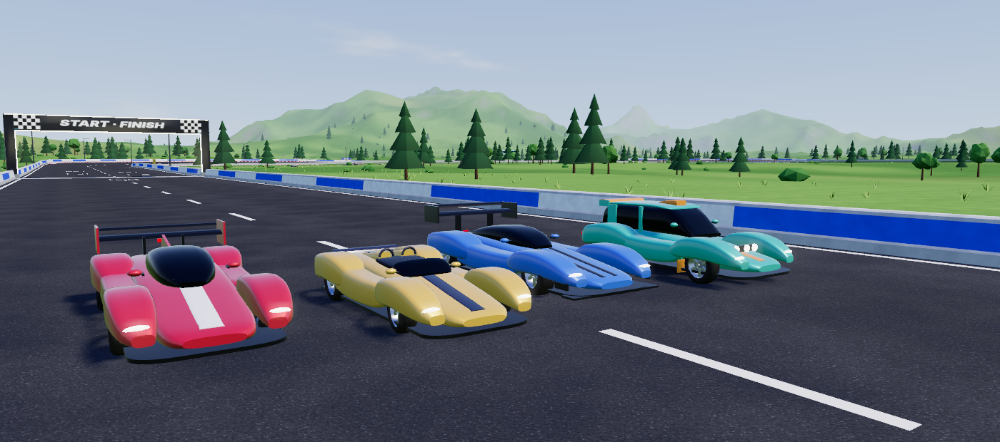
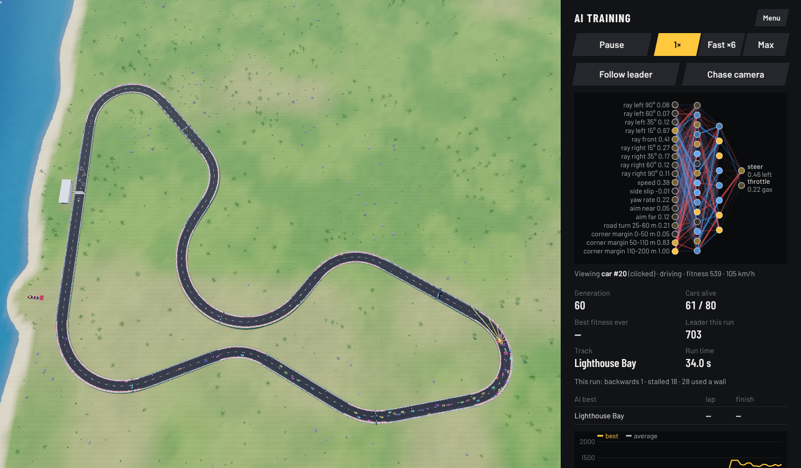

# Track Rush

A small Trackmania-style racer that runs in your browser, plus a neural-network AI driver
that you train yourself with neuroevolution and can watch learn in real time.
Pick one of 4 cars, chase the medal times on 12 tracks, fire the nitro, score points for clean
driving, race the ghost of your own best run, and play with a keyboard or a gamepad.

Everything runs locally: no accounts, no cloud, no paid APIs. Three.js is included in `vendor/`,
so it works offline.


| Driving (nitro flames, the score on the left) | Training the AI |
| --- | --- |
|  |  |

## Run it

You need [Node.js](https://nodejs.org) (any recent version) for the one-line web server.

```bash
cd racing-game
npx serve
```

Then open the address it prints (usually http://localhost:3000). `npm start` does the same thing.

Any static web server works, for example `python3 -m http.server 8000`. Opening `index.html`
straight from disk (`file://`) does **not** work, because browsers block JavaScript modules there.

There is nothing to install: no `npm install`, no build step.

### Play it on GitHub Pages

Because the game is a plain static site, GitHub Pages can host it: in your repository go to
**Settings → Pages**, choose **Deploy from a branch**, pick `main` and `/ (root)`, and save.
The game is then playable at `https://<your-user>.github.io/<repo-name>/`.

### Graphics quality

The game picks a quality level by itself and steps it down (high → medium → low) when the frame
rate drops. You can force a level by adding `?gfx=high`, `?gfx=medium` or `?gfx=low` to the address.
`low` draws less scenery (fewer boats and city lights too), fewer wall sparks and shorter nitro trails, turns off
scenery shadows and grass, and renders at a lower resolution.

## Playing

| Key | Gamepad | Action |
| --- | --- | --- |
| ↑ / W | RT (analogue) | Accelerate |
| ↓ / S | LT (analogue) | Brake, then reverse once stopped |
| ← → / A D | Left stick (analogue), d-pad ← → | Steer |
| Space | A | Handbrake (start a slide) |
| Shift (either one) | X or RB | Nitro (hold it) |
| R | View (Back on older pads) | Restart the run instantly |
| Enter / Backspace | B | Respawn at the last checkpoint (the timer keeps running) |
| G | Y | Show or hide the ghost of your best run |
| Esc | Menu (Start on older pads) | Back to the menu |
| 1-9, 0, -, =, arrows, Enter | d-pad / left stick, A | Pick a track on the menu (0, - and = are tracks 10-12) and drive |
| C / Shift+C | RB / LB | Next / previous car on the menu |
| H or ? | View (on the menu) | Open the **Controls** screen: every key and button (Esc, H or B closes it) |

Each run starts with a 3-2-1-GO countdown. Circuits are 3 laps, and a lap only counts when you pass
every checkpoint in order. At each checkpoint you see your split time compared with your best run
(green = faster, red = slower). Best times and splits are saved in your browser for each track and
car and shown on the track menu. Sprints have a long straight after the finish line, so you can brake to a stop.

**The menu** is three steps: **1 Track**, **2 Car**, **3 Drive**. Each track tile shows the track's outline (the
dot is the start; sprints have a second dot at the finish), its number, how hard it is (1-5 bars), and the
medal and best time you have with the picked car. The panel on the right (under the tiles in narrow windows) is
the selected track: its description, length and laps, then with the picked car your best time, best score,
whether a ghost is saved, the AI's best and the four medal times. The menu shows one line of key hints; the
**Controls** button (or **H**, **?**, or **View** on a gamepad) lists the rest.

**Drifting:** pull the handbrake (Space) into a corner to make the rear step out, then countersteer
and use the throttle to hold the slide. Braking hard while turning only tightens the line a little.

**Gamepad:** any controller the browser reads with the standard layout works (the buttons are named
as on an Xbox pad; on a PlayStation pad A is ✕, B is ○, X is □ and Y is △). Plug it in or press a button and a
short note confirms it. The stick and both triggers are analogue, with a small dead zone so a worn
stick doesn't drift; half-way on the stick gives about a third of full steering, for fine corrections.
Keyboard and gamepad can be used together (each control takes the stronger of the two). On the menu
and the training screen the d-pad or stick moves a highlight, **A** presses, **B** goes back, and on the menu
**LB** / **RB** change the car. While the gamepad is the last thing you used, the key hints in the race show its buttons.

### The cars



There are four cars. Each handles differently and has its own best times, ghosts, medals and best scores.

- **Racer** (red, the default): the all-rounder. Quick, grippy and stable, never far off the pace anywhere.
  It is exactly the car of earlier versions, so its old best times, ghosts and trained AI networks still count.
- **Kestrel** (yellow): light and nimble. The most grip, the shortest braking and the quickest launch, but a low
  top speed. It is the quickest car on twisty tracks (Hairpin Valley, Technical Trial, Canyon Run, Lighthouse Bay).
- **Thunder** (blue): heavy and brutal. Huge power and the highest top speed; its downforce makes it grip better
  the faster it goes, so slow corners need patience. It is the quickest car where the straights are long
  (Banked Speedway, Grand Marathon, Night Highway).
- **Drifter** (teal): a loose rally car. It slides on demand, holds long drifts and lands jumps without losing
  speed. It is the quickest car over the jumps (Ramp Rally, Seaside Stunts) and scores drift points easily.

| Car | Mass | 0-100 km/h | 0-200 km/h (with nitro) | Top speed (with nitro) | Nitro tank | 100-0 km/h | Cornering grip, 30 m / 120 m circle | Drift held |
| --- | --- | --- | --- | --- | --- | --- | --- | --- |
| Racer | 1,250 kg | 2.70 s | 9.78 s (7.57 s) | 277.7 km/h (291.8) | 5 s | 30.7 m | 1.68 g / 1.58 g | 0.83 s |
| Kestrel | 950 kg | 2.43 s | 11.28 s (9.78 s) | 230.2 km/h (239.8) | 4 s | 27.7 m | 1.78 g / 1.59 g | 0.75 s |
| Thunder | 1,650 kg | 2.68 s | 8.20 s (6.08 s) | 312.7 km/h (328.9) | 6 s | 33.8 m | 1.47 g / 1.56 g | 1.07 s |
| Drifter | 1,150 kg | 2.50 s | 9.23 s (7.57 s) | 264.3 km/h (278.9) | 5 s | 33.1 m | 1.59 g / 1.52 g | 1.63 s |

The numbers are measured with the game's own physics (`npm run cars`, see [Tools](#tools)). "Drift held" is how
long a keyboard driver typically keeps a handbrake slide going. The car picker shows the same as five bars
(speed, acceleration, grip, drift, nitro).

**Picking a car:** click a car card under the tracks (a double-click drives straight away), press **C** /
**Shift+C** on the menu, or use **RB** / **LB** on a gamepad (or the d-pad: down from the bottom row of tracks,
then around the car cards). The line under the cards describes the picked car. The choice is remembered, and Drive and
Race the AI ghost use it. The track tiles, the records and the medal times follow the picked car. The AI always drives the
Racer (it was trained with it).

### Nitro

Hold **Shift** (or **X** / **RB** on a gamepad) to burn nitro: it adds a strong push on top of the engine, with
blue flames from the exhausts and a slight camera kick. A full tank lasts 4-6 s depending on the car and is
worth roughly 0.3-0.5 s on a long straight. Nitro only works on the ground and going forwards: it does nothing in
the air, in reverse, while braking or while the handbrake is held. Holding nitro alone also opens the throttle.

The **NITRO** gauge above the speed shows the tank in ten segments: it glows while you boost, changes colour
when it is low and reads EMPTY when it is empty. Every run starts with a full tank, and a respawn keeps what
is left. The tank is **refilled by points** (see below): every 16,000 points you bank put one full tank back, so
a clean lap refills about half a tank to a full one, depending on the track, and drifts and jumps fill it faster.
Penalties take nothing out of the tank, and points banked at the finish refill nothing (the race is over).

### Points for clean driving

Each run in Drive and Race the AI ghost scores style points. In short:

| What | Points |
| --- | --- |
| Clean checkpoint (no wall contact or respawn since the last one; the lap line and the finish count too) | 500 × the combo |
| Combo | starts at x1 and goes up by one with every clean checkpoint in a row, up to x5; a wall contact or a respawn puts it back to x1 |
| Drift (a slide of 12° or more above 43 km/h, at least 0.6 s, ending without a wall contact or a spin) | about 600 a second at 30° and 90 km/h, more for more angle and speed, doubling over the first 3 s |
| Air (a jump of 0.5 s or more, landed straight with no wall contact right after) | 500 a second in the air ("Big air" from 1.5 s, "Huge air" from 2.5 s) |
| Close call (within 0.5 m of a wall above 108 km/h without touching it) | 250 |
| Clean lap / clean run (no wall contact or respawn) | +2,000 / +5,000 |
| Wall contact | −150, plus 25 for every m/s of speed lost into the wall and 200 a second of scraping after the first 0.5 s, at most −1,500 |
| Respawn | −500 |

Drifts, jumps and close calls only count on new road: after a respawn (or if you turn round and drive back),
the stretch you have already driven scores none of them again until you are past the furthest point you had
reached. The score never goes below zero.

The score sits under the lap and checkpoint counters with the combo next to it. A line below shows the drift,
jump or wall contact going on right now, and short notes pop up for every gain and loss. The finish panel shows
the total, the breakdown and how much nitro the points earned. Your **best score is saved for each track and
car** and shown in the menu's track panel. Clean driving pays most: one wall hit costs the combo and the clean lap and
clean run bonuses, often 10,000-15,000 points in all.

### Medals

Every track has four medal times for every car, as in Trackmania: **author**, **gold**, **silver** and **bronze**.
The menu shows the selected track's medal times for the picked car in the track panel (the ones you have won are
lit) and, on each track tile, the medal your best time with that car has earned. During a race the HUD shows the
next medal to aim for under your best time: it is crossed out once the clock passes it, and ticked when you beat
it. The finish panel shows the medal the run earned (marked NEW when it beats your previous one) and how far you
are from the next.

Author times (gold, silver and bronze are 6 %, 20 % and 50 % slower, rounded up to a whole second; for example
the Racer's Rookie Oval medals are 2:01.867, 2:10, 2:27 and 3:03):

| Track | Racer | Kestrel | Thunder | Drifter |
| --- | --- | --- | --- | --- |
| Rookie Oval | 2:01.867 | 2:05.550 | 2:01.867 | 2:04.367 |
| Hairpin Valley | 3:46.583 | 3:44.050 | 3:48.433 | 3:46.833 |
| Ramp Rally | 2:52.417 | 2:55.183 | 2:53.517 | 2:52.083 |
| Banked Speedway | 2:01.017 | 2:17.317 | 1:55.450 | 2:04.017 |
| Technical Trial | 3:44.033 | 3:41.933 | 3:47.950 | 3:45.017 |
| Grand Marathon | 2:30.467 | 2:33.017 | 2:29.317 | 2:32.033 |
| Coastal GP | 3:07.950 | 3:09.750 | 3:13.283 | 3:09.533 |
| Mountain Pass | 1:47.683 | 1:48.250 | 1:49.150 | 1:48.500 |
| Canyon Run | 4:15.450 | 4:11.933 | 4:25.167 | 4:12.150 |
| Night Highway | 3:15.450 | 3:19.050 | 3:15.050 | 3:16.367 |
| Lighthouse Bay | 2:38.067 | 2:37.433 | 2:40.467 | 2:40.817 |
| Seaside Stunts | 1:08.233 | 1:09.650 | 1:08.617 | 1:07.967 |

The times are for the full race you drive (3 laps, or the whole sprint), from a standing start with a full
nitro tank. The author time is the fastest of 50 runs of a simple autopilot with different cornering
settings, driving each car with the same physics as you: it burns nitro on the straights and its points
refill the tank as yours do (`npm run medals`, see [Tools](#tools)). The autopilot only follows the centre line
and uses nitro simply, so a driver with a real racing line and good nitro timing can beat even the author time.
A medal counts to the millisecond the HUD shows.

### Your ghost

When you set a personal best, the run is saved as the **ghost** of that track and car: from the next restart a
see-through light-blue car (the same model as yours, with flames where you used nitro) drives your best run
alongside you, so you can see where you gain or lose time. It is only drawn: you can drive through it, and it
never affects your race. It fades out while it is right on top of your car (every race starts that way) and
disappears once it has finished. **G** (or **Y** on a gamepad) shows or hides it during a race, and the menu
option **Race my best-run ghost** sets the same choice; it is remembered. The menu's track panel says "Ghost: Saved" when
the picked car has one saved. Runs in **Race the AI ghost** count too (that race shows the AI; your own ghost
appears in Drive).

A ghost stores the car's position, angles, wheel speed and nitro 30 times a second (plus the moments of
landings, wall hits and respawns), packed into about 8,500 characters per minute of racing, and replays within
about 2 cm of the original run. It stores where the car was, not which keys were pressed, so it can't drift off
when replayed. Best times and ghosts only count for the physics version they were set with.

### How the cars drive

The Racer is a 1,250 kg, all-wheel-drive sports car: 0-100 km/h in about 2.7 s, a top speed of
about 277 km/h, and around 1.6-1.7 g of cornering grip. The other cars use the same physics with their own
weight, engine, gearing, tyres, downforce, brakes and steering. In plain words, the physics
(`src/physics/car.js`, the cars in `src/physics/cars.js`) works like this:

- **Tyres** grip more as they start to slide sideways, peak at about 8° of slip, then lose a little grip.
  Braking or accelerating uses up some of that grip, so you can't brake flat out and turn at full grip at the same time.
- **Weight moves** when you brake (onto the front tyres) or accelerate (onto the rear), and downforce
  presses the car onto the road more the faster it goes.
- **Gearbox**: automatic, 6 speeds, with an engine that has a real torque curve and a rev limiter. The HUD shows gear and revs.
- **Steering** has a speed-sensitive lock, so a keyboard can't overdrive the front tyres at high speed,
  and a stability control (like a road car's ESC) stops quick left-right key presses from building
  up a fishtail. Stability control switches off while you use the handbrake, so you can still drift.
- **Hills and banking** matter: banked corners push the car into the turn and add grip, and the car
  stays planted over crests unless the road really drops away (kicker ramps).
- **Jumps**: in the air the car keeps the rotation it took off with; steering only nudges it a little.
  Landings don't bounce.
- **Walls** cost time, so the racing line matters: a hit takes away the speed going into the wall and
  also speed along it, far more for a hard hit than for a graze. A 5° touch at 150 km/h costs about
  15-20 km/h, a 15° hit at 200 km/h about half the speed, and a 30° hit at 180 km/h (or anything
  steeper) stops the car. Rubbing along a wall slows the car further: grinding along a barrier at full
  throttle settles at about 90 km/h. Walls don't bounce you back across the road (at most 1 m/s), and
  the car lines up with the wall as it slides. Pinned nose-first against a wall, full throttle with the
  wheels turned away slides it off within about 2 s; at part throttle a steep nose-in needs reversing
  (or Enter). Hits throw sparks and give the camera a short shake (no shake if your system is set to
  reduce motion). Every car has the same size for collisions and the same walls.

### Tracks

| # | Track | Type | Length | Scenery | Difficulty | What it asks of you |
| --- | --- | --- | --- | --- | --- | --- |
| 1 | Rookie Oval | 3 laps | 2.17 km/lap | meadow | ★ | Learn the car, carry speed through sweepers |
| 2 | Hairpin Valley | 3 laps | 2.42 km/lap | alpine | ★★ | Five switchbacks over a ridge: brake early, power out |
| 3 | Ramp Rally | 3 laps | 2.37 km/lap | desert | ★★★ | Four kicker jumps of 4-7 m: hit each ramp straight |
| 4 | Banked Speedway | 3 laps | 2.84 km/lap | dusk | ★★★ | Steep banked bowls (24-28°): trust the banking |
| 5 | Technical Trial | 3 laps | 2.59 km/lap | canyon | ★★★★ | A 10 m chicane, a jump, banked sweepers and a switchback climb |
| 6 | Grand Marathon | Sprint | 7.18 km | meadow | ★★★★★ | Everything from 1-5 in one long point-to-point run |
| 7 | Coastal GP | 3 laps | 2.90 km/lap | dusk | ★★★ | Fast grand-prix circuit: big braking zones, quick esses |
| 8 | Mountain Pass | Sprint | 4.50 km | alpine | ★★★★ | Banked switchbacks up to the summit and a twisting descent |
| 9 | Canyon Run | 3 laps | 2.85 km/lap | canyon | ★★★★★ | Narrow road, jumps, blind crests and tight S-bends |
| 10 | Night Highway (new) | 3 laps | 3.12 km/lap | night | ★★ | Kilometre-long straights and slow corners under the lights: brake hard, then fire the nitro |
| 11 | Lighthouse Bay (new) | 3 laps | 2.35 km/lap | seaside | ★★★ | Long sweeping bends round a bay, past a lighthouse: hold the drift |
| 12 | Seaside Stunts (new) | Sprint | 3.02 km | seaside | ★★★★ | Six kickers down the coast road, with step-downs and a 7.5 m launch |

Two new themes came with the new tracks: **night** (moon and stars, lit lamps, glowing barrier stripes and a
city skyline) and **seaside** (the sea on the open side, a beach, palms, boats and a lighthouse).
Roads vary in width (10 to 22 m) and height (up to about 18 m of climb). A map of every track is in
[docs/tracks-overview.svg](docs/tracks-overview.svg).

## Training the AI

1. On the menu, click **Train the AI**.
2. Pick the settings, then **Start training**:
   - **Population size**: cars per generation (default 80). More cars learn faster per generation but each generation takes longer.
   - **Mutation rate**: chance that each weight is nudged when breeding (default 0.1).
   - **Hidden layer size(s)**: neurons in the hidden layer, e.g. `12`, or `16,8` for two hidden layers.
   - **Laps per circuit**: laps driven per training run (1 is fastest; the network can still race 3 laps).
   - **Walls**: **Ride them** (default) lets a car that hits a wall keep driving (it just loses the speed the
     wall costs), so the AI can learn to use a wall where that is quicker than braking. **Crash out** takes a car
     out of the run the moment it touches a wall, so it learns clean racing lines instead.
   - **Train on**: one or more tracks. With several, every car drives each track in turn and its fitness is averaged, which gives a driver that generalises better.
3. Use the speed buttons: **1×** (real time), **Fast ×6**, or **Max**, which stops 3D rendering and simulates as
   fast as your CPU allows (often 20-50× real time with 80 cars, depending on your CPU). Max runs on a
   background thread (a Web Worker), so the page stays smooth while it trains; the dashboard, chart, autosave
   and **Save best network** keep working. Pause, another speed, **Watch best** or **Race best** bring the
   session back to the page exactly where it was. In a browser without workers, Max simulates on the page instead.

The AI always drives the **Racer**, never uses nitro (its inputs and outputs are the same as in version 3)
and scores no points.

The dashboard shows:
- a live diagram of the network: blue connections are positive weights, red are negative, thicker means stronger, and nodes light up with their current activation (warm = positive, cool = negative). Input and output nodes are labelled.
- the sensor rays of the car being shown, drawn in the 3D view (green = far wall, red = close wall)
- a chart of best and average fitness per generation
- generation, cars alive, best fitness so far, why the cars in the current run stopped, and the AI's best lap and finish times per track



Click any car in the 3D view to see its network instead of the leader's; **Follow leader** goes back.
**Overview camera** shows the whole track from above, which makes clicking cars easier.

Typical progress with 80 cars, one track at a time, after 100 generations:

| Track | Walls: Ride them | Walls: Crash out |
| --- | --- | --- |
| Hairpin Valley | first finish in generation 0, best lap 1:12.9 | generation 44, best lap 1:27.1 |
| Technical Trial | generation 0, best lap 1:13.3 | generation 20, best lap 1:23.3 |
| Canyon Run | generation 0, best lap 1:27.5 | generation 8, best lap 1:30.6 |
| Mountain Pass | generation 0, finish 1:46.1 | generation 8, finish 1:59.0 |

The new tracks are quick to learn: with **Crash out** the first finish came in generation 2-13 on Night Highway,
0-2 on Lighthouse Bay and 0-7 on Seaside Stunts (it varies with the random start).

With **Ride them** the AI learns to keep full throttle and turn most corners off the outside wall: it
practically never brakes (0-2 % of the time) and touches a wall in about 6-13 % of its driving. Walls cost
far more speed since version 3, but stopping against a hairpin wall still costs less than a second, so on
twisty tracks a wall works as a brake that is stronger than the tyres. With **Crash out** it learns to brake
(17-26 % of the time) and keep off the walls, which looks like clean racing. The gap between the two is
about half of what it was in version 2 (for example Hairpin Valley 1:12.9 against 1:27.1; in version 2,
1:05.5 against 1:29.5). Generations take longer with walls allowed, because fewer cars drop out early.
Training on several tracks at once takes longer too.

### How the AI works

- **Network** (`src/ai/network.js`): a small fully connected network with tanh activations.
  - 18 inputs (`src/ai/sensors.js`): 9 distance rays fanning out from the nose (-90° to +90°, 100 m range),
    speed, side slip, yaw rate, two "aim" angles to points on the road ahead (further ahead at higher speed),
    how much the road turns 25-60 m ahead, and three **corner margins**: how much faster than its current
    speed the car could take the tightest corner 0-50 m, 50-110 m and 110-200 m ahead. The corner margins
    are what teach it to brake before hairpins.
  - 2 outputs: steering (left/right) and throttle (positive = accelerate, negative = brake/reverse).
  - The network is also run on the mirror image of its inputs and the two answers are combined, so it
    drives left and right corners the same way.
- **Evolution** (`src/ai/genetic.js`): the top 5% survive unchanged, parents are picked by tournament
  selection, children mix their parents neuron by neuron and are then mutated. A few random newcomers keep diversity up.
- **Fitness** (`src/ai/trainer.js`): 1000 × share of the race distance covered, + 200 × share of checkpoints reached,
  + a bonus for finishing that grows the faster the car finishes. A car is out of the run when it touches a wall
  (only with **Walls: Crash out**), stalls, drives backwards, is too slow to reach the next checkpoint, falls far behind the first car to finish,
  or runs out of time. Time limits scale with the length of the track.

### Saving and loading a network

- The best network is **autosaved in your browser** whenever it improves, so it survives a page reload.
  Tick **Continue from saved network** on the training screen to keep training it.
- **Save best network** (training screen) or **Save network…** (menu) downloads a `.json` file.
- **Load network…** (menu or training screen) loads such a file. On the training screen, training
  continues from it: the new population is made of the loaded network plus mutated copies.

The file contains the weights, the layer sizes, the sensor version, the generation count, the fitness history,
the tracks and wall rule it was trained with and the AI's best times. The menu and the training screen show a
network's wall rule; files saved before the Walls setting existed count as **Crash out**. Networks from version 1 of the game (11 inputs) can't be
used with the new sensors and are refused with a message; train a new one. Networks trained before version 3
still load, but walls now cost far more speed, so they drive worse than they used to: retrain them (or keep
training them with **Continue from saved network**). Networks trained with version 3 work unchanged.

### Watching and racing the AI

- **Watch the AI** (menu) or **Watch best** (training screen): the AI drives a full race on the selected track, with its network and sensor rays shown live. If it gets stuck for 3 s it is put back at its last checkpoint.
- **Race the AI ghost** (menu) or **Race best (ghost)** (training screen): you race the AI with the car you picked; the AI is a see-through Racer you can drive through. The HUD shows how far ahead or behind you are at each checkpoint.

### Training without a browser (optional)

For long runs you can train from the command line with the same code, then load the result in the browser:

```bash
node tools/headlessTrain.mjs hairpin-valley,technical-trial 100 my-driver.json
# continue later from that file:
node tools/headlessTrain.mjs hairpin-valley,technical-trial 100 my-driver-2.json my-driver.json
# options: --pop 80  --hidden 16,8  --mutation 0.1  --laps 1  --walls ride|crash  --stop-after 10  --quiet
```

The physics is deterministic, so a network trained from the command line drives exactly the same in the browser.

## Adding a track

Tracks live in `src/tracks/trackData.js` as plain data. Add an object to the `TRACKS` array:

```js
{
  id: 'my-track',            // unique, used for saved times
  name: 'My Track',
  difficulty: 2,             // 1-5 stars
  description: 'Shown on the menu.',
  type: 'circuit',           // 'circuit' (laps) or 'sprint' (point to point)
  laps: 3,
  width: 16,                 // default road width in metres
  theme: 'meadow',           // 'meadow' | 'desert' | 'alpine' | 'canyon' | 'dusk' | 'night' | 'seaside'
  checkpoints: [2, 4],       // indices into `points` where checkpoint gates stand
  points: [                  // [x, z, height, bankDegrees?, widthMetres?]
    [0, 0, 0], [0, 150, 0], [40, 190, 0, 15], [80, 150, 0],
    [80, 0, 3], [40, -40, 0, 15],
  ],
},
```

- The centre line is a smooth curve (Catmull-Rom spline) through the points; x/z are metres on the ground, height is metres up.
- A circuit's start/finish line is at `points[0]`, and the car drives towards `points[1]`.
  A sprint runs from the first to the last point; `startAt` (metres of road before the cars' start position)
  and `runOff` (metres of road after the finish line) set where the start and finish lines go.
- Banking is given as a positive angle and automatically leans into the corner. A width given at a point
  is blended smoothly into the neighbouring road.
- Steep up-slopes (over 12 %) become kicker ramps that the car can jump from.
- Keep corners wider than half the road width, and keep separate parts of the track at least a road width apart (crossings and bridges are not supported).
- The menu has keys for 12 tracks (1-9, 0, - and =); further tracks are picked with the mouse, arrows or gamepad.

Placing points by hand gets fiddly, so there is an optional helper: `tools/turtle.mjs` lets you "drive"
a turtle with commands like `S(200)` (straight), `L(90, 40, 20)` (left turn, 90°, radius 40 m, 20° banking),
hairpins, S-bends, climbs, crests and self-sizing kicker ramps. The built-in tracks are written that way in
`tools/generateTracks.mjs`. Run `npm run tracks` to regenerate `trackData.js`: it refuses to write a track
that breaks the design rules (overlaps, too-tight corners, too-steep grades, short landing zones, sprints
without a run-off) and draws every track into `docs/tracks-overview.svg`.

Then run `npm run medals` to work out the medal times for every car (see [Tools](#tools)). The game shows no
medals for a track whose layout, laps, physics or scoring rules no longer match `src/tracks/medals.js`, and
`npm test` fails until it is regenerated.

## Tools

| Command | What it does |
| --- | --- |
| `npm start` | Serves the game (`npx serve`) |
| `npm test` | The self-test (below); it also runs on GitHub Actions for every push |
| `npm run tracks` | Regenerates `src/tracks/trackData.js` and `docs/tracks-overview.svg` from `tools/generateTracks.mjs` |
| `npm run medals` | Works out the medal times of every track and car and writes `src/tracks/medals.js` (about 15 s on 4 cores, 40-50 s on one). `npm run medals -- --check` only compares; `-- --jobs=N` uses N threads (default one per core, at most 4; the result is the same) |
| `npm run cars` | Measures every car's stats with the real physics (`tools/carStats.mjs`, a few seconds) and prints the `stats:` lines for `src/physics/cars.js`; `npm run cars -- --check` only compares |
| `npm run train` | Trains the AI from the command line (`tools/headlessTrain.mjs`, see above) |
| `npm run bench` | Measures how fast the physics runs, each car's speed and what wall hits and grinding cost |

Run `npm run medals` after changing the physics, a car, the scoring rules, a track or its laps, and
`npm run cars` (then paste its lines into `src/physics/cars.js`) after changing a car.

After changing tracks, physics, cars, scoring or the AI, run `npm test` (takes under a minute). It checks that every
track builds and can be finished by a simple autopilot without touching a wall, that checkpoints only count in
order, that walls don't bounce the car back but do cost speed (a 30° hit at 180 km/h loses at least half of it),
that a car pressed nose-first against a wall can steer off, that on Hairpin Valley a clean lap beats one that never
brakes and uses the walls instead, that fast cars can't pass through walls and that random driving never produces
invalid numbers. For the cars, it checks that the Racer still drives exactly as in version 3 (a stored fingerprint
of its state after fixed runs), that the stats on the car picker match the physics, and that every car finishes
every track, stays inside the walls even at its top speed with nitro, keeps its lane without fishtailing and lands
jumps cleanly, and that nitro follows its rules. For the AI, it checks that its inputs are in range and left/right
symmetric, that short training runs learn with both wall rules (Rookie Oval with each, Hairpin Valley with
**Crash out**), that the two wall rules keep or remove a car that hits a wall, that saved networks load back and
drive the identical lap, and that a training session handed to the background thread and back continues exactly
as if it never moved. It also checks that a recorded ghost replays within a few cm and broken saved data is
ignored, that every track has medal times for every car and the runs behind one track's author times still drive
them to the millisecond, that the car models build, that the score is exact and repeatable, rewards clean
driving, drifts and jumps, refills nitro and can't be farmed by respawning or driving back, and that best times,
ghosts and scores are kept per track and car (old saved data included).

## Code layout

```
index.html              page layout (menu, Controls screen, HUD, training dashboard)
css/style.css           styles: colour, type and spacing tokens at the top (see "Look" below)
vendor/                 Three.js r160 and a few of its add-ons (bloom post-processing), MIT licence
vendor/fonts/           Barlow and Barlow Condensed (woff2, Latin subset), SIL Open Font License
src/main.js             entry point, mode switching, main loop
src/tracks/
  trackData.js          the 12 track definitions (generated)
  trackBuilder.js       control points -> sampled centre line, width, banking, checkpoints, kickers
  medals.js             medal times per track and car (generated by tools/medals.mjs)
src/physics/
  car.js                car physics and nitro (no Three.js, shared by player, ghost and AI)
  cars.js               the four cars: physics specs, measured stats, descriptions
  collision.js          track queries: locate on track, wall collision, wall ray casts
src/game/
  race.js               laps, checkpoints in order, timing, splits
  score.js              points for clean driving and the nitro refills (no DOM, works in Node)
  playMode.js           drive / watch AI / race the AI ghost / your best-run ghost
  replay.js             records your runs and packs / replays them as ghosts (no DOM, works in Node)
  trainMode.js          training screen
  scene.js              renderer, sky, lights, themes, quality levels, bloom
  trackMesh.js          3D road, kerbs, barriers, gates, terrain, scenery
  carMesh.js            car models, ghosts, instanced AI cars, nitro flames, tyre smoke, skid marks, wall sparks, sensor rays
  camera.js             chase camera (with wall shake and nitro kick), overview camera
  input.js              keyboard and gamepad
  storage.js            best times, ghosts, best scores, settings and saved network (localStorage), file save/load
src/ai/
  network.js            neural network
  genetic.js            population and evolution
  sensors.js            AI inputs, mirrored driving, AIDriver
  trainer.js            runs and scores generations (works in Node too)
  trainWorker.js        the Web Worker that trains at Max speed
src/ui/
  hud.js, menu.js       race HUD (gear and rev bar, nitro gauge, score, next medal), menu (track tiles with minimaps,
                        track panel, car picker, Controls screen)
  networkView.js        live network diagram
  fitnessChart.js       fitness chart
tools/                  track generator, turtle helper, medal times, car stats, headless trainer, physics benchmark, self-test
docs/                   screenshots and the track overview map
.github/workflows/      CI: runs `npm test`
HANDOFF.md              status notes and ideas for future work
```

### Look

The interface uses one small set of design tokens, defined as CSS custom properties at the top of
`css/style.css`: near-black and grey panels, white and grey text, one accent colour (the yellow), green and red
only for gains and losses (time deltas, points), and the medal colours only for medals. Panels are flat, with no
gradients or glows; the only glow is the nitro gauge while it burns. Buttons, tags and HUD plates share one slant
(`--skew`), and spacing sits on a 4 px grid (`--s1` ... `--s6`). Type is Barlow for text and Barlow Condensed
for headings, numbers and buttons, with tabular figures so times don't jitter; there are four text sizes
(13, 16, 20 and 32 px) plus the big HUD numbers. The track minimaps on the menu are drawn at start-up from each
track's centre line (`trackMap` in `src/ui/menu.js`), so a new track gets one automatically.

Physics runs at a fixed 60 steps per second everywhere (the screen interpolates between steps), so an AI
trained at "Max" speed drives exactly the same when you watch it.

### Saved data

Everything is kept in the browser's localStorage; clearing the site's data loses it, and there is no export.

| Key | What |
| --- | --- |
| `trackrush.records.v4` | best time and splits per track and car |
| `trackrush.ghost.<track>.<car>` | the ghost of that best run, one per track and car |
| `trackrush.scores.v1` | best score per track and car |
| `trackrush.settings` | ghost on / off and the picked car |
| `trackrush.network.v2` | the latest trained AI network |

A ghost for every track and car (48) at bronze pace takes about a third of the space a browser usually gives a
site (measured in Chromium). If the storage is full anyway, the game first removes the old ghost the new one
replaces and tries again; if that is not enough, the finish panel says the ghost could not be saved.

Saved data from older versions: version 3 best times (`trackrush.records.v3`) and ghosts
(`trackrush.ghost.<track>`) are read as the Racer's, since it is the same car. The first best time you set in
version 4 copies the old times across (the old key is left as it is), and a new Racer ghost on a track replaces
the old one. The Racer's medal times now come from an autopilot that uses nitro, so they are 1-3 s faster than in
version 3, and an old best time may show one medal less than before. Networks trained in version 3 work as they
are. Best times and networks from version 1, and best times from version 2, are not carried over (the tracks,
the AI's inputs or the walls changed); version 2 networks still load, but should be retrained.

## Licence

No licence has been chosen for this project yet. Three.js is © three.js authors, MIT licence ([vendor/three.LICENSE](vendor/three.LICENSE)).
The Barlow and Barlow Condensed fonts in `vendor/fonts/` are © 2017 The Barlow Project Authors
(https://github.com/jpt/barlow), SIL Open Font License 1.1 ([vendor/fonts/OFL.txt](vendor/fonts/OFL.txt)); the files
are subsets (Latin letters, digits and punctuation) of the originals, four weights in about 80 KB.
