# Track Rush

A Trackmania-style racer, plus a neural-network AI driver that you train yourself with
neuroevolution and can watch learn in real time. Pick one of 6 cars, chase the medal times on
15 tracks, fire the nitro, score points for clean driving, race the ghost of your own best run,
and play with a keyboard or a gamepad.

Version 6.0.0 is the game rebuilt in the [Godot](https://godotengine.org) game engine (version
4.7.2). It plays the same as the browser version 5 it was ported from: the same tracks, cars,
physics, points, medals and AI. The browser version is still in the [`web/`](web/) folder and
still playable. Everything runs on your own computer: no accounts, no internet, no cloud.
Version 6.1.0 adds two cars, the Dune buggy and the Vortex hypercar, and new detailed car models
with spinning, steering wheels, working suspension, lights and a driver who steers, leans into the
corners and celebrates at the finish (see [The cars](#the-cars)).
Version 6.2.0 lets you train the AI with any of the six cars: every car keeps its own AI network, which
Watch the AI and Race the AI ghost use when that car is picked (see [Training the AI](#training-the-ai)).
Version 6.3.0 adds road surfaces: stretches of dirt and packed snow on four tracks, with less grip, longer
slides, dust and snow thrown up by the tyres, and a car that suits them, the Dune (see [Road surfaces](#road-surfaces)).
Version 6.4.0 adds three tracks at the end of the list, each in a scenery of its own: **Forest Rally**, a dirt rally
stage through autumn woods; **Northern Lights**, banked bowls of packed snow under the aurora; and **Summit Rush**, a
sprint over a mountain on asphalt, dirt and snow (see [Tracks](#tracks)).
Version 6.5.0 adds a career: medals and wins against five AI opponents (Rookie, Amateur, Pro, Expert and Elite) pay
money and career points, and money buys cars: you start with the Racer and buy the other five on the car picker
(see [Money, points and cars](#money-points-and-cars)).
Version 6.6.0 makes the tightest corners of five of the old tracks more forgiving: the hairpins and switchbacks of
Hairpin Valley, Technical Trial, Grand Marathon, Mountain Pass and Canyon Run are rounder (22-25 m instead of 13-19 m)
and their road 2-3 m wider; they are still hairpins, and the tracks keep their shape and their dirt and snow (see
[The reworked corners](#the-reworked-corners-version-660)).
Version 6.7.0 adds a terminal: in Settings (or with the `` ` `` key on the menu) you type commands such as `money 5000`,
`points 200`, `car vortex` or `unlock all` to add money and points, get cars and open everything (see
[The terminal](#the-terminal)).
Version 6.8.0 makes the game more linear: the tracks open one at a time. You start with Rookie Oval; a bronze medal
(or better) on a track, with any car, opens the next one, for good. Watch the AI and Train the AI still work on every
track (see [Unlocking tracks](#unlocking-tracks)).
Version 6.9.0 makes the bronze medal faster: 1.3 × the author time instead of 1.5 × (2:39 instead of 3:03 for the
Racer on Rookie Oval). Tracks you have opened stay open and rewards already paid stay paid (see [Medals](#medals)).
With it, all nine features the owner asked for after the port are done.
Version 6.10.0 polishes dirt and snow: instead of shaking the camera, loose ground now splashes **mud and snow onto the
screen** (round the edges, never over the middle; it slides off on asphalt, and Settings can turn it off); the dirt
and snow roads have **richer, less repetitive textures** (wheel ruts, puddles, pebbles, packed tracks, powder, ice,
glints); the **change from asphalt to dirt or snow is ragged and spread out** instead of a straight line; the
**barriers get dirty** along dirt and crusted with snow and ice along snow, and are **slidier** there; and the **brakes
work better on loose ground** (10-15 % shorter stops, no more spins when braking in a curve). The medal times and AI
opponents of the seven dirt and snow tracks are new; the other eight tracks are unchanged (see
[Road surfaces](#road-surfaces)).
Version 6.11.0 adds **car upgrades**, so money stays useful once all six cars are bought: every car has four parts,
the **engine** (power), the **tyres** (grip on asphalt), the **nitro** tank (bigger, refills faster) and **loose grip**
(grip on dirt and snow), three levels each, bought on the car picker. The stat bars show what they add, the car shows
them too (bigger exhausts, yellow tyre rings, blue nitro bands, mud flaps), and the medal times and AI opponents stay
as they are, so upgrades make medals and wins easier (see [Upgrades](#upgrades)).
Version 6.12.0 adds **sound and music**. Every car's engine is synthesized live from its revs, throttle and gears,
and each of the six sounds like itself: a race V6, a high-revving four, a deep cross-plane V8, a turbo four that hisses
when you lift, a rattly buggy and a screaming V12, with the gear changes, the rev limiter, crackles on a lift and the
nitro's roar. The tyres squeal on asphalt, gravel crunches on dirt and snow on snow, the wind rises with speed, walls
bang and scrape and landings thump; the countdown, checkpoints, laps, the finish, a new medal or best time and an
opened track each have a sound; the menus click and the shop rings. Four music tracks play, one on the menus and three
in the races (by scenery). Settings has volume sliders for Master, Music, Effects and Engines and mutes the game while
its window is in the background (see [Sound and music](#sound-and-music)).
Version 6.13.0 adds **Race the field**: a full race against five AI drivers instead of one see-through car. They line
up ahead of you on a two-wide starting grid (you start last), each with a name, a car and colours of their own, and
the cars are **solid**: they bump, lean on each other and get pushed off line. The HUD shows your place (P3/6), the
gaps to the cars ahead and behind and the standings; at the finish the panel lists everyone's time and gap, the top
three stand on a **podium**, and your place pays money and points, more for a harder field (see
[Race the field](#race-the-field)).
Version 6.14.0 adds **championships**: five cups of three tracks each (the Rookie Cup to the Grand Finale), raced back
to back against the same five AI drivers at a level you pick. Each race scores 10-8-6-5-4-3 points, the standings
between the races set the next grid (the leader starts on pole), the top three of the final standings stand on the
podium with **gold, silver and bronze trophies**, and the cup pays a big prize by your final place. The menu's **Cups**
button (or **T**) opens them and shows your **trophy cabinet** (see [Championships](#championships)).
Version 6.15.0 lets **the AI you train use nitro**: it sees its tank, learns where to fire it (out of the corners onto
the straights) and refills it by driving cleanly, as you do; Watch the AI shows its tank. **Races against AI cars have
no nitro** for anyone (Race the AI, Race the field, championships), and the HUD says so (see [Nitro](#nitro) and
[Training the AI](#training-the-ai)).


| Driving at night (headlights, nitro flames, the score on the left) | The finish panel |
| --- | --- |
| 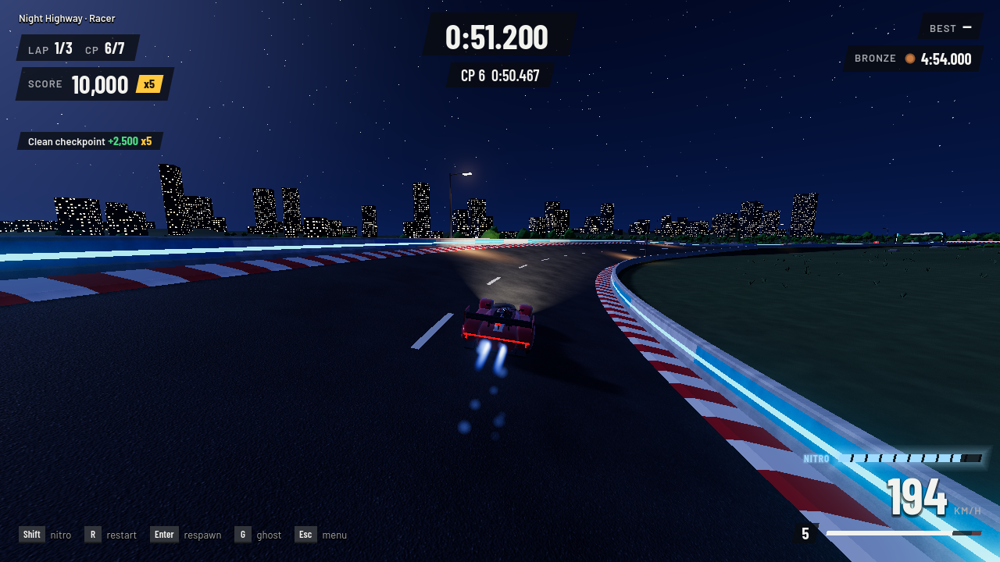 | 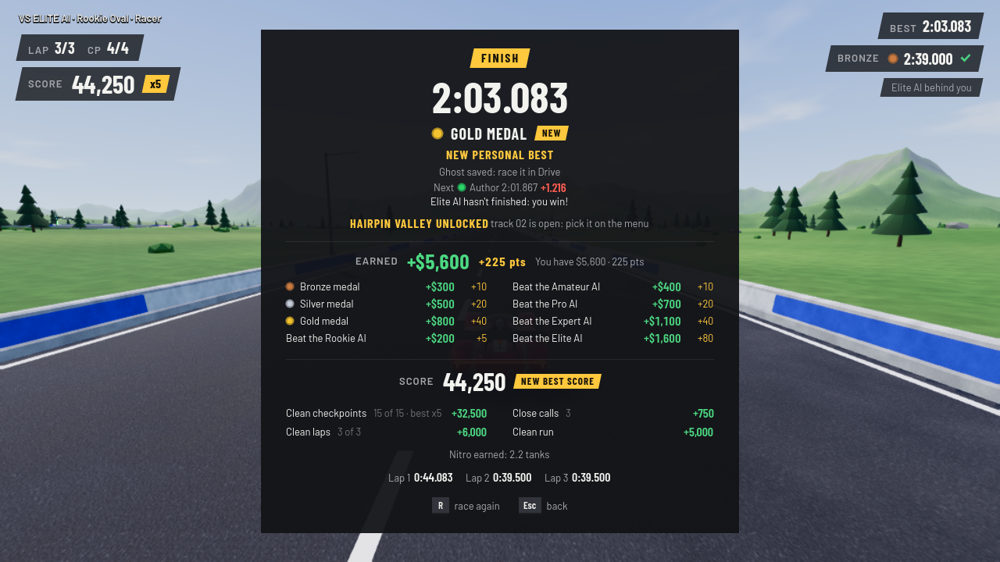 |

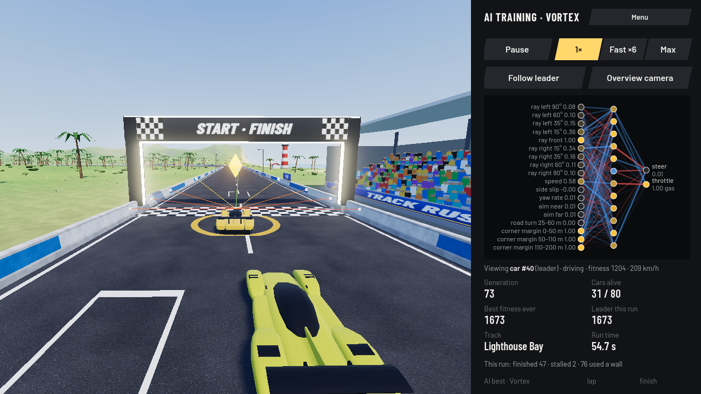

## Play it on Windows

### The ready-made game (no installation)

1. Get `TrackRush-6.15.0-windows.zip`. It is made with the export steps in
   [Making the game files](#making-the-game-files-export); it is not stored in the repository
   itself (it is about 40 MB), so it is shared separately, for example attached to a release on
   the repository's GitHub **Releases** page.
2. Unzip it anywhere (right-click, **Extract All...**). You get `TrackRush.exe`,
   `libtrackrush.windows.template_release.x86_64.dll` and a short `README.txt`.
   **Keep the `.dll` file next to `TrackRush.exe`**: it is the fast AI training engine.
   Without it the game still runs, but AI training is about a hundred times slower
   (the training screen says so).
3. Double-click `TrackRush.exe`.

The game is not signed with a certificate, so the first time Windows may show a blue
**"Windows protected your PC"** (SmartScreen) box. Click **More info**, then **Run anyway**.

Nothing is installed and nothing is written next to the game: your best times, ghosts,
settings, money, cars and AI networks are kept in one save file (see [Saved data](#saved-data)).
To remove the game, delete the folder (and the save folder, if you want your records gone too).

### From the project, with Godot 4.7.2

This is how you run the game while working on it. Godot runs on Windows, Linux and macOS
(the fast AI training library is only built for Windows and Linux, see
[`native/README.md`](native/README.md); elsewhere training is slower).

1. Download Godot **4.7.2**, the standard version (not ".NET"), from its
   [release page](https://github.com/godotengine/godot/releases/tag/4.7.2-stable)
   (for Windows: `Godot_v4.7.2-stable_win64.exe.zip`). Unzip it; there is nothing to install.
2. Get this repository onto your computer (on GitHub: **Code**, **Download ZIP**, then unzip;
   or `git clone`).
3. Start Godot. In the Project Manager click **Import**, pick the `project.godot` file in the
   repository folder, then **Open**. The first time, Godot spends a few seconds importing the
   fonts and the icon.
4. Press **F5** (or the ▶ "Run Project" button at the top right). The game opens in its own window.

Use the same Godot version (4.7.2): an older one can't run the project, and a newer one may
offer to convert it.

## Playing

| Key | Gamepad | Action |
| --- | --- | --- |
| ↑ / W | RT (analogue) | Accelerate |
| ↓ / S | LT (analogue) | Brake, then reverse once stopped |
| ← → / A D | Left stick (analogue), d-pad ← → | Steer |
| Space | A | Handbrake (start a slide) |
| Shift (either one) | X or RB | Nitro (hold it) |
| R | View (Back on older pads) | Restart the run instantly |
| Enter / Backspace | B | Respawn at the last checkpoint (the timer keeps running) |
| G | Y | Show or hide the ghost of your best run |
| Esc | Menu (Start on older pads) | Back to the menu |

On the menu:

| Key | Gamepad | Action |
| --- | --- | --- |
| Arrows or W A S D, 1-9, 0, -, = | d-pad / left stick | Pick a track (0, - and = are tracks 10-12; tracks 13-15 with the arrows, the mouse or the pad). A locked track can be picked too: its panel says what opens it |
| C / Shift+C | RB / LB | Next / previous car |
| Enter or Space | A | Drive |
| H or ? | View | The **Controls** screen: every key and button (Esc, H or B closes it) |
| O | highlight **Settings**, then A | The **Settings** screen |
| `` ` `` (the key under Esc) | Settings, highlight **Terminal**, then A | The **terminal**: commands for money, points and cars (not during a race) |
| T | highlight **Cups**, then A | The **championships**: pick a cup and a level, or the standings of the cup you are in (v6.14.0) |
| Mouse | | Click a track tile or a car card to pick it, double-click to drive straight away |

Each run starts with a 3-2-1-GO countdown. Circuits are 3 laps, and a lap only counts when you pass
every checkpoint in order. At each checkpoint you see your split time compared with your best run
(green = faster, red = slower). Sprints have a long straight after the finish line, so you can brake
to a stop. When you finish, the finish panel shows your time, the medal it earned, how far you are
from the next medal, your points with their breakdown, and the lap times; **R** races again and
**Esc** goes back to the menu.

**The menu** is three steps: **1 Track**, **2 Car**, **3 Drive**. Each track tile shows the track's
outline (the dot is the start; sprints have a second dot at the finish), its number, how hard it is
(1-5 bars), and the medal and best time you have with the picked car; a locked track's tile is darker, with a
padlock and what opens it ("Bronze on 02": a bronze on track 02), and a track that has just opened says **NEW**
(see [Unlocking tracks](#unlocking-tracks)). The panel on the right is the
selected track: its description, length and laps, then with the picked car your best time, best
score, whether a ghost is saved, the AI's best and the four medal times. Under it are **Drive** (**BUY** or
**LOCKED** when the picked car is not yours yet, **LOCKED** on a locked track), the **Race my best-run ghost** option and the **AI driver** block:
the opponent (**Rookie** to **Elite**, or **My AI**, the picked car's own network), what it does on this track and
what beating it pays, Race the AI, Watch the AI, **Race the field** (v6.13.0: five AI drivers of the picked level on a
grid with you), Train the AI and Load / Save network. Next to the **3 Drive** heading the **Cups** button (v6.14.0)
shows your trophy cabinet and opens the championships. The header shows your money
and career points and a few key hints; the **Controls** button lists the rest, and the **Settings** button opens the
settings.

**Drifting:** pull the handbrake (Space) into a corner to make the rear step out, then countersteer
and use the throttle to hold the slide. Braking hard while turning only tightens the line a little.

**Gamepad:** any controller Windows (or Linux) recognises as a game controller works; the buttons are
named as on an Xbox pad (on a PlayStation pad A is ✕, B is ○, X is □ and Y is △). Plug it in and a
short note confirms it. The stick and both triggers are analogue, with a small dead zone so a worn
stick doesn't drift; half-way on the stick gives about a third of full steering, for fine
corrections. Keyboard and gamepad can be used together (each control takes the stronger of the two).
On the menu, the Settings screen and the training screen the d-pad or stick moves a highlight,
**A** presses, **B** goes back, and on the menu **LB** / **RB** change the car. While the gamepad is
the last thing you used, the key hints show its buttons.

### The cars

There are six cars. Each handles differently and has its own best times, ghosts, medals and best scores.

- **Racer** (red, the default): the all-rounder. Quick, grippy and stable, never far off the pace anywhere.
- **Kestrel** (yellow): light and nimble. The most grip, the shortest braking and the quickest launch, but a low
  top speed. It is the quickest car on twisty tracks (Hairpin Valley, Technical Trial, Canyon Run, Lighthouse Bay).
- **Thunder** (blue): heavy and brutal. Huge power and the highest top speed; its downforce makes it grip better
  the faster it goes, so slow corners need patience. It is the quickest car where the straights are long
  (Banked Speedway, Grand Marathon, Night Highway).
- **Drifter** (teal): a loose rally car. It slides on demand, holds long drifts and lands jumps without losing
  speed. It is the quickest of the first four cars over the jumps (Ramp Rally, Seaside Stunts) and scores drift
  points easily; on dirt and snow it keeps a little more grip than the Racer.
- **Dune** (green): an open buggy on big tyres. Soft and forgiving: strong grip in slow corners, traction on all
  four wheels, gentle slides that are easy to catch and soft landings, but the lowest top speed, so it is the slowest
  car on tarmac. On dirt and snow it keeps far more grip than any other car (97 % of it on dirt, 72 % on snow), which
  makes it the quickest car of all on Ramp Rally and Hairpin Valley. It is the easiest car to drive cleanly.
- **Vortex** (orange): a mid-engine hypercar. The most power, the highest top speed and the most grip at speed,
  but light and twitchy at the limit, and its nitro tank lasts only 3 s. In the medal autopilot's hands it is the
  quickest car on every track with little or no loose road; on dirt and snow it keeps the least grip of all, so it is
  only fifth on Ramp Rally and Hairpin Valley. In your hands it rewards precise driving.

| Car | Mass | 0-100 km/h | 0-200 km/h (with nitro) | Top speed (with nitro) | Nitro tank | 100-0 km/h | Cornering grip, 30 m / 120 m circle | Drift held |
| --- | --- | --- | --- | --- | --- | --- | --- | --- |
| Racer | 1,250 kg | 2.70 s | 9.78 s (7.57 s) | 277.7 km/h (291.8) | 5 s | 30.7 m | 1.68 g / 1.58 g | 0.83 s |
| Kestrel | 950 kg | 2.43 s | 11.28 s (9.78 s) | 230.2 km/h (239.8) | 4 s | 27.7 m | 1.78 g / 1.59 g | 0.75 s |
| Thunder | 1,650 kg | 2.68 s | 8.20 s (6.08 s) | 312.7 km/h (328.9) | 6 s | 33.8 m | 1.47 g / 1.56 g | 1.07 s |
| Drifter | 1,150 kg | 2.50 s | 9.23 s (7.57 s) | 264.3 km/h (278.9) | 5 s | 33.1 m | 1.59 g / 1.52 g | 1.63 s |
| Dune | 1,100 kg | 2.87 s | 12.68 s (10.88 s) | 222.4 km/h (232.9) | 5 s | 31.7 m | 1.71 g / 1.43 g | 0.60 s |
| Vortex | 1,150 kg | 2.57 s | 6.22 s (5.47 s) | 321.4 km/h (338.1) | 3 s | 28.8 m | 1.68 g / 1.75 g | 1.22 s |

The numbers are measured with the game's own physics (`tools/car_stats.gd`, see [Tests and tools](#tests-and-tools)).
"Drift held" is how long a keyboard driver typically keeps a handbrake slide going. The car picker shows the same
as five bars (speed, acceleration, grip, drift, nitro). The numbers are for asphalt; on dirt and snow every car grips,
brakes and accelerates less (see [Road surfaces](#road-surfaces)).

**Picking a car:** click a car card under the tracks (a double-click drives straight away), press **C** /
**Shift+C** on the menu, or use **RB** / **LB** on a gamepad. The cards sit three to a row (two in a narrow
window); the line under them describes the picked car (in a window under 760 px high, such as 1280 x 720, a car you
own shows its upgrades there instead, see [Upgrades](#upgrades); the description is in the card's tooltip). The choice is remembered, and Drive and Race the AI use it.
A new player owns only the Racer: the other cards show a padlock and the car's price, and their stats stay
readable. With a locked car picked, Drive reads **BUY $10,000** (or **LOCKED** when your money is short) and buys it
after asking (see [Money, points and cars](#money-points-and-cars)). The track tiles, the records and the medal times follow the picked car, and so does the AI driver block:
each car has its own AI network (see [Training the AI](#training-the-ai)).

**The models.** Every car is drawn in detail: tyres with tread grooves, spoked rims in the car's own style, brake
discs and calipers, suspension arms (and coil springs on the Dune) that you can see working, head and tail lights,
mirrors, vents, panel lines, wings and exhausts, and its race number on the doors. The wheels spin with the car's
speed and the front ones steer; the body squats when you accelerate, dives under braking, leans out of corners and
sinks onto its springs when it lands, while the wheels stay on the road (and hang down in the air). The Vortex's
rear wing tilts up as an air brake. A driver sits in every car: the steering wheel turns with the front wheels and
the arms follow it, the head looks into the corners and leans against the cornering force, the body rocks under
braking and acceleration and bumps on landings, and at the finish the driver pumps a fist. The brake lights glow
brighter when you brake. On night tracks (and at dusk) the headlights light the road ahead: two real lights on
High graphics, one on Medium, and a cheap glow on the road on Low. Each car is a single mesh, so it costs only a
few draw calls; the Low setting uses a lighter version of it, and the AI training fleet a much simpler one.

### Nitro

Hold **Shift** (or **X** / **RB** on a gamepad) to burn nitro: it adds a strong push on top of the engine, with
blue flames from the exhausts and a slight camera kick. A full tank lasts 4-6 s depending on the car and is
worth roughly 0.3-0.5 s on a long straight. Nitro only works on the ground and going forwards: it does nothing in
the air, in reverse, while braking or while the handbrake is held. Holding nitro alone also opens the throttle.

The **NITRO** gauge above the speed shows the tank in ten segments: it glows while you boost, changes colour
when it is low and reads EMPTY when it is empty. Every run starts with a full tank, and a respawn keeps what
is left. The tank is **refilled by points** (see below): every 16,000 points you bank put one full tank back, so
a clean lap refills about half a tank to a full one, depending on the track, and drifts and jumps fill it faster.
Penalties take nothing out of the tank, and points banked at the finish refill nothing (the race is over).
The nitro upgrade makes the tank last longer and refill faster (see [Upgrades](#upgrades)).

**No nitro in AI races** (version 6.15.0). In every race against AI cars (Race the AI at any level and against My
AI, Race the field and championships) nobody has nitro: every car starts with an empty tank and nothing refills
it. The nitro gauge is hidden there, the HUD reads "No nitro in AI races" in its place, and the menu's 3 Drive
heading says the same. Your time still counts for medals, records and opening tracks. Drive, your own ghost, Watch
the AI and training keep nitro.

### Points for clean driving

Each run in Drive and Race the AI ghost scores style points:

| What | Points |
| --- | --- |
| Clean checkpoint (no wall contact or respawn since the last one; the lap line and the finish count too) | 500 × the combo |
| Combo | starts at x1 and goes up by one with every clean checkpoint in a row, up to x5; a wall contact or a respawn puts it back to x1 |
| Drift (a slide of 12° or more above 43 km/h, at least 0.6 s, ending without a wall contact or a spin) | about 600 a second at 30° and 90 km/h, more for more angle and speed, doubling over the first 3 s |
| Air (a jump of 0.5 s or more, landed straight with no wall contact right after) | 500 a second in the air |
| Close call (within 0.5 m of a wall above 108 km/h without touching it) | 250 |
| Clean lap / clean run (no wall contact or respawn) | +2,000 / +5,000 |
| Wall contact | −150, plus 25 for every m/s of speed lost into the wall and 200 a second of scraping after the first 0.5 s, at most −1,500 |
| Respawn | −500 |

Drifts, jumps and close calls only count on new road: after a respawn (or if you turn round and drive back),
the stretch you have already driven scores none of them again until you are past the furthest point you had
reached. The score never goes below zero.

The score sits under the lap and checkpoint counters with the combo next to it. A line below shows the drift,
jump or wall contact going on right now, and short notes pop up for every gain and loss. The finish panel shows
the total, the breakdown and how much nitro the points earned. Your **best score is saved for each track and
car** and shown in the menu's track panel. Clean driving pays most: one wall hit costs the combo and the clean
lap and clean run bonuses, often 10,000-15,000 points in all.

### Medals

Every track has four medal times for every car, as in Trackmania: **author**, **gold**, **silver** and **bronze**.
The menu shows the selected track's medal times for the picked car in the track panel (the ones you have won are
lit) and, on each track tile, the medal your best time with that car has earned. During a race the HUD shows the
next medal to aim for under your best time: it is crossed out once the clock passes it, and ticked when you beat
it. The finish panel shows the medal the run earned (marked NEW when it beats your previous one) and how far you
are from the next.

Gold, silver and bronze are 6 %, 20 % and 30 % slower than the author time, rounded up to a whole second (for
example the Racer's Rookie Oval medals are 2:01.867, 2:10, 2:27 and 2:39). Author times:

| Track | Racer | Kestrel | Thunder | Drifter | Dune | Vortex |
| --- | --- | --- | --- | --- | --- | --- |
| Rookie Oval | 2:01.867 | 2:05.550 | 2:01.867 | 2:04.367 | 2:09.683 | 1:52.250 |
| Hairpin Valley | 3:58.183 | 3:52.700 | 4:10.667 | 3:56.133 | 3:49.867 | 3:58.083 |
| Ramp Rally | 3:05.633 | 3:04.500 | 3:12.917 | 3:03.983 | 3:00.133 | 3:05.700 |
| Banked Speedway | 2:01.017 | 2:17.317 | 1:55.450 | 2:04.017 | 2:23.150 | 1:48.600 |
| Technical Trial | 3:50.300 | 3:46.467 | 3:52.567 | 3:50.067 | 3:52.117 | 3:35.650 |
| Grand Marathon | 2:30.667 | 2:33.000 | 2:29.483 | 2:32.283 | 2:39.033 | 2:19.267 |
| Coastal GP | 3:07.950 | 3:09.750 | 3:13.283 | 3:09.533 | 3:16.167 | 2:54.900 |
| Mountain Pass | 1:51.617 | 1:50.650 | 1:56.533 | 1:53.833 | 1:52.633 | 1:49.683 |
| Canyon Run | 4:20.167 | 4:17.033 | 4:30.900 | 4:21.117 | 4:16.017 | 4:15.017 |
| Night Highway | 3:15.450 | 3:19.050 | 3:15.050 | 3:16.367 | 3:24.583 | 2:58.767 |
| Lighthouse Bay | 2:38.067 | 2:37.433 | 2:40.467 | 2:40.817 | 2:43.533 | 2:28.617 |
| Seaside Stunts | 1:08.233 | 1:09.650 | 1:08.617 | 1:07.967 | 1:10.500 | 1:01.433 |
| Forest Rally | 3:23.333 | 3:18.617 | 3:38.783 | 3:15.850 | 3:03.350 | 3:34.967 |
| Northern Lights | 3:08.283 | 3:06.617 | 3:21.617 | 3:01.700 | 3:02.750 | 3:25.667 |
| Summit Rush | 1:47.417 | 1:46.933 | 1:53.850 | 1:47.550 | 1:42.067 | 1:49.950 |

The times are for the full race you drive (3 laps, or the whole sprint), from a standing start with a full
nitro tank. The author time is the fastest of 50 runs of a simple autopilot with different cornering
settings, driving each car with the same physics as you: it burns nitro on the straights and its points
refill the tank as yours do (`tools/medals.gd`, see [Tests and tools](#tests-and-tools)). The autopilot only
follows the centre line and uses nitro simply, so a driver with a real racing line and good nitro timing can beat
even the author time. A medal counts to the millisecond the HUD shows. (On the six all-asphalt tracks that are still
the browser version's layouts the first four cars' author, gold and silver times are the browser version's; its bronze
is 1.5 × the author time. Hairpin Valley, Ramp Rally,
Mountain Pass and Canyon Run got dirt or snow in version 6.3.0 and new times, 0.8-37 s slower than before depending on
the car: see [Road surfaces](#road-surfaces). Hairpin Valley, Technical Trial, Grand Marathon, Mountain Pass and Canyon
Run got rounder, wider hairpins in version 6.6.0 and new times again: see [Tracks](#tracks). The Dune and the Vortex,
and the three tracks of version 6.4.0, exist only in this version.)

**The faster bronze (version 6.9.0).** Until version 6.8.0 bronze was 1.5 × the author time; it is 1.3 × now, 13 to
54 s faster depending on the track and car. The medals your best times hold are worked out from the times when they
are shown, so the menu, the HUD and `status` use the new bronze at once. A best time that was a bronze before and is
slower than the new bronze holds no medal now (the HUD then aims at the new bronze); nothing else is taken away:

- the tracks it opened stay open (the save file keeps them; from now on a track opens at the new bronze), and
- the money and points it paid stay yours, and a new bronze there pays nothing again (it was paid); silver and better
  pay as before.

A save from version 6.7.0 or older (from before tracks opened one at a time) still opens every track it has a best
time on, but the track after one opens only for a time under today's bronze.

### Unlocking tracks

The tracks open one at a time, in the menu's order. A new career starts with **Rookie Oval**; a **bronze medal or
better** on a track opens the next one. Any car counts (a bronze with the Kestrel opens the next track for every car),
and so does a bronze won while racing an AI opponent. The finish panel says so ("Hairpin Valley unlocked"), and the
new track's tile says **NEW** until you pick it or leave the menu.

- **An opened track stays open for good**, even when a later version makes a medal faster or changes the track (the
  save file keeps the list of opened tracks).
- A **locked track** can still be picked with the keys, the pad or the mouse. Its tile shows a padlock and what opens
  it ("Bronze on 02"), its panel says it in full, and Drive reads **LOCKED**. **Drive** and **Race the AI** are
  refused there with a message saying what opens it.
- **Watch the AI** and **Train the AI** work on every track, locked or not (the AI lab pays nothing). Race best on
  the training screen needs an open track, Watch best works anywhere.
- The terminal's `unlock tracks` (or `unlock all`) opens every track at once (see [The terminal](#the-terminal)).

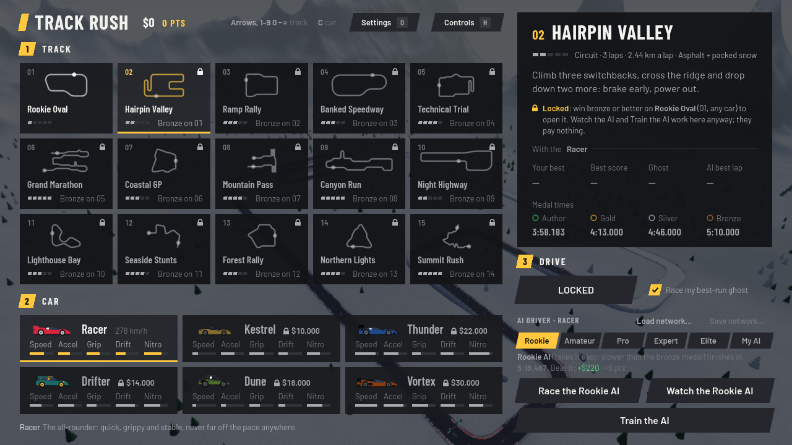

A save from an earlier version (when every track was open) keeps every track you have a best time on, with any car
(including best times kept from an older version of a track), and opens the track after every one where a best time
is bronze or better against today's bronze time.

### Money, points and cars

Beating medal times and AI opponents pays **money** and **career points**. Money buys cars; points are your career
total (they buy nothing and are not the style score of one run). The menu's header shows both, and the finish panel
lists what a run earned and why.

| Reward (on Rookie Oval) | Money | Points |
| --- | --- | --- |
| Bronze / silver / gold / author medal | $300 / $500 / $800 / $1,200 | 10 / 20 / 40 / 80 |
| Beat the Rookie / Amateur / Pro / Expert / Elite AI | $200 / $400 / $700 / $1,100 / $1,600 | 5 / 10 / 20 / 40 / 80 |

- **Each reward is paid once** per track, car and medal (or AI level). A better medal later pays only what is new,
  the same result again pays nothing (the finish panel says "paid before").
- A medal pays the medals below it too (a first gold pays bronze, silver and gold), and beating an AI pays the
  easier levels on that track with that car as well (they are slower).
- **Later tracks pay more**: track 2 pays 10 % more than Rookie Oval, track 15 (Summit Rush) 140 % more.
- Each car earns on its own: a gold with the Kestrel pays again after a gold with the Racer.

**The AI opponents.** Pick one in the menu's AI driver block, then **Race the ... AI**: its car drives next to yours
(see-through: you can drive through it) and you win by finishing ahead of it. Every track and car has its own
opponents, driven by AI networks shipped with the game (trained on that track with that car; your own network is
not touched). The levels are the same network held to a lower top speed: Rookie finishes in about 1.6 × the author
time (slower than bronze), Amateur 1.4 × (a little slower than bronze), Pro 1.25 × (between silver and bronze),
Expert 1.13 × (between gold and silver) and Elite about the author time (always faster than gold). The menu shows the picked opponent's time on the selected
track. **My AI** races and watches the picked car's own trained network as before; it pays no AI rewards (medals
still pay). Watch the AI shows any opponent drive.

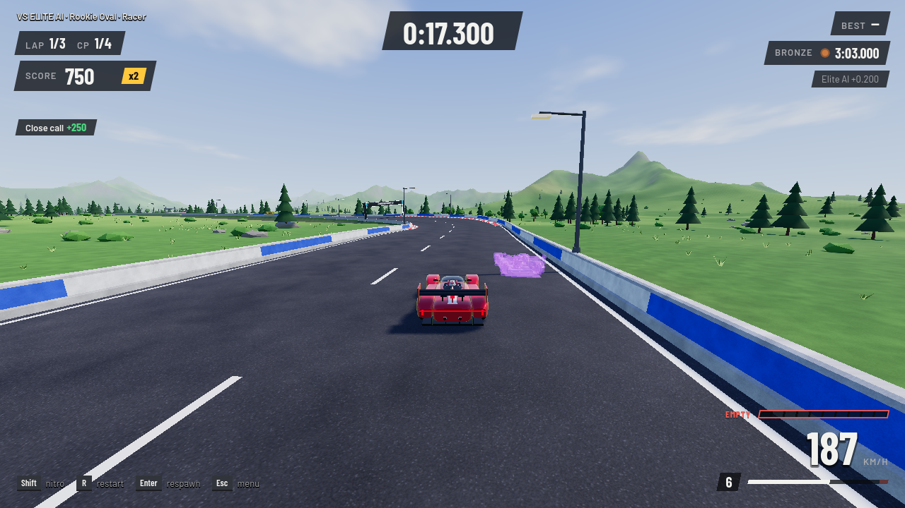

### Race the field

(Version 6.13.0.) Pick a level in the AI driver block (**Rookie** to **Elite**; not My AI) and press **Race the
field**: five AI drivers race you on the selected track, with solid cars. Locked tracks and cars you don't own are
refused as for Drive.

- **The drivers.** Eight drivers take turns (Ada Brandt, Rico Vance, Juno Park, Sol Reyes, Kai Ostrom, Tess Moreau,
  Nils Haugen and Lena Fox), each with a car and paint of their own; a race takes five of them, the same five every
  time on the same track and level. Each drives the shipped AI opponent network of its car with a top speed of its
  own: the last AI on the grid at the level's pace with **your** car (beating it is like beating that AI opponent),
  the others 2, 4, 6 and 8 % slower, the slowest on pole. A driver whose car can't keep that pace on the track (a
  Dune on a fast oval) drives your car instead.
- **The grid.** Two wide and staggered, 10 m between cars, the AI ahead and you last, on the usual start spot, so the
  race is the same distance as Drive: **your time counts for medals, records, your ghost and opening tracks** as in
  Drive (your best-run ghost doesn't race along).
- **No nitro** (version 6.15.0): nobody in the field has nitro, you included (see [Nitro](#nitro)).
- **Solid cars.** Cars push each other apart and lose a little speed when they touch; nothing launches or sticks, and
  a car over a ramp flies over the others. The AI ease off behind a car close ahead and steer to the side with more
  room, and an AI stuck or facing the wrong way for a few seconds is put back on the road (it can't be hit for a
  second after). Contacts only exist in this mode: Drive, Race the AI, the ghosts, training and the medal times are
  exactly as before.
- **The HUD** shows your place (P3/6), the car ahead and behind with the gap in seconds, and the standings with
  everyone's gap to you; mud and snow from any car close ahead reach your screen.
- **The finish.** At your finish your place is final (everyone still racing is behind you). The finish panel moves
  to the right with the finishing order, times and gaps (filled in as the others finish) and what the run paid; after
  two seconds the top three stand on a podium on the start straight. **R** races again, **Esc** goes back.

**Pay by place** (on Rookie Oval, a Pro field; Rookie fields pay 0.6 ×, Amateur 1 ×, Pro 1.5 ×, Expert 2.1 ×, Elite
3 ×, and later tracks more, as for medals):

| Place | 5th | 4th | 3rd | 2nd | 1st | 6th |
| --- | --- | --- | --- | --- | --- | --- |
| Money | $90 | $140 | $230 | $380 | $680 | nothing |
| Points | 2 | 3 | 6 | 12 | 23 | |

Like medals, a place pays the places below it too (a first 3rd pays 5th, 4th and 3rd) and each is paid once per
track, car and field level: a better place later pays only the difference. The medal the run's time earns is paid as
in Drive. A win against a Pro field on Rookie Oval pays $1,520 and 46 points on top of the medal.

| Mid-race (an Elite field on Rookie Oval) | The podium and the finish panel |
| --- | --- |
| 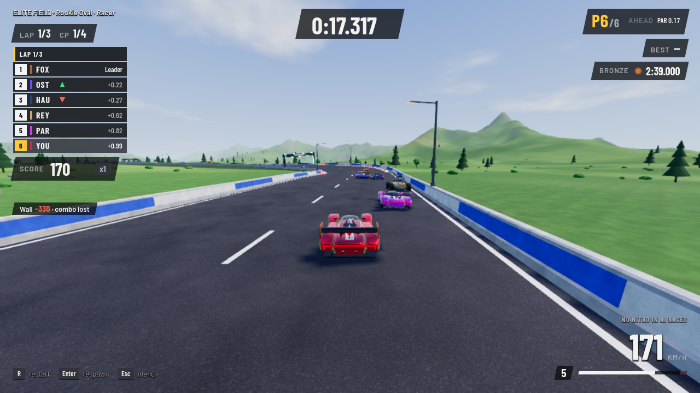 | 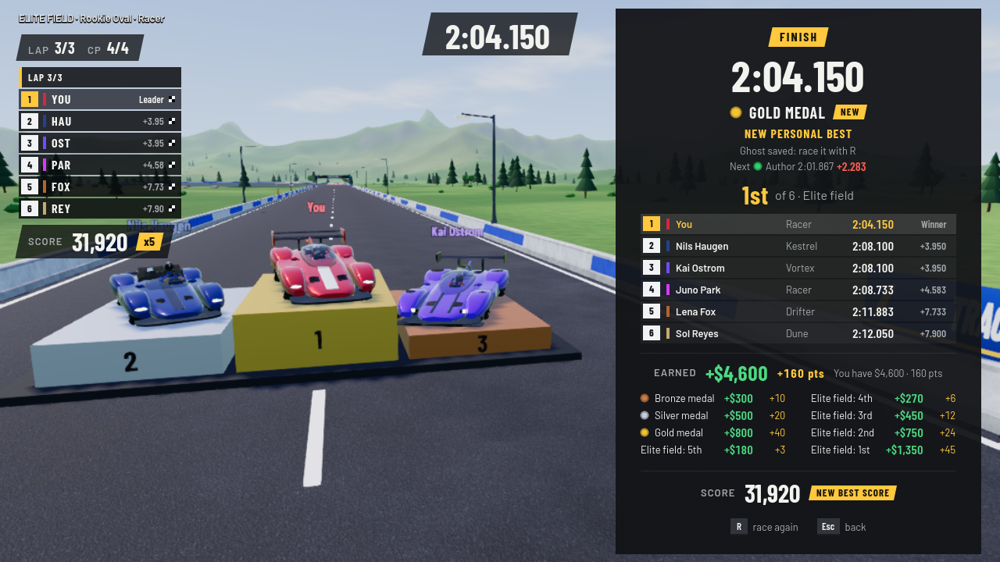 |

**The car shop.** Pick a locked car and press Drive (BUY): it asks first, then the car is yours for good.

| Car | Racer | Kestrel | Drifter | Dune | Thunder | Vortex |
| --- | --- | --- | --- | --- | --- | --- |
| Price | owned | $10,000 | $14,000 | $18,000 | $22,000 | $30,000 |

A player who wins gold and beats the Expert on every track with the Racer has $8,400 after two tracks and
$13,200 after three (a second car), and $102,000 after all 15, enough for all five cars ($94,000). Silver and the Pro
everywhere buy the Kestrel after five tracks.

### Championships

(Version 6.14.0.) Press **Cups** (next to the **3 Drive** heading) or **T** on the menu. A championship is three
races back to back against the same five AI drivers, with the car you picked: the standings after each race set the
next grid, and the final standings give trophies and a big payout.

| | Cup | Tracks | Opens with track |
| --- | --- | --- | --- |
| 1 | **Rookie Cup** | Rookie Oval, Hairpin Valley, Ramp Rally | 03 |
| 2 | **Asphalt Cup** | Night Highway, Banked Speedway, Coastal GP | 10 |
| 3 | **Technical Cup** | Lighthouse Bay, Technical Trial, Seaside Stunts | 12 |
| 4 | **Dirt and Snow Cup** | Forest Rally, Mountain Pass, Canyon Run | 13 |
| 5 | **Grand Finale** | Northern Lights, Grand Marathon, Summit Rush | 15 |

Together they cover all 15 tracks, each cup harder than the one before. A cup opens when all three of its tracks are
open (a locked cup can be picked: it says which tracks are still locked). Pick a cup with ↑ / ↓ and the field's level
(**Rookie** to **Elite**) with ← / →, and press **START CUP** (Enter).

- **The races.** Each race is a [field race](#race-the-field) on the cup's next track with its usual pay (medals,
  records, your ghost and opening tracks count as in Drive), plus points for the championship: **10, 8, 6, 5, 4, 3**
  for 1st to 6th (none for a car out of the race). The finish panel says what the race scored; **Enter** shows the
  standings. The cup's five drivers are picked by the cup and level and stay the same in every race.
- **The standings** come between the races, over the menu (with the next track picked behind them): each driver's
  place in every race run so far and their points, the leader first. Equal points go to the better best place, then
  to the better place in the latest race. **RACE 2** (Enter) starts the next one, **Quit cup** (Q) ends the cup
  (it asks first; the cup pays nothing, the races you ran keep their pay), **Esc** closes them and keeps the cup.
- **The grid** follows the standings: the leader on pole, the last last. Race 1 starts as a field race (you last);
  later you start where the standings put you, still on the usual start spot (so the race stays as long as in Drive),
  with the cars behind you in the standings lined up behind you.
- **In a race** R restarts it before the finish; **Esc** goes back to the standings without counting it (race it
  again). After your finish the cars still racing keep the order they had when you leave.
- **The end.** After the last race, Enter: the **trophy moment**: the top three of the final standings on the podium
  with gold, silver and bronze trophies and their points, the final standings and the cup's pay. Enter goes back to
  the menu, whose cabinet shows your trophy.
- **Saved as you go.** A cup in progress is kept in the save file after every race: close the game and the Cups button
  opens its standings again.

**The cup's pay** by your final place, on top of the three races' pay (the Rookie Cup at Pro; the levels pay 0.6 ×,
1 ×, 1.5 ×, 2.1 × and 3 × as for field races, and each later cup a quarter more: an Elite win in the Grand Finale pays
$25,200 and 660 points):

| Final place | 4th | 3rd | 2nd | 1st | 5th, 6th |
| --- | --- | --- | --- | --- | --- |
| Money (in all) | $450 | $1,500 | $3,300 | $6,300 | nothing |
| Points (in all) | 8 | 31 | 76 | 166 | |

As for medals and field places, each place is paid once per cup and level (whatever car), and a better place later
pays only the difference (a 3rd, then a win, pays $1,500, then $4,800).

**The trophy cabinet.** The Cups button shows a trophy per cup in the colour of your best place at the highest level
you have a trophy at, with five pips under it for Rookie to Elite; its tooltip and the cup picker spell it out (a gold,
silver or bronze trophy per level). `reset career` keeps the trophies (it makes the cup payouts pay again and drops a
cup in progress).

| The cup picker (the cabinet per cup and level) | The standings between the races |
| --- | --- |
| 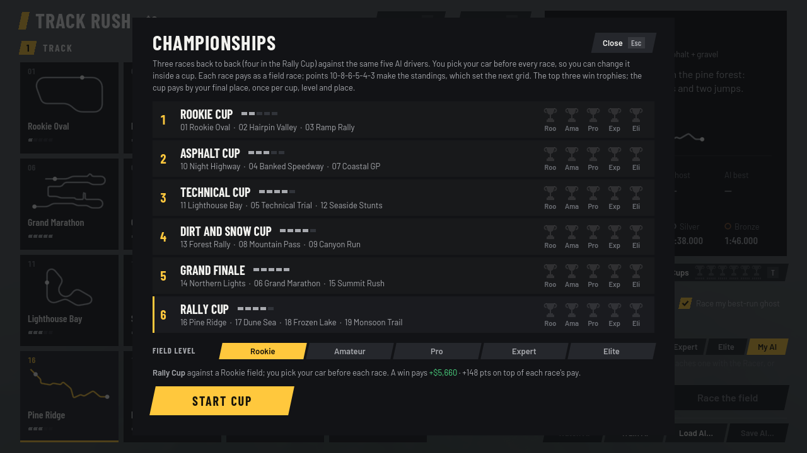 | 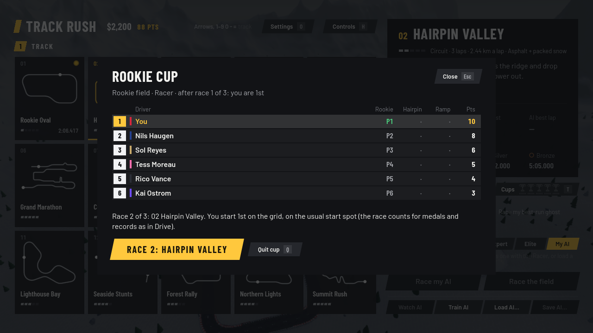 |

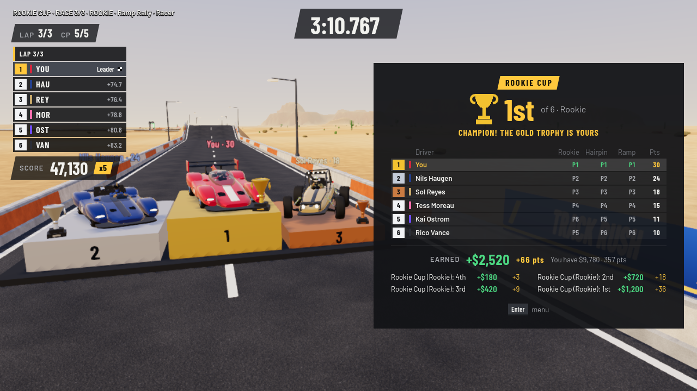

### Upgrades

Money also buys **upgrades** for the cars you own: four parts per car, three levels each, bought one level at a time
and in order. They are on the car picker: the picked car shows a row of four chips under the cards, each with the
part's name, a pip per level (green: bought) and the next level's price (yellow when you can afford it, grey when not,
MAX when all three are bought). Click a chip (or highlight it with the gamepad: down from the car, then A) to buy the
next level: it asks first and says what the level does and what is left. A car you don't own shows its parts greyed
out: buy the car first. The car's stat bars then show the stock car in white (yellow when picked) and what the
upgrades add in green; its top speed turns green when it is higher. The `upgrade` and `buy <car> <part>` commands of
[the terminal](#the-terminal) do the same.

| Part | What a level does | Everything at level 3, the Racer (stock → upgraded) |
| --- | --- | --- |
| **Engine** | +5 % power: about 4-8 % quicker to 200 km/h and 1-2 % more top speed per level | 0-200 km/h 9.78 → 8.33 s, top speed 277.7 → 289.5 km/h |
| **Tyres** | +4 % grip on asphalt: about 3-5 % more cornering grip per level, slightly shorter stops (the grip on dirt and snow is the loose grip part's) | 1.68 / 1.58 g → 1.89 / 1.73 g on the 30 m / 120 m circles, 100-0 km/h 30.7 → 30.3 m |
| **Nitro** | +10 % on the tank's length and +10 % refill from points per level | 5.0 → 6.5 s of nitro, 145 → 223 m covered on one tank |
| **Loose grip** | +5 % grip on dirt and snow per level, never above the car's grip on asphalt | about +15 % on dirt and snow (1.15 → 1.32 g on dirt); the Dune, which already keeps 97 % of its grip on dirt, gains 2 % there and 15 % on snow |

The numbers are measured with the game's own physics (`tools/upgrades.gd`, see [Tests and tools](#tests-and-tools)).
Everything at level 3 takes 4-8 % off a race for every car on Rookie Oval, Technical Trial, Ramp Rally and Hairpin
Valley (the medal autopilot's best of 10 settings; the Racer on Rookie Oval 2:11.4 → 2:03.1, on Ramp Rally 3:09.2 →
2:53.9). One part at level 3: the tyres 3-5 % on asphalt tracks, the engine 1-2 %, loose grip 1-4 % on dirt and
snow tracks, the nitro under 1 %. Each car keeps its character: no car spins or bounces
more when fully upgraded (tested on jumps, braking in a curve on asphalt, dirt and snow, and holding a lane with the
keyboard). Every part works on every car by the same share, so with the same upgrades the Kestrel is still
the nimble one, the Thunder the brute and the Dune the dirt specialist.

| Car | Engine (levels 1 / 2 / 3) | Tyres | Nitro | Loose grip | Every level |
| --- | --- | --- | --- | --- | --- |
| Racer | $1,500 / $3,000 / $5,250 | $1,200 / $2,400 / $4,200 | $700 / $1,450 / $2,500 | $900 / $1,800 / $3,150 | $28,050 |
| Kestrel | $1,250 / $2,500 / $4,400 | $1,000 / $2,000 / $3,500 | $600 / $1,200 / $2,100 | $750 / $1,500 / $2,650 | $23,450 |
| Thunder | $2,750 / $5,500 / $9,600 | $2,200 / $4,400 / $7,700 | $1,300 / $2,650 / $4,600 | $1,650 / $3,300 / $5,750 | $51,400 |
| Drifter | $1,750 / $3,500 / $6,150 | $1,400 / $2,800 / $4,900 | $850 / $1,700 / $2,950 | $1,050 / $2,100 / $3,700 | $32,850 |
| Dune | $2,250 / $4,500 / $7,900 | $1,800 / $3,600 / $6,300 | $1,100 / $2,150 / $3,800 | $1,350 / $2,700 / $4,750 | $42,200 |
| Vortex | $3,750 / $7,500 / $13,150 | $3,000 / $6,000 / $10,500 | $1,800 / $3,600 / $6,300 | $2,250 / $4,500 / $7,900 | $70,250 |

Prices follow the car's price (the Racer counts as a $12,000 car) and rise with every level. Every part of every car
costs $248,200 in all, against $94,000 for the five cars: a player who wins gold and beats the Expert on every track
earns $102,000 per car driven, so the cars and all their upgrades take about three and a half such careers.

- **Medal times and AI opponents stay stock.** The medal times were set by the stock cars and the AI opponents always
  drive stock cars, so an upgraded car makes medals and wins easier. Each reward is still paid only once.
- **Where they count:** Drive, Race the AI and, with your own network (My AI), Watch the AI, Race my AI and the
  training screen all use the car with its upgrades. The AI opponents never do.
- **Records and ghosts** remember the levels of the run (they are kept in the save file with it); a ghost replays the
  run exactly whatever the car has now, since it stores where the car was. Older records and ghosts count as stock.
- **reset career** (in the terminal) makes every car stock again.
- **On the car:** a bigger, polished exhaust tip per engine level, a yellow ring on every tyre that widens with the tyre
  level, a blue band round the tail pipes per nitro level and mud flaps behind the rear wheels with loose grip (not on
  the Drifter, which has its own, nor on the open-wheeled Dune).

| The car picker, every part of the Racer bought | On the car |
| --- | --- |
| 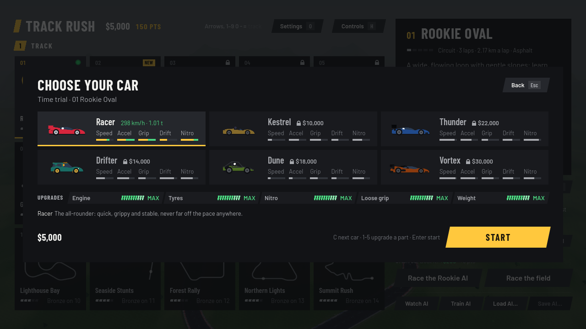 | 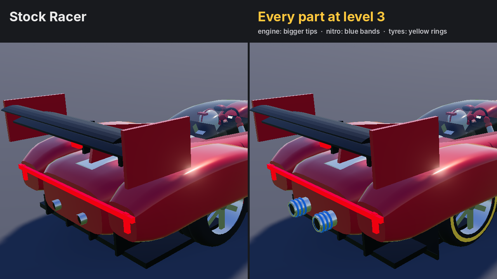 |

### Your ghost

When you set a personal best, the run is saved as the **ghost** of that track and car: from the next restart a
see-through light-blue car (the same model as yours, with flames where you used nitro) drives your best run
alongside you, so you can see where you gain or lose time. It is only drawn: you can drive through it, and it
never affects your race. It fades out while it is right on top of your car (every race starts that way) and
disappears once it has finished. **G** (or **Y** on a gamepad) shows or hides it during a race, and the
**Race my best-run ghost** option (on the menu and in Settings) sets the same choice; it is remembered. The menu's
track panel says "Ghost: Saved" when the picked car has one saved. Runs in **Race the AI ghost** count too (that
race shows the AI; your own ghost appears in Drive).

A ghost stores the car's position, angles, wheel speed and nitro 30 times a second (plus the moments of landings,
wall hits and respawns) and replays within a few centimetres of the original run. It stores where the car was, not
which keys were pressed, so it can't drift off when replayed. Best times and ghosts only count for the physics
version they were set with.

### How the cars drive

The Racer is a 1,250 kg, all-wheel-drive sports car: 0-100 km/h in about 2.7 s, a top speed of about 277 km/h,
and around 1.6-1.7 g of cornering grip. The other cars use the same physics with their own weight, engine,
gearing, tyres, downforce, brakes and steering. In plain words, the physics (`sim/car.gd`, the cars in
`sim/cars.gd`) works like this:

- **Tyres** grip more as they start to slide sideways, peak at about 8° of slip, then lose a little grip.
  Braking or accelerating uses up some of that grip, so you can't brake flat out and turn at full grip at the same time.
- **Weight moves** when you brake (onto the front tyres) or accelerate (onto the rear), and downforce
  presses the car onto the road more the faster it goes.
- **Gearbox**: automatic, 6 speeds, with an engine that has a real torque curve and a rev limiter. The HUD shows gear and revs.
- **Steering** has a speed-sensitive lock, so a keyboard can't overdrive the front tyres at high speed,
  and a stability control (like a road car's ESC) stops quick left-right key presses from building
  up a fishtail. Stability control switches off while you use the handbrake, so you can still drift.
- **Hills and banking** matter: banked corners push the car into the turn and add grip, and the car
  stays planted over crests unless the road really drops away (kicker ramps).
- **Jumps**: in the air the car keeps the rotation it took off with; steering only nudges it a little.
  Landings don't bounce.
- **Walls** cost time, so the racing line matters: a hit takes away the speed going into the wall and
  also speed along it, far more for a hard hit than for a graze. A 5° touch at 150 km/h costs about
  15-20 km/h, a 15° hit at 200 km/h about half the speed, and a 30° hit at 180 km/h (or anything
  steeper) stops the car. Rubbing along a wall slows the car further: grinding along a barrier at full
  throttle settles at about 90 km/h. Walls don't bounce you back across the road, and the car lines up
  with the wall as it slides. Pinned nose-first against a wall, full throttle with the wheels turned away
  slides it off within about 2 s; at part throttle a steep nose-in needs reversing (or Enter). Hits throw
  sparks and give the camera a short shake. Every car has the same size for collisions and the same walls.

The physics runs at a fixed 60 steps per second everywhere (the screen draws the cars in between steps), so
it doesn't depend on the frame rate, and an AI trained at Max speed drives exactly the same when you watch it.

### Road surfaces

Most of the road is asphalt. Since version 6.3.0 four tracks also have stretches of **dirt** and **packed snow**, and
the three tracks of version 6.4.0 are mostly dirt or snow.
You see them coming: a brown gravel road or a white one of packed snow, no painted lines or kerbs, and muddy or
snow-crusted barriers alongside. You also feel them:

| The Dune throwing up dust on Ramp Rally's dirt | The Racer sliding on Hairpin Valley's packed snow |
| --- | --- |
| 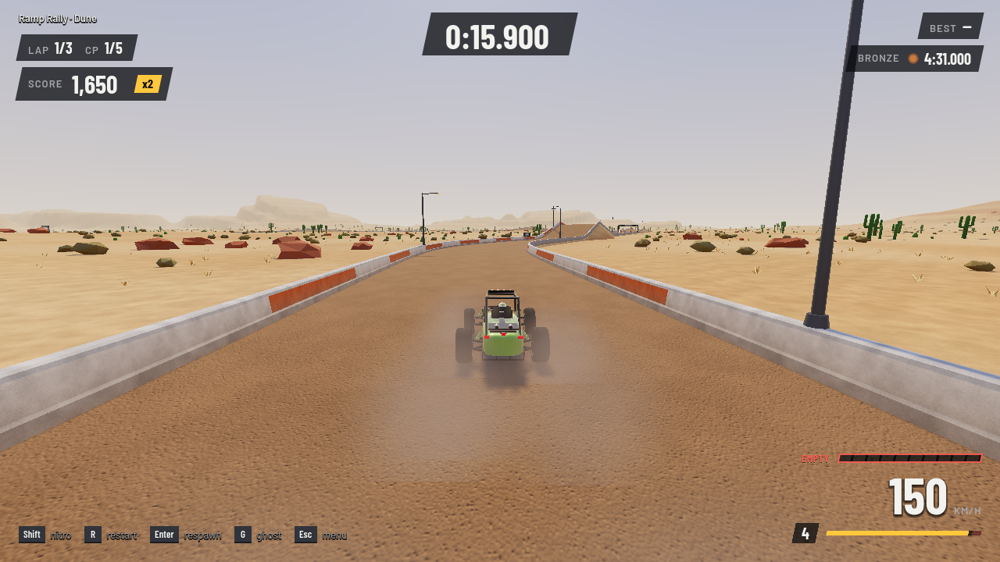 | 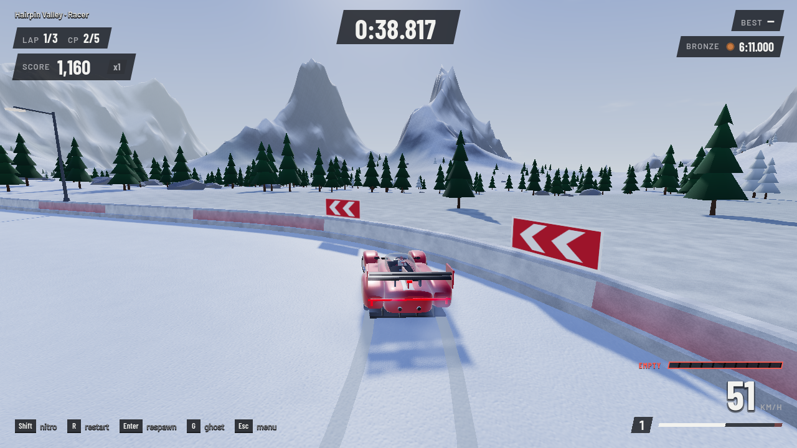 |

| Surface | Grip | Rolling resistance | Slides | Where |
| --- | --- | --- | --- | --- |
| Asphalt | all of it | normal | as before | every track |
| Dirt | 55-97 % of the car's tarmac grip, depending on the car | 3 × asphalt | start sooner and are easier to hold | Forest Rally (88 % of a lap), Ramp Rally (47 %), Summit Rush (30 %), Canyon Run (14 %), Mountain Pass (11 %) |
| Packed snow | 42-72 % | 2.2 × asphalt | as on dirt, on even less grip | Northern Lights (79 %), Hairpin Valley (27 %), Summit Rush (21 %), Mountain Pass (19 %) |

Since version 6.10.0 the brakes do more on loose ground (dirt × 1.24, snow × 1.28) with a gentler anti-lock limit, and
the barriers along it are slidier (wall friction × 0.55 on dirt, × 0.45 on snow).

How the physics handles it (`sim/surfaces.gd` holds the table, `sim/car.gd` uses it):

- Each car keeps **its own share of its grip** on each surface, for cornering, braking and traction alike. The Dune's
  big tyres lose almost nothing on dirt; the Vortex's slick hypercar tyres lose the most.
- On loose ground the tyres build up their force more slowly as they start to slide, so **slides start sooner and
  last longer**, and the stability control can only do 60 % of its work. Drifts score points as usual.
- **Rolling resistance** is higher, so the top speed and the acceleration drop a little.
- The front and rear tyres each feel the road under them, and the change from one surface to the next is **blended
  over about 10 m**: the grip never jumps, and on the way onto dirt the front tyres lose grip a moment before the rear.
- **Brakes on loose ground (version 6.10.0).** Braking used to lock up and run wide there: in a curve most cars spun
  when braking hard on snow. Now the brakes press harder (× 1.24 on dirt, × 1.28 on snow) while an anti-lock limit
  keeps the tyres just short of locking (90 % of their grip instead of 97 %), and a braked front tyre keeps more of
  its cornering grip (a friction ellipse instead of a circle). Every car stops 12-14 % shorter from 100 km/h on dirt
  and 15 % shorter on snow, and braking flat out in a 120 m curve from 0.45 g leaves at most 2.5° of sideslip. The
  cars keep their order: the Dune stops shortest on snow and, with the Kestrel, on dirt; the Thunder and Vortex
  longest. On dirt the Racer, Kestrel, Drifter and Dune now stop about as short as on asphalt (the dirt's rolling drag
  helps the brakes); snow is still longer for every car but the Dune.
- **Walls along loose ground (version 6.10.0)** are slidier: the friction of a wall hit and of rubbing along it is ×
  0.55 on dirt and × 0.45 on snow (the speed going into the wall still goes). Scraping a wall at 108 km/h for 2 s, the
  Racer loses 11.3 m/s on asphalt, 7.1 on dirt and 5.4 on snow. Walls still cost time: the medal autopilot's lap beats
  never braking (riding the walls) on every dirt and snow track with the Racer (see Known limits in `HANDOFF.md` for
  the Vortex and Thunder on Northern Lights).

What that does to each car (measured with `tools/car_stats.gd --surface=dirt` and `--surface=snow`):

| Car | Grip kept on dirt / snow | 100-0 km/h: asphalt / dirt / snow | Cornering grip on a 30 m circle: asphalt / dirt / snow | Top speed: dirt / snow (asphalt) | Drift held on dirt / snow |
| --- | --- | --- | --- | --- | --- |
| Racer | 70 % / 55 % | 30.7 / 29.8 / 36.6 m (6.9.0: 34.0 / 43.0) | 1.68 / 1.15 / 0.91 g | 266.7 / 271.1 km/h (277.7) | 1.08 / 1.47 s |
| Kestrel | 72 % / 58 % | 27.7 / 27.3 / 32.8 m (31.2 / 38.5) | 1.78 / 1.26 / 1.02 g | 225.9 / 227.6 km/h (230.2) | 0.93 / 1.13 s |
| Thunder | 62 % / 48 % | 33.8 / 37.7 / 47.1 m (43.0 / 55.2) | 1.47 / 0.90 / 0.68 g | 294.0 / 301.3 km/h (312.7) | 2.42 / 0.90 s |
| Drifter | 74 % / 60 % | 33.1 / 30.0 / 34.5 m (34.8 / 40.5) | 1.59 / 1.15 / 0.93 g | 256.7 / 259.7 km/h (264.3) | 2.95 / 4.00 s |
| Dune | 97 % / 72 % | 31.7 / 27.4 / 28.7 m (31.2 / 33.8) | 1.71 / 1.63 / 1.21 g | 217.6 / 219.5 km/h (222.4) | 0.58 / 0.63 s |
| Vortex | 55 % / 42 % | 28.8 / 37.2 / 47.1 m (42.4 / 55.2) | 1.68 / 0.89 / 0.67 g | 315.8 / 320.3 km/h (321.4) | 3.10 / 3.35 s |

Why these tracks:

- **Ramp Rally** (desert) is a rally stage now: from the first jump's run-out to the third jump, the S-bend, the dune
  and the banked left are dirt, and the big 7 m jump takes off from it.
- **Canyon Run**: the double-left turnaround between the two canyons is a gravel track, a place to slide the car
  round instead of braking to a crawl.
- **Mountain Pass** (alpine): the fast valley sweepers at the start are a dirt road, and the summit ridge is packed
  snow; the asphalt comes back 60 m before the first hairpin down, so you brake for it on tarmac.
- **Hairpin Valley** (alpine): packed snow from the third switchback up and over the ridge, the highest and coldest part.

The three tracks of version 6.4.0 were made for the surfaces: see [Tracks](#tracks). The other eight tracks are all
asphalt and unchanged. On loose ground the tyres throw up **dust** on dirt and **snow spray** (blue-grey, so it shows
on the white road) on snow (more when you slide; fewer particles at Medium and Low graphics; the AI opponent you race
throws them up too), leave **tyre tracks in the colour of the surface** (faint ones even without sliding). The
menu's track panel names a track's surfaces ("Circuit · 3 laps · 2.37 km a lap · Asphalt + dirt").

**How they look (version 6.10.0).**

- **Mud and snow on the screen.** On dirt, splats of mud hit the screen (some run down in a drip) and a film of dried
  mud and specks creeps in from the corners and the bottom; on snow, flecks of snow land and melt into clear drops and
  frost grows in from the corners; a few clods or flakes fly past close to the camera. It builds up with speed, with
  sliding and when you follow the AI car close behind on loose ground, and on asphalt it slides off and fades within
  about two seconds. It always stays out of an oval around the middle of the screen, so the road ahead stays clear;
  there are fewer splats at lower graphics quality, and **Screen dirt and snow** in [Settings](#settings) turns it off.
  (It replaces version 6.3's camera rumble on loose ground; hitting or scraping a wall still shakes the camera.)
- **The roads.** Dirt has two worn wheel ruts in each lane (darker and packed, fewer stones), damp patches, small dark
  puddles in the ruts, pebbles and cracks, and a colour that drifts over 50-200 m; snow has packed grey tyre tracks in
  the lanes, loose white powder at the sides, glints that twinkle as you move, glossy blue-grey ice in places and
  bluish shade in the hollows. The detail is mixed from two samples at different scales and angles, so no tile repeats
  at driving height.
- **Where the surface changes** the road is no longer cut by a straight line: the dirt reaches onto the asphalt in big
  ragged patches and tongues carried along the wheel tracks, snow drifts in from the edges, scattered clumps lie a
  little before and after, and the tarmac next to it is dusty or frosted. The look spreads over about ±20 m while the
  grip still changes over about 10 m, and the middle of the look's change follows the grip's, so what you see and what
  you feel agree.
- **The barriers** along dirt are darker low down with smears and drops of mud, wet mud at the foot and grime
  streaks running down; along snow they have a crust of snow on top, snow piled at the foot, rime and flecks of snow
  low down and a glossy glaze of ice in places. It fades in and out with the surface.

| Mud on the screen on Ramp Rally | Snow and frost on Hairpin Valley |
| --- | --- |
| 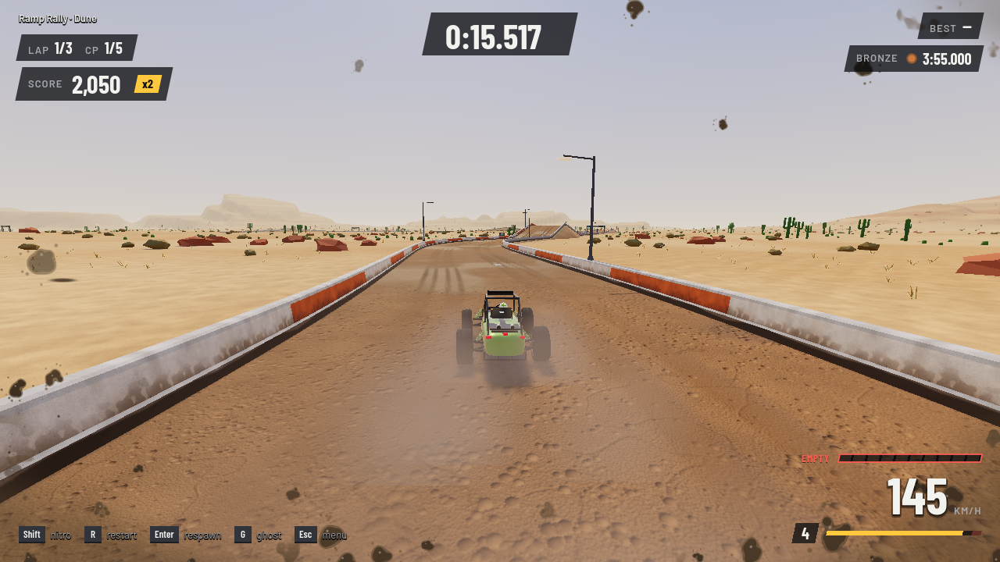 | 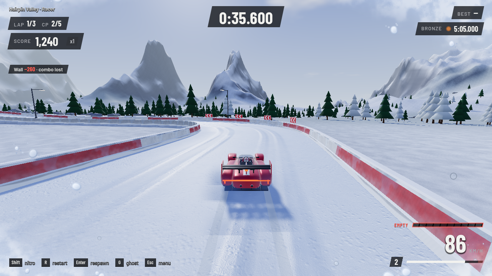 |

| The change onto dirt, version 6.9.0 | The same spot in version 6.10.0 |
| --- | --- |
| 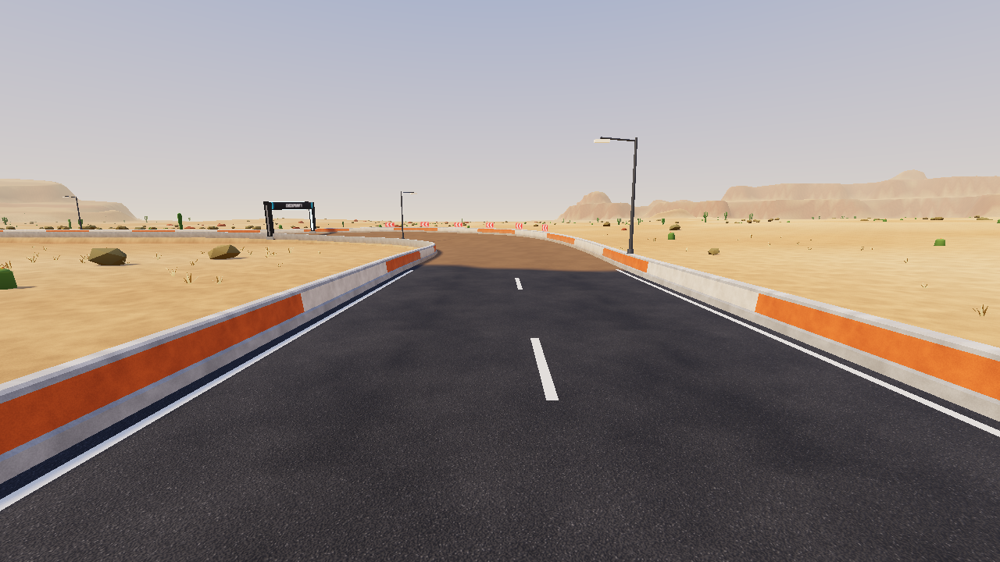 | 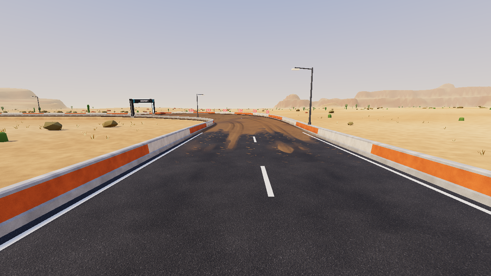 |

The four tracks are **new versions** of themselves: best times, best scores and ghosts set on them before 6.3.0 no
longer count (the menu shows none and the medals are new), and so do the AI's best laps there. They are not deleted:
the save file keeps them under `"archive"` (see [Saved data](#saved-data)). The new author times compared with the
old all-asphalt ones:

| Track | Racer | Kestrel | Thunder | Drifter | Dune | Vortex |
| --- | --- | --- | --- | --- | --- | --- |
| Hairpin Valley (snow) | +20.65 s | +18.22 s | +30.07 s | +19.95 s | +11.10 s | +36.55 s |
| Ramp Rally (dirt) | +13.22 s | +9.32 s | +19.40 s | +11.90 s | +1.77 s | +28.95 s |
| Mountain Pass (dirt and snow) | +5.58 s | +4.08 s | +7.37 s | +4.77 s | +1.60 s | +8.80 s |
| Canyon Run (dirt) | +8.62 s | +7.95 s | +6.65 s | +9.25 s | +0.77 s | +14.23 s |

**Version 6.10.0** changed the brakes and walls on loose ground, so the medal times of the seven dirt and snow tracks
were worked out again (`tools/medals.gd --update`; the eight asphalt tracks keep theirs to the millisecond) and their
AI opponents recalibrated. Best times, scores and ghosts set before stay (a record set under the old brakes may be a
little easier or harder to beat now), and so do tracks opened and rewards paid. The author times, against 6.9.0:

| Track | Racer | Kestrel | Thunder | Drifter | Dune | Vortex |
| --- | --- | --- | --- | --- | --- | --- |
| Hairpin Valley | -3.68 s | -4.10 s | -3.27 s | -4.33 s | -1.82 s | -3.73 s |
| Ramp Rally | -1.48 s | -1.57 s | -2.57 s | -2.17 s | +0.03 s | -3.87 s |
| Mountain Pass | -0.70 s | -0.12 s | -1.27 s | -0.50 s | -0.05 s | -0.98 s |
| Canyon Run | -0.42 s | -0.95 s | -1.52 s | -0.15 s | +1.78 s | -0.93 s |
| Forest Rally | -3.45 s | -2.33 s | -7.73 s | -1.35 s | +2.00 s | -8.28 s |
| Northern Lights | -2.53 s | -1.35 s | -6.22 s | -0.53 s | -0.25 s | -9.32 s |
| Summit Rush | -1.88 s | -1.57 s | -2.85 s | -2.62 s | +0.67 s | -3.80 s |

(Mostly faster: braking later and sliding along walls saves time. The Dune, which already braked best on loose
ground, gains little, and its fastest autopilot run came out up to 2 s slower on four tracks.)

### Tracks

| # | Track | Type | Length | Scenery | Surface | Difficulty | What it asks of you |
| --- | --- | --- | --- | --- | --- | --- | --- |
| 1 | Rookie Oval | 3 laps | 2.17 km/lap | meadow | asphalt | ★ | Learn the car, carry speed through sweepers |
| 2 | Hairpin Valley | 3 laps | 2.44 km/lap | alpine | asphalt, packed snow over the ridge | ★★ | Five switchbacks over a ridge: brake early, power out |
| 3 | Ramp Rally | 3 laps | 2.37 km/lap | desert | asphalt, dirt from the first jump to the third | ★★★ | Four kicker jumps of 4-7 m: hit each ramp straight |
| 4 | Banked Speedway | 3 laps | 2.84 km/lap | dusk | asphalt | ★★★ | Steep banked bowls (24-28°): trust the banking |
| 5 | Technical Trial | 3 laps | 2.70 km/lap | canyon | asphalt | ★★★★ | A 10 m chicane, a jump, banked sweepers and a switchback climb |
| 6 | Grand Marathon | Sprint | 7.20 km | meadow | asphalt | ★★★★★ | Everything from 1-5 in one long point-to-point run |
| 7 | Coastal GP | 3 laps | 2.90 km/lap | dusk | asphalt | ★★★ | Fast grand-prix circuit: big braking zones, quick esses |
| 8 | Mountain Pass | Sprint | 4.64 km | alpine | asphalt, a dirt valley road, packed snow on the summit | ★★★★ | Banked switchbacks up to the summit and a twisting descent |
| 9 | Canyon Run | 3 laps | 2.90 km/lap | canyon | asphalt, a dirt turnaround at the far end | ★★★★★ | Narrow road, jumps, blind crests and tight S-bends |
| 10 | Night Highway | 3 laps | 3.12 km/lap | night | asphalt | ★★ | Kilometre-long straights and slow corners under the lights: brake hard, then fire the nitro |
| 11 | Lighthouse Bay | 3 laps | 2.35 km/lap | seaside | asphalt | ★★★ | Long sweeping bends round a bay, past a lighthouse: hold the drift |
| 12 | Seaside Stunts | Sprint | 3.02 km | seaside | asphalt | ★★★★ | Six kickers down the coast road, with step-downs and a 7.5 m launch |
| 13 | Forest Rally | 3 laps | 2.54 km/lap | autumn | dirt, but for the start and finish straight | ★★★ | A rally stage through autumn woods: flowing bends to slide through, crests and two jumps |
| 14 | Northern Lights | 3 laps | 2.83 km/lap | arctic | packed snow, two asphalt stretches | ★★★★ | Banked snow bowls (20-24°), a jump and long slides at night under the aurora: smooth hands win |
| 15 | Summit Rush | Sprint | 4.38 km | highland | asphalt, a dirt forest climb, packed snow on the summit, dirt again on the way down | ★★★★★ | The finale: two jumps, sweeping switchbacks up to 18 m, the snow, and a flying descent |

#### The reworked corners (version 6.6.0)

Version 6.6.0 opened up the corners that caught cars out the most on five tracks. Every hairpin (a turn of about
180°) is now at least 24 m round, the road through it 2-3 m wider, and the straights next to each corner were
shortened by as much as the corner grew, so each track keeps its shape, its start and its dirt and snow where they
were. Radius and road width, before and after:

| Track | What changed | Length |
| --- | --- | --- |
| Hairpin Valley | the six switchback corners 16 → 22 m and the two hairpins down 17 → 24 m, on a 15 m road (was 13); the snowy left at the end of the ridge keeps its 40 m but is 15 m wide and banked 12° (it was flat) | 2.42 → 2.44 km/lap |
| Technical Trial | the two hairpins of the switchback climb 15 → 24 m, on a 16 m road (14); the 10 m chicane stays | 2.59 → 2.70 km/lap |
| Grand Marathon | the hairpin of the switchback climb 16 → 24 m and the corners either side of it 20 → 24 m, on a 17 m road (15) | 7.18 → 7.20 km |
| Mountain Pass | the six banked hairpins 18 → 24 m going up and 19 → 25 m coming down, on a 15 m road (13) | 4.50 → 4.64 km |
| Canyon Run | the hairpin of the far tongue 13 → 24 m and the rights either side 20 → 26 m, on a 13 m road (10); the gravel turnaround's two lefts 22 → 28 m on a 12 m road (10); the narrow canyons stay narrow | 2.85 → 2.90 km/lap |

How much it helps, measured with the medal autopilot (`tools/corners.gd`, all 50 settings of the medal sweep with
each of the six cars): it touches a wall on these five tracks 6-41 % less per lap (Hairpin Valley 140 → 82 steps of
wall contact a lap, Technical Trial 104 → 92, Grand Marathon 147 → 138, Mountain Pass 148 → 133, Canyon Run 159 →
139), and it is 10-17 km/h faster through the hairpins at their slowest point (Technical Trial's hairpins 14 → 27
km/h, Canyon Run's 13 → 30, Mountain Pass's 49-51 → 60-63). The new author times are 10.7 s faster to 5.2 s slower
than the old ones, depending on the track and car (the tracks got 18-142 m longer).

| Technical Trial's first hairpin in 6.5.0 (15 m) | The same hairpin in 6.6.0 (24 m), from the same camera |
| --- | --- |
| 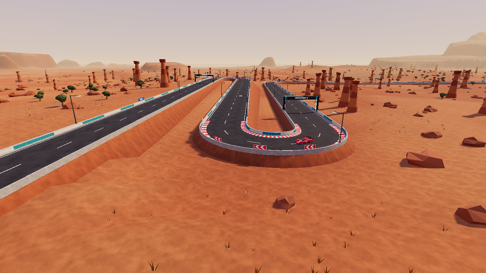 | 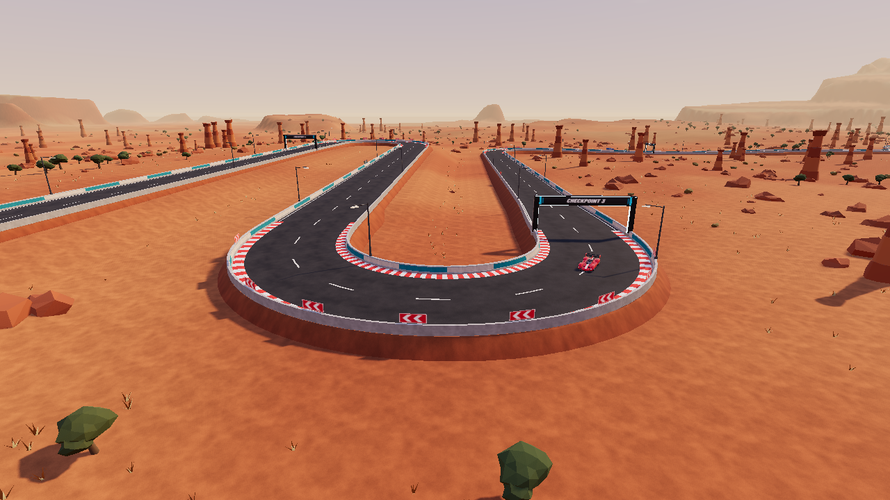 |

These five tracks are **new versions**: best times, best scores and ghosts set on them before 6.6.0 no longer count
(the menu shows none, and the medal times and AI opponents are new). They are not deleted: the save file keeps them
under `"archive"` (see [Saved data](#saved-data)). Money and points already paid for medals and AI wins on them stay
paid and are not paid a second time: a track pays each medal and each AI level once per car, whatever its version.

Tracks 13-15 (version 6.4.0) come after the twelve of the browser version, harder from one to the next, and each
has a scenery of its own: **autumn** (a golden afternoon in mixed woods that grow close to the road: orange oaks, red
maples, birches and pines), **arctic** (a polar night with the northern lights rippling over the sky, snowy pines,
moonlight, lit barriers and headlights) and **highland** (bright and cold: larch and pine forest below, and above it
snow on the ground beside the snowy road, where the trees carry snow too).

| Forest Rally | Northern Lights | Summit Rush |
| --- | --- | --- |
| 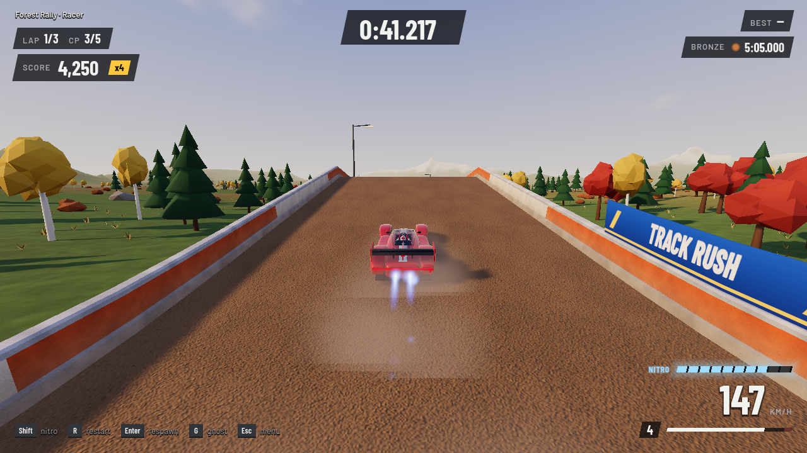 | 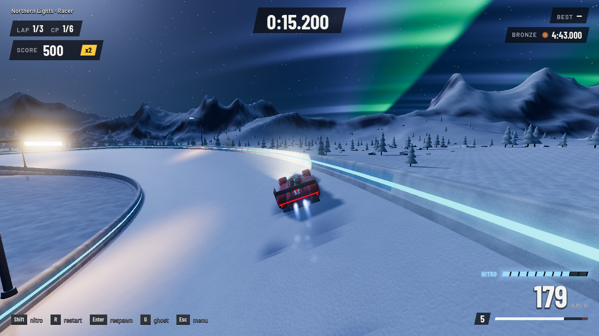 | 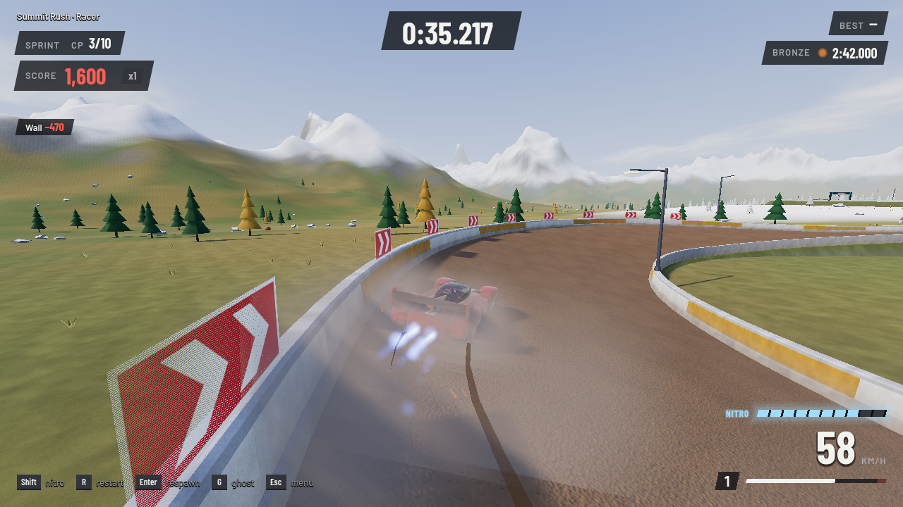 |

Roads vary in width (10 to 22 m) and height (up to about 18 m of climb). A map of the first twelve tracks is in
[web/docs/tracks-overview.svg](web/docs/tracks-overview.svg) (their layouts are the browser version's, except the
corners reworked in 6.6.0; the browser version has no dirt or snow, and not tracks 13-15).

## Training the AI

1. On the menu, click **Train the AI**.
2. Pick the settings, then **START TRAINING**:
   - **Car**: the car the AI learns to drive. The car picked on the menu is preselected; click another tile to
     train that one. The small "gen N" on a tile means that car already has a trained network.
   - **Population size**: cars per generation (default 80). More cars learn faster per generation but each generation takes longer.
   - **Mutation rate**: chance that each weight is nudged when breeding (default 0.1).
   - **Hidden layer size(s)**: neurons in the hidden layer, e.g. `12`, or `16,8` for two hidden layers.
   - **Laps per circuit**: laps driven per training run (1 is fastest; the network can still race 3 laps).
   - **Walls**: **Ride them** (default) lets a car that hits a wall keep driving (it just loses the speed the
     wall costs), so the AI can learn to use a wall where that is quicker than braking. **Crash out** takes a car
     out of the run the moment it touches a wall, so it learns clean racing lines instead.
   - **Train on**: one or more tracks (the menu's track is ticked). With several, every car drives each track in
     turn and its fitness is averaged, which gives a driver that generalises better.
   - **Continue from saved network**: keep training the car's network instead of starting from random drivers.
3. Use the speed buttons: **1×** (real time), **Fast ×6** (six physics steps per drawn frame), or **Max**, which
   stops drawing the 3D view and simulates as fast as your computer allows. Max runs on a background thread with
   the native trainer (FleetSim, a small C++ library in `bin/` that steps the whole population on several CPU
   cores), so the screen stays smooth; the dashboard, the chart, the autosave and **Save best network** keep
   working. With 80 cars Max ran about 120-150 times faster than real time in the game on a 4-core test PC
   (Linux, nothing else running; the browser version managed 30-40×). If the native library is missing or
   doesn't load, training runs in GDScript instead, at only about real time with 80 cars, and the screen says so.
   **Pause**, another speed, **Watch best** or **Race best** take the session back from the thread exactly where it was.

**Nitro** (version 6.15.0). The AI has a nitro button and sees how full its tank is, and it learns when to fire it
like everything else: a network that burns it where it gains time finishes faster and scores better. Its tank
refills by the same rule as yours, from the points a clean run would bank: 500 × the combo (x1 to x5) for each
clean checkpoint and 2,000 for a clean lap, 16,000 to a full tank (× the nitro upgrade's refill); a wall contact
spoils the checkpoint and the lap as it does for you (drifts and jumps refill nothing for the AI, and it scores no
points). Training, Watch the AI and the AI's best lap on the training screen all use nitro; races against the AI
don't (see [Nitro](#nitro)). New networks start with the nitro output switched off (its weights at zero) and evolve
it from there, so a population of random drivers doesn't burn nitro into the walls.
Measured with 80 cars, seed 1 and 150 generations at Max: on Rookie Oval the AI learned to fire nitro coming out of
the corners onto the straights (in a 3-lap race 13 burns, 9 % of the race, 86 % of it with a straight road ahead,
using its whole tank and the 1.2 tanks its clean checkpoints refilled); its race takes 2:02.817 with nitro and
2:04.533 with an empty tank. On Night Highway: 21 burns, 3:12.483 against 3:14.217. The same training run without
nitro (`--no-nitro`) ended with a best lap of 43.150 against 42.383 with nitro (Night Highway 1:07.500 against
1:05.550).

**Cars.** Every car has its own AI network: training with the Thunder autosaves the Thunder's network and leaves the
Racer's alone. A training session belongs to its car (the title says which, e.g. **AI TRAINING · THUNDER**, and so do
the fitness chart and the AI best table). Clicking another car under **Car** while training ends the session and
starts a new one with that car, continuing from that car's saved network when it has one. If the session holds a
better network than the one saved (for example a car of the current run already beats the best so far), the screen
asks first: **Save it, then switch**, **Switch without saving** or **Keep training**. Each car learns its own
driving: a network trained with one car may get round with another (on Rookie Oval with Crash out, the six
networks trained 20 generations each finished a lap with 14 of their 30 other cars, mostly slower than that car's
own network) or crash out in the first corner, so train each car's network with that car.

The dashboard shows:
- a live diagram of the network: blue connections are positive weights, red are negative, thicker means stronger,
  and nodes light up with their current activation. Input and output nodes are labelled.
- the sensor rays of the car being shown, drawn in the 3D view (green = far wall, red = close wall)
- a chart of best and average fitness per generation (of the session's car)
- generation, cars alive, best fitness so far, why the cars in the current run stopped, and the AI's best lap and
  finish times per track with the session's car

Click any car in the 3D view to see its network instead of the leader's; **Follow leader** goes back.
**Overview camera** shows the whole track from above, which makes clicking cars easier.

With **Ride them** the AI learns to keep full throttle and turn many corners off the outside wall, because a wall
works as a brake that is stronger than the tyres; with **Crash out** it learns to brake and keep off the walls,
which looks like clean racing but takes longer to learn. In the browser version, with 80 cars on one track,
Hairpin Valley's best lap after 100 generations was 1:12.9 with Ride them against 1:27.1 with Crash out (first
finish in generation 0 against 44); the simulation here is the same, so expect the same kind of progress.

### How the AI works

- **Network** (`ai/network.gd`): a small fully connected network with tanh activations.
  - 19 inputs (`ai/sensors.gd`): 9 distance rays fanning out from the nose (-90° to +90°, 100 m range),
    speed, side slip, yaw rate, two "aim" angles to points on the road ahead (further ahead at higher speed),
    how much the road turns 25-60 m ahead, three **corner margins**: how much faster than its current
    speed the car could take the tightest corner 0-50 m, 50-110 m and 110-200 m ahead, and (version 6.15.0)
    the **nitro tank** (0 empty to 1 full). The corner margins are what teach it to brake before hairpins.
  - Speed and corner margins are measured against the car's own top speed, so "1" means flat out for every
    car and a corner the car can take flat out reads the same in each. For the Racer the inputs are exactly those of earlier versions, so Racer
    networks from version 6.0-6.1 and from the browser drive exactly as before.
  - 3 outputs: steering (left/right), throttle (positive = accelerate, negative = brake/reverse) and (version
    6.15.0) **nitro** (above 0 burns nitro, as much as the output says; at 0 or below it doesn't).
  - The network is also run on the mirror image of its inputs and the two answers are combined, so it
    drives left and right corners the same way.
- **Evolution** (`ai/genetic.gd`): the top 5 % survive unchanged, parents are picked by tournament
  selection, children mix their parents neuron by neuron and are then mutated. A few random newcomers keep diversity up.
- **Fitness** (`ai/trainer.gd`): 1000 × share of the race distance covered, + 200 × share of checkpoints reached,
  + a bonus for finishing that grows the faster the car finishes. A car is out of the run when it touches a wall
  (only with **Walls: Crash out**), stalls, drives backwards, is too slow to reach the next checkpoint, falls far
  behind the first car to finish, or runs out of time. Time limits scale with the length of the track.

### Saving and loading a network

- The best network is **autosaved in the save file** as the session's car's network whenever it improves, so it
  survives closing the game. Tick **Continue from saved network** on the training screen to keep training it.
- **Save best network** (training screen) also writes a copy as a file, `ai-<car>-gen<N>.json` (for example
  `ai-thunder-gen40.json`), in the `networks` folder next to the save file. **Save network…** (menu) saves the
  picked car's network wherever you choose.
- **Load network…** loads such a file: on the menu as the picked car's network, on the training screen as the
  session's car's, and training continues from it (the new population is made of the loaded network plus mutated
  copies). A network trained with another car loads too, with a note saying which car it learned; it then drives
  the picked car, so expect it to brake too early or too late until it has been trained with that car.

The files are the same format as the browser version's: a network trained in the browser loads here. Since
version 6.15.0 a saved network has 19 inputs and 3 outputs (`"sensorVersion": 3`), which the browser version
can't read (it calls it a version 1 network); files from the browser and from versions 6.0-6.14 (18 inputs, 2
outputs) load here and drive exactly as they did, with the nitro input and output added at zero weight, so they
never fire nitro until they are trained further. The file contains the weights, the layer sizes, the sensor version,
the car it was trained with (`"car": "thunder"`; a file without it, like every browser file and those of versions
6.0-6.1, is a Racer network), the generation count, the fitness history, the tracks and wall rule it was trained
with and the AI's best times. Networks from version 1 of the game (11 inputs) can't be used with these sensors
and are refused with a message.

### Watching and racing the AI

The menu's AI driver block races either an **AI opponent** (Rookie to Elite, shipped with the game, see
[Money, points and cars](#money-points-and-cars)) or **My AI**, the network you trained for the picked car.

- **Watch the AI** (menu) or **Watch best** (training screen): the AI drives a full race on the selected track
  with its car (on the menu the picked car, on the training screen the session's car), with its network and
  sensor rays shown live. If it gets stuck for 3 s it is put back at its last checkpoint.
- **Race the AI** (menu: "Race the Pro AI", "Race my AI") or **Race best (ghost)** (training screen): you race the
  AI with the car you picked; the AI is a see-through copy of its car you can drive through. The HUD shows how far
  ahead or behind you are at each checkpoint, and the finish panel who won and by how much. You race only on an
  open track ([Unlocking tracks](#unlocking-tracks)); watching works on every track.
- With **My AI** picked and no network for that car yet, the AI driver block says so, and Watch and Race stay
  off until you train one (**Train the AI** starts with that car) or load a network file.

### Training without the game window (optional)

For long runs you can train from the command line with the same code, then load the result in the game
(Godot's console executable on Windows is `Godot_v4.7.2-stable_win64_console.exe`; run these from the
repository folder, after opening the project in Godot once):

```bash
godot --headless --path . --script res://tools/headless_train.gd -- hairpin-valley,technical-trial 100 my-driver.json
# continue later from that file:
godot --headless --path . --script res://tools/headless_train.gd -- hairpin-valley,technical-trial 100 my-driver-2.json my-driver.json
# options: --pop 80  --hidden 16,8  --mutation 0.1  --laps 1  --walls ride|crash  --stop-after 10  --quiet
#          --threads 4  --seed 1  --car racer|kestrel|thunder|drifter|dune|vortex  --gdscript  --no-nitro
```

`--car` picks the car to train (default the Racer); the file records it. `--no-nitro` trains with empty tanks (the
way the shipped AI opponents were trained, since they race without nitro); such a network never saw a full tank
and may drive worse with one (Watch the AI gives it one: on Rookie Oval 2:17.083 instead of 2:02.800). To use the network in the game, pick
that car on the menu and **Load network…**. The physics is deterministic, so a network trained from the command
line drives exactly the same in the game.

## Sound and music

(Version 6.12.0.) What you hear in a race:

- **Your engine**, made live from the car's revs, throttle and gear, so its pitch is exactly the revs: it drops at
  every upshift and picks up again, bounces off the **rev limiter**, burbles and **crackles** when you lift from high
  revs, and the **nitro** makes it harder and brighter with a whoosh on top. Before GO, holding the throttle revs it.
  Each car has its own engine: the **Racer** a smooth race V6, the **Kestrel** a light, high-revving four with a loud
  intake, the **Thunder** a deep cross-plane V8 that burbles, the **Drifter** a turbo four whose turbo whistles as it
  spools and **hisses (blow-off) when you lift**, the **Dune** a rough, rattly air-cooled buggy engine and the
  **Vortex** a high-pitched V12 scream.
- **The tyres and the ground**: squeal on asphalt when the tyres slide (louder the harder they slide), gravel crunch
  and hiss on dirt and crunching snow on snow (with your speed and slide), road roar, and **wind** rising with speed.
- **Hits**: a wall hit is light, medium or heavy by how fast you hit it, scraping along a barrier grinds, a landing
  thumps by how hard you come down; the nitro lighting and respawning have their own sounds.
- **The race**: three countdown beeps and GO, a chime at every checkpoint and lap, the finish, then a fanfare for a new
  medal (or a jingle for a new best time) and a sound for a track you just opened. The music goes down under the finish
  panel.
- **Other cars**: the AI car you race is heard from where it is (quieter, left or right, nearer or farther); your
  best-run ghost is silent (it would double your own engine).

The **music** is electronic: a laid-back track on the menus and three race tracks chosen by the track's scenery
(**Overdrive** on the green and coastal tracks, **Neon Rush** at night, dusk and on the arctic track, **Dust Devil** on
the desert, canyon, mountain and autumn tracks). The menus click as you move and pick, the shop rings when you buy, the
terminal's keys click as you type.

**Settings → Audio** has four volumes (**Master**, **Music**, **Effects** and **Engines**, in steps of 10 %; 0 is
off) and **Mute in the background** (on by default: no sound while another window is in front).

Every sound is made by the project itself: the engines are synthesized while you play (`audio/engine_voice.gd`) and the
effects and music were generated by `tools/gen_sounds.py` (no recordings or sound packs; see
[assets/audio/CREDITS.md](assets/audio/CREDITS.md)). They add about 6 MB to the game (music 3.4 MB, effects 3.0 MB as
files; less inside the exported game, which compresses the effects).

## Settings

The **Settings** screen (the button in the menu's header, or **O**) has:

| Setting | Choices | What it does |
| --- | --- | --- |
| Graphics quality | High (default) / Low | **High** starts with everything on and steps down to medium and then low by itself when frames get slow. **Low** stays low: less scenery, fewer sparks and shorter nitro trails, no scenery shadows or grass, and a lower rendering resolution. |
| Screen dirt and snow | On (default) / Off | (Version 6.10.0) On dirt and snow, mud and snow splash onto the screen around its edges (never over the middle) and slide off on asphalt. Off: a clean screen. |
| Fullscreen | On / Off | Fill the whole screen instead of a window. |
| Vertical sync | On (default) / Off | Match the monitor's refresh rate: no tearing, a little more input lag. |
| Interface size | Auto (default), 100 %-200 % | The size of the menus and the HUD. Auto: 100 % up to 1920x1080, bigger on larger screens. |
| Race my best-run ghost | On (default) / Off | The same as the option on the menu and **G** in a race. |
| Master volume | 0-100 % (default 100 %) | (Version 6.12.0) Everything the game plays. |
| Music | 0-100 % (default 70 %) | The menu and race music. |
| Effects | 0-100 % (default 80 %) | Tyres, ground, walls, wind, the race's sounds and the menus' clicks. |
| Engines | 0-100 % (default 80 %) | Your car's engine and the AI car's. |
| Mute in the background | On (default) / Off | No sound while another window is in front. |
| Terminal | Open | Opens [the terminal](#the-terminal) (also the `` ` `` key). |

Up / down (or W / S, the d-pad) pick a row, left / right or Enter change it (a volume by 10 %), Esc or O closes the
screen; the mouse clicks the choices and clicks or drags a volume bar. The choices are saved straight away. At
1280 x 720 and larger the screen has two columns (Audio and Career on the right) and needs no scrolling; a smaller
window shows one column that scrolls to the row you pick.

### The terminal

The terminal is a small console for changing your career by typing. Open it with **Terminal: Open** in Settings or
with the `` ` `` key (the key under Esc) on the menu or in Settings; it never opens during a race (`` ` `` does
nothing there). Type a command and press **Enter**; it prints what it did and the new value, saves at once, and the menu
behind it shows the new money, points and cars straight away.

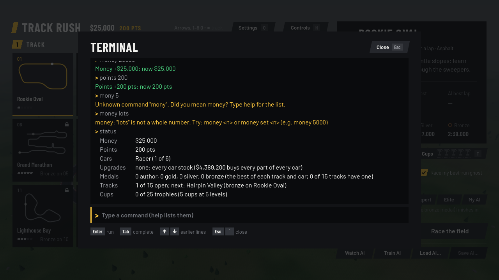

| Command | What it does |
| --- | --- |
| `help` / `help <command>` | Lists the commands / explains one (`help money`) |
| `money <n>` | Adds n dollars (`money 5000`); a minus takes money away (`money -2000`), never below $0. Commas are fine (`5,000`) |
| `money set <n>` | Sets your money to exactly n (`money set 12000`). `money` alone shows it |
| `points <n>` / `points set <n>` | The same for career points (`points 200`, `points set 1000`) |
| `car <name>` / `car all` | Gives you a car without paying (`car vortex`, names in any case), or every car. `car` alone lists the cars and their prices |
| `buy <name>` | Buys a car with your money, as BUY on the car picker does (`buy kestrel`) |
| `buy <name> <part>` | Buys the next level of a part of a car you own with your money, as its chip on the car picker does (`buy dune engine`; parts: `engine`, `tyres`, `nitro`, `loose`) |
| `upgrade <name> <part> <level>` | Sets a part of a car you own to a level, 0 to 3, without paying (`upgrade dune tyres 3`); `upgrade dune max` puts every part at 3, `upgrade dune stock` back to 0, `upgrade all max` / `upgrade all stock` every car you own; `upgrade dune` shows its levels and next prices, `upgrade` alone every car's |
| `unlock all` | Every car is yours and every track is open, for good (`unlock cars` / `unlock tracks`: only those) |
| `cup` / `cup <cup> <level> <place>` | Lists the trophy cabinet (your best place in each cup at each level) / records a place without racing and without pay (`cup rookie pro 1`: a gold in the Rookie Cup at Pro; place 0 takes it away). Cups: `rookie`, `asphalt`, `technical`, `dirt-snow`, `finale` |
| `status` | Your money, points, the cars you own and their upgrades, how many medals you hold, how many tracks are open (and what opens the next one) and how many cup trophies you have |
| `reset career` | Starts the career over: $0, 0 points, only the Racer (stock), and every medal and AI win pays again (best times, ghosts, AI networks and settings stay). The tracks medals opened stay open; those only `unlock tracks` opened lock again. It asks first: type `reset career confirm` to do it |
| `clear` | Clears the terminal (Ctrl+L too) |
| `exit` | Closes the terminal (Esc or `` ` `` too) |

**Tab** completes a command's name and its first word (`unl` Tab gives `unlock `, `car v` Tab gives `car vortex `;
with several matches it lists them), **Up** / **Down** bring back the lines you typed before, and a typing mistake
gets a short message saying what to type instead (`mony 5000`: "Did you mean money?"). Typing needs a keyboard; a
gamepad can open the terminal from Settings (highlight Terminal, A) and close it (B).

## Saved data

Everything is kept in one file, `trackrush_save.json`:

| System | Folder |
| --- | --- |
| Windows | `%APPDATA%\TrackRush\` (paste that into the address bar of a File Explorer window), usually `C:\Users\<you>\AppData\Roaming\TrackRush\` |
| Linux | `~/.local/share/TrackRush/` |
| macOS | `~/Library/Application Support/TrackRush/` |

The same folder is used whether you run the exported game or the project from the Godot editor. It holds your
best time and splits, the ghost of that run and your best score for every track and car, the settings (since 6.12.0
also the volumes), the
trained AI network of every car (a save file from version 6.0-6.1 had one network, the Racer's: it stays the Racer's),
and the career: money, points, the cars you own and their upgrades, the rewards already paid, the tracks medals have
opened and whether the terminal's `unlock all` opened every track, and (6.14.0) the cup trophies, the cup payouts
and a cup in progress. Next to it are `networks\` (the copies **Save best network** writes) and `logs\`
(Godot's log files, useful when something goes wrong).

The file is written safely (to a temporary file first, then swapped in), so a crash can't leave half a save. If
it can't be read, it is kept as `trackrush_save.json.bad` and the game starts fresh. To start over, close the game
and delete the file. Best times and ghosts made with another version of the physics are not used. Best times, best
scores and ghosts also remember the version of the track they were set on: when a track changes (as four did in
6.3.0, when they got dirt and snow, and five in 6.6.0, when their tight corners were opened up), the old ones stop
counting and are moved to an `"archive"` section of the file (the next time the game saves anything), where they are
kept but not shown. A save file from an older version is
upgraded when it is loaded. A save from before 6.5.0 is paid once for the medals its best times hold (a message says
how much); it owns only the Racer, like a new player. Rewards already paid stay paid when a track changes: a
track pays each medal and AI level once per car, whatever its version. A save from before 6.8.0 opens the tracks
its best times earn (see [Unlocking tracks](#unlocking-tracks)); opened tracks stay open when a track or a medal
time changes. A save from before 6.11.0 starts with every car stock (no upgrades); its records and ghosts count as
stock runs.

Saves from the browser version (kept in the browser's storage) can't be carried over; AI networks can (save the
network in the browser, then use **Load network…** here).

## The browser version (`web/`)

The [`web/`](web/) folder is Track Rush 5.0.0, the original browser game (JavaScript and Three.js), kept as it was:
it is the reference the Godot version was checked against, and it still works. To play it you need
[Node.js](https://nodejs.org); in the `web` folder run `npx serve` and open the address it prints (usually
http://localhost:3000), or use any static web server. [web/README.md](web/README.md) and
[web/HANDOFF.md](web/HANDOFF.md) describe it. Godot ignores the folder (it holds a `.gdignore` file).

## Making the game files (export)

The project has two export presets (`export_presets.cfg`): **Windows Desktop** (`build/windows/TrackRush.exe`)
and **Linux** (`build/linux/TrackRush.x86_64`). The game data is packed inside the executable; the AI training
library (`bin/`) is copied next to it and must stay there. The `build/` folder is not stored in git.

In the Godot editor:

1. Once: **Editor → Manage Export Templates… → Download and Install** (the 4.7.2 templates, about 1 GB).
2. **Project → Export…**, pick **Windows Desktop**, click **Export Project…**, untick **Export With Debug**,
   and save as `build/windows/TrackRush.exe`.
3. For a zip to share: put `TrackRush.exe` and `libtrackrush.windows.template_release.x86_64.dll` (plus a short
   README) in a zip, like `TrackRush-6.15.0-windows.zip`.

From the command line (the same presets; delete the `.godot` folder first for a clean build):

```bash
godot --headless --path . --import
godot --headless --path . --export-release "Windows Desktop" build/windows/TrackRush.exe
godot --headless --path . --export-release "Linux" build/linux/TrackRush.x86_64
```

The Windows build can be made on Linux and the other way round. The Linux build's training library needs a
recent Linux (glibc 2.38, as in Ubuntu 24.04 or newer); on an older one the game runs and trains in GDScript.

## Tests and tools

Run these from the repository folder (`godot` is the Godot 4.7.2 executable; on Windows use the `_console.exe`
one to see the output). Run `godot --headless --path . --import` once first (after a fresh checkout, or after
adding a script with a new `class_name`), and keep a time limit around headless runs (`timeout 1500 godot ...`
on Linux): a script error at start-up leaves Godot waiting instead of exiting.

| Command | What it does |
| --- | --- |
| `godot --headless --path . --script res://tests/run_tests.gd` | The test suite, about 6 minutes: `sim` (tracks, physics, road surfaces, race, points, ghosts, medals, save file, money and points, unlocking tracks, the faster bronze, car upgrades, the cups: points, standings, grids, payouts; the numbers are compared with the browser version's on the browser's versions of the tracks: all asphalt, and the five reworked in 6.6.0 as they were before), `ui`, `world` (3D building, no window; the engine sounds and a car's sounds from the physics), `game` (the game shell, input, modes, the car shop, races against the AI opponents, the terminal's commands, locked tracks, upgrades, sound: buses, volumes, the background mute and the sounds of a race and the shop, Race the field, championships) and `ai` (network, sensors, FleetSim against the GDScript simulation with every car, stock and upgraded, training with every car, the training screen, the AI opponents' levels, whole AI field races). Add `-- sim ai` to run only some. It also runs on GitHub Actions for every push (`.github/workflows/test.yml`). |
| `xvfb-run -a -s "-screen 0 1920x1080x24" godot --path . --resolution 1280x720 --script res://tests/e2e/game_e2e.gd -- scenario=races save=/tmp/e2e.json gfx=low` | End-to-end tests of the real game in a window (Linux with a virtual display; on Windows leave out `xvfb-run ...`). Scenarios: `races`, `modes`, `cars` (an AI network per car: train one, watch it, race it), `menu`, `settings1` then `settings2` (same save file), `shots` (the README screenshots), `economy` (money, points, races against the AI opponents, buying a car), `surfaces` (dirt and snow: the menu's surface line, dust, snow spray, tyre-mark colours, mud and snow on the screen and gone again on asphalt; give `gfx=high`, for its screenshots and its snow-spray check, which `gfx=low` thins out to a coin flip), `terminal` (the terminal: open it with `` ` `` and from Settings, type commands, add money, buy cars with it, close it; `` ` `` in a race does nothing), `unlock` (a new career: locked tracks refuse Drive and Race the AI, Watch and Train work, a bronze on Rookie Oval opens Hairpin Valley), `upgrades` (a new career: the part chips, buying every level of every part of the Racer by clicking, a faster race with the same autopilot, the upgraded run's ghost), `audio` (sound and music: the menu music, the Settings sliders and the background mute, two races with the engine's pitch measured against the revs, the cues heard when they play, gravel and snow, a wall hit, the AI car's sound; it records the sound and logs every frame; run it with `--write-movie out.avi` (Movie Maker) so the sound is mixed in step with the frames, and with `--audio-driver Dummy` on a machine without a sound card), `field` (Race the field: the grid, a race, the podium), `cup` (a championship: the cup picker, three races driven by the autopilot, the standings between them, the trophy moment and the cabinet; `races=1` drives only the first race), `perf`. Always give `save=` so your own save file is left alone. See the top of `tests/e2e/game_e2e.gd`. |
| `godot --headless --path . --script res://tools/headless_train.gd -- ...` | Trains the AI without the game window (see above) |
| `godot --headless --path . --script res://tools/gen_tracks.gd` | Regenerates `data/tracks.json` from the track designs in the same file and checks the design rules (`-- --check` only compares) |
| `godot --headless --path . --script res://tools/medals.gd` | Works out the medal times of every track and car and writes `data/medals.json`: about 35 minutes on 3 cores for the six cars (`-- --check` only compares, `-- --jobs=N` threads, `-- --update --tracks=a,b` sweeps only those tracks and keeps the others' times: 17 minutes for four tracks; `-- --factors` works gold, silver and bronze out again from the author times already in the file after a factor in `sim/medals.gd` changes, in a second, as version 6.9.0 did for bronze; `-- --js=<file>` compares with the browser version's times, author, gold and silver only since 6.9.0) |
| `godot --headless --path . --script res://tools/opponents.gd` | The AI opponents in `data/opponents/`: `-- --train` trains a network per track and car with FleetSim (about 70 minutes for all 90 on 3 threads; `--cars=a,b --tracks=a,b` for some, `--retrain` to replace), then without `--train` it sets each level's speed cap and stores its race time (about 15 minutes); `-- --check` re-runs every stored race and compares the times |
| `godot --headless --path . --script res://tools/corners.gd` | Lists the tight corners of every track (radius, road width, banking) and how the medal autopilot takes them with each car: its lowest speed and its wall contacts per lap there, from the author runs in `data/medals.json` (`-- --tracks=a,b`, `--max-r=40` for corners tighter than 40 m, `--sweep` for the wall contacts over all 50 settings of the medal sweep, as long as the medal sweep: about 16 minutes for five tracks on 3 threads; `--tracks-json=` and `--medals=` read older files, `--json=` writes the numbers). Made for version 6.6.0's corner rework |
| `godot --headless --path . --script res://tools/car_stats.gd` | Measures every car's stats with the real physics and prints the `stats` lines for `sim/cars.gd` (`-- --check` only compares; about a minute; `-- --surface=dirt` or `snow` measures the cars on that surface instead, the numbers in [Road surfaces](#road-surfaces)) |
| `godot --headless --path . --script res://tools/upgrades.gd` | Measures what the upgrades do with the real physics: every car stock and with each part's levels (`tools/car_stats.gd`'s numbers), the grip on dirt and snow with loose grip, and prints the `MEASURED` lines for `sim/upgrades.gd` (about 8 minutes on 3 threads; `-- --check` only compares; `-- --laps` the medal autopilot's best lap times on four tracks stock and upgraded, `--quick` on 10 settings instead of 50, `--tracks=a,b --cars=a,b`) |
| `godot --headless --path . --script res://tools/bench.gd` | Measures how fast the GDScript physics runs |
| `godot --headless --path . --script res://tools/field.gd` | Measures Race the field without the game: whole field races with every car (yours too) driven by its AI on five tracks at every level; prints whether every AI finished, the contacts, the respawns, how often the finishing order follows the drivers' paces and the script time per step (`-- --tracks=a,b --levels=a,b --car=racer --threads=3`, `--solo` also races each AI alone to compare; about 4 minutes for 15 races on 3 threads with `--solo`) |
| `python3 tools/gen_sounds.py` | Makes every sound effect (`assets/audio/sfx/`) and music track (`assets/audio/music/`) from code (needs Python 3 with numpy, and ffmpeg for the music; `--only sfx` or `music`, `--names a,b` for some; about a minute). The same run writes the same files |
| `godot --headless --path . --script res://tools/engine_preview.gd -- cars=thunder out=/tmp/engines` | Renders each car's engine to WAV files (a rev sweep and a medal-autopilot lap with the sim's own revs and gears) and prints its levels, the firing frequency it carries and what it costs |
| `tools/parity/` | The scripts that compared this version with the browser version number by number (they need Node.js and `web/`; each file says how to run it) |

Run `tools/medals.gd` after changing the physics, a car, the scoring rules, a track or its laps, then
`tools/opponents.gd` (the opponents' levels follow the author times; after a change to the physics, a car, the
sensors or a track's layout, `--train --retrain` the affected networks first), and `tools/car_stats.gd` (then paste
its lines into `sim/cars.gd`) and `tools/upgrades.gd` (its `MEASURED` lines into `sim/upgrades.gd`) after changing a
car or an upgrade. Screenshot and preview scripts
for the 3D world and the interface are in `tests/visual/`; for the car models: `car_studio.gd` (any car from any
side, steering, cornering, braking, in the air or celebrating, `noglass=1` to see the driver, `up=3,3,3,3` with its
upgrades), `car_corner.gd` (a
car driven by the autopilot on a real track, stopped mid-corner, close up or from the chase camera), `world_cars.gd`
(all six on a start grid) and `car_cost.gd` (each car's draw calls and triangles at each quality level, and the AI
fleet's). Each file says how to run it. The native training library is built as described in
[`native/README.md`](native/README.md).

### Adding a track

Tracks are designed in `tools/gen_tracks.gd` with a "turtle" (`tools/turtle.gd`) that you drive around with
commands like `S(200)` (straight), `L(90, 40, {bank = 12})` (left turn, 90°, radius 40 m, 12° banking), hairpins,
S-bends, climbs, crests and self-sizing kicker ramps; `.surface("dirt")` (or `"snow"`) makes the road from there on
dirt until `.surface("asphalt")`. Add a `_circuit(...)` or `_sprint(...)` entry there, run
`tools/gen_tracks.gd` (it refuses a track that breaks the design rules: overlaps, too-tight corners, too-steep
grades, short landing zones, sprints without a run-off, dirt or snow patches under 60 m or on the start grid) and then
`tools/medals.gd`. A new surface is an entry in `sim/surfaces.gd` (its grip, rolling resistance and looks; FleetSim
gets the table as data), a grip-share field in `CarSpec` if each car should differ on it, and a third slot in the road
shader (`world/shaders/road_surface.gdshader`, which has two: dirt and snow). The menu, minimaps, scenery and
AI pick a new track up by themselves; the menu has keys for 12 tracks (1-9, 0, -, =), further tracks are picked with
the mouse, arrows or gamepad, and its grid makes rows as full as it can (15 tracks: three rows of five, which fit a
1280 x 720 window without scrolling). A track's scenery is a theme in `world/themes.gd` (sky, light, fog, ground
colours, mountains and scenery species, all data; since 6.4.0 also `woods` for a forest close to the road,
`sky.aurora` for the northern lights and `ground.roadSnow` for snowy land beside snowy road); add its name to
`THEMES` in `tools/gen_tracks.gd`. The tests in `tests/test_sim.gd` check every track against the design rules and
that the tracks, their signatures and their medal times stay exactly as they are (the five tracks reworked in 6.6.0
against what their corners must be now). To rework a corner of an existing track, shorten the straights next to it by
as much as it grows (a 90° turn of radius r moves the road 1.4244 × r forward and sideways, a hairpin 2.053 × r
sideways) so the rest of the track stays put, run `tools/corners.gd` before and after (`--tracks-json=` and
`--medals=` read the old files), then `tools/medals.gd --update --tracks=<id>` and `tools/opponents.gd --train
--tracks=<id>` and the levels; the old records move to the archive by themselves when the track's length changes.

## Project layout

```
project.godot           the Godot project (Forward+, 1280x720 base size, main scene main.tscn)
main.tscn               the main scene: one node with game/app.gd
game/                   the game shell: modes, threaded track loading, quality, settings, AI network files (app.gd),
                        keyboard and gamepad (input.gd), the AI link (ai_link.gd), messages, the terminal's
                        commands (terminal.gd: one table of commands)
modes/                  menu, play (Drive, Race the AI), field (Race the field), watch (Watch the AI) and train (the training screen)
sim/                    game logic without any graphics: tracks, road surfaces, car physics and nitro, the six cars,
                        collisions, race timing, points, ghosts, medals, the save file, the autopilot, money and
                        points (economy.gd: the reward table and the shop), the AI opponents' levels (opponents.gd),
                        car upgrades (upgrades.gd: the parts, their levels, prices and the upgraded specs), Race the
                        field (field.gd: the drivers, paces and grid; field_race.gd: the race; car_contact.gd: solid cars),
                        championships (cups.gd: the cups, points, standings and grids; cup_run.gd: a cup in progress)
ai/                     the AI: network, evolution, sensors and driver, trainer, an opponent's race (opponent_race.gd)
native/                 the C++ source of FleetSim, the fast training simulation (built into bin/)
bin/                    the built FleetSim libraries for Windows and Linux (trackrush.gdextension names them)
world/                  3D: track mesh, terrain and scenery, sky and themes, car models (car_shapes.gd: the six
                        bodies; car_build.gd + car_kit.gd: one skinned mesh per car with its driver; car_model.gd:
                        the skeleton's animation and lights), effects (smoke, dust, snow spray, skids, sparks, nitro),
                        chase camera, the AI fleet and sensor rays, the podium (podium.gd) and its trophies (trophy.gd); shaders/ (road_surface: dirt
                        and snow roads)
ui/                     the interface, built in code: style, menu, Controls, Settings and terminal screens, HUD, finish panel,
                        training dashboard (car_chip.gd: its car tiles), network view, fitness chart, the car
                        picker's part chips (part_chip.gd), the volume bars (volume_bar.gd), the championships (cup_screen.gd,
                        cup_table.gd, cup_cabinet.gd: the menu's Cups button), ui_sound.gd (the
                        interface's sounds, without depending on audio/)
audio/                  sound (v6.12.0): the buses, volumes, pooled players and music (game_audio.gd), every sound
                        file as data (sound_bank.gd), the live engine synthesizer (engine_voice.gd) and a car's
                        sounds from its physics (car_audio.gd)
assets/audio/           the effects (sfx/, WAV) and music (music/, Ogg Vorbis) made by tools/gen_sounds.py; CREDITS.md
assets/fonts/           Barlow and Barlow Condensed (SIL Open Font License, OFL.txt)
data/                   tracks.json, medals.json and opponents/ (an AI opponent network per track and car, with its
                        levels; made by tools/)
tools/                  track generator, turtle, medal times, AI opponents, car stats, upgrades' effects, field races, headless
                        trainer, benchmark, parity checks, the sound generator (gen_sounds.py) and engine preview
tests/                  run_tests.gd and test_*.gd (headless), e2e/ (the real game), visual/ (screenshots), fixtures/
docs/screenshots/       the pictures in this file (Godot ignores docs/: it holds a .gdignore file)
web/                    the browser version 5.0.0 (ignored by Godot)
export_presets.cfg      Windows and Linux export settings
.github/workflows/      CI: the Godot tests and the browser version's self-test
HANDOFF.md              status, how the port was checked, conventions, known limitations and what comes next
```

## Licence

No licence has been chosen for the game yet. Godot Engine is © the Godot Engine contributors, MIT licence
(https://godotengine.org/license); the exported game contains it. The Barlow and Barlow Condensed fonts in
`assets/fonts/` are © 2017 The Barlow Project Authors (https://github.com/jpt/barlow), SIL Open Font License 1.1
([assets/fonts/OFL.txt](assets/fonts/OFL.txt)); the files are subsets (Latin letters, digits and punctuation) of
the originals. The sound effects and music in `assets/audio/` and the engine sounds are made by the project itself
(`tools/gen_sounds.py`, `audio/engine_voice.gd`): no third-party audio ([assets/audio/CREDITS.md](assets/audio/CREDITS.md)).
The browser version in `web/` includes Three.js, © three.js authors, MIT licence
([web/vendor/three.LICENSE](web/vendor/three.LICENSE)). FleetSim (`native/`) is built with godot-cpp, MIT licence.
